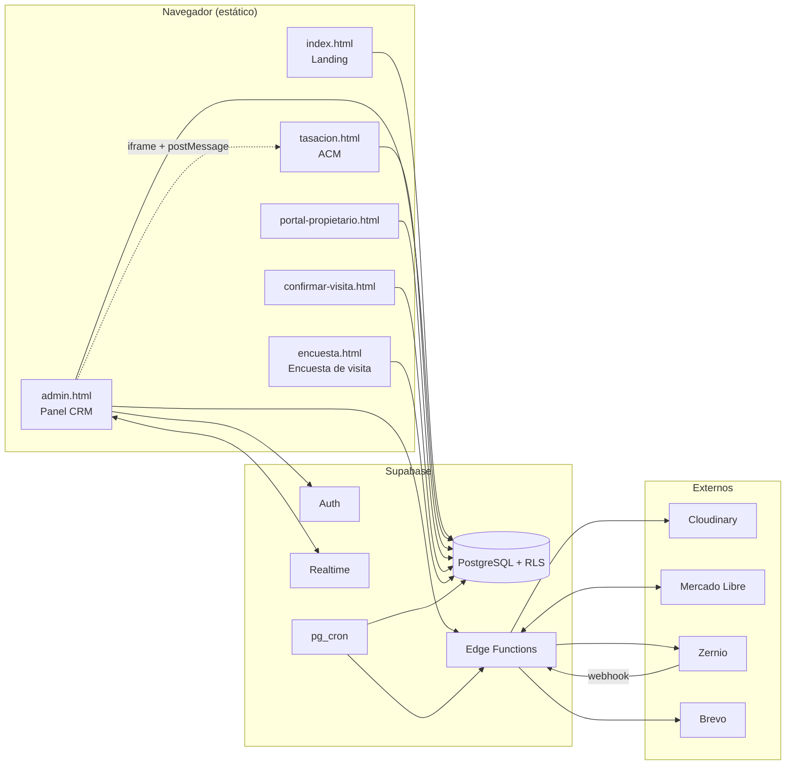
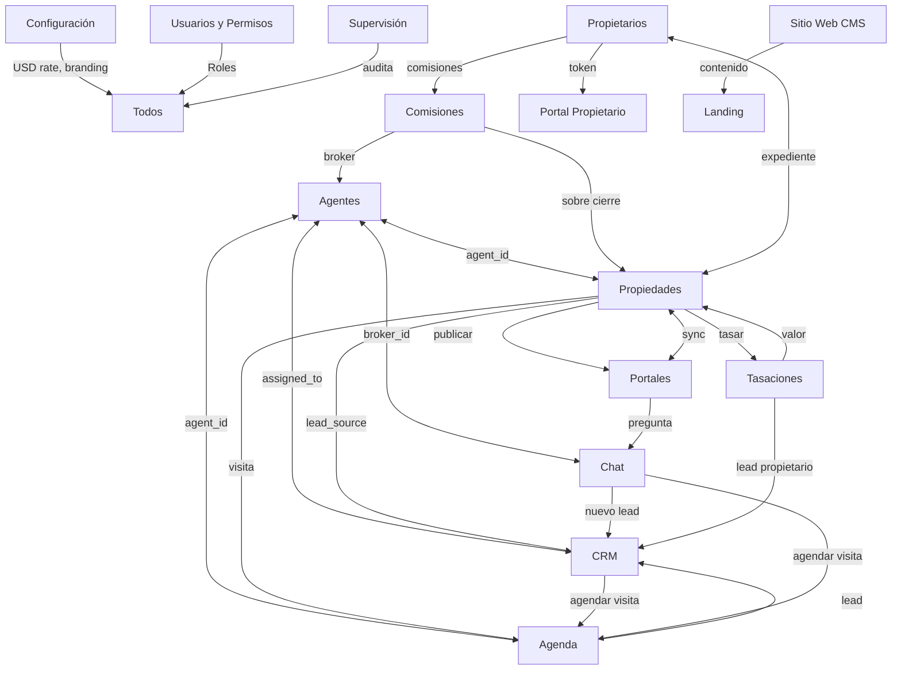
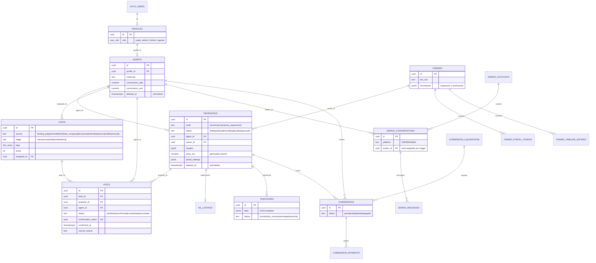
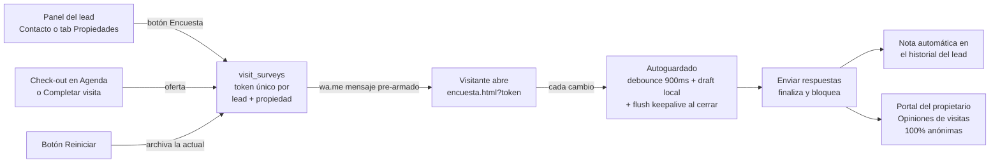
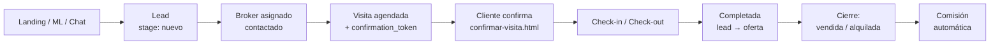

# 🏠 BIENENHAUS PROPIEDADES

**Landing pública + CRM inmobiliario completo para una inmobiliaria premium de Buenos Aires**


🌐 **Sitio:** https://bienenhaus.com.ar


---

## 📑 Índice

1. [Descripción y alcance](#-descripción-y-alcance)
2. [Funcionalidades del sistema](#-funcionalidades-del-sistema)
3. [Stack tecnológico](#-stack-tecnológico)
4. [Arquitectura](#-arquitectura)
5. [Páginas y URLs](#-páginas-y-urls)
6. [Estructura del proyecto](#-estructura-del-proyecto)
7. [Instalación y puesta en marcha](#-instalación-y-puesta-en-marcha)
8. [Base de datos](#-base-de-datos)
9. [Roles y permisos](#-roles-y-permisos)
10. [Seguridad](#-seguridad)
11. [Panel administrativo (14 módulos)](#-panel-administrativo-14-módulos)
12. [Landing pública](#-landing-pública)
13. [Captación y medición del sitio](#-captación-y-medición-del-sitio)
14. [Portal del Propietario](#-portal-del-propietario)
15. [Confirmación de visitas](#-confirmación-de-visitas)
16. [Encuesta de Visita — HOJA DE VISITA](#-encuesta-de-visita--hoja-de-visita)
17. [Tasaciones (ACM)](#-tasaciones-acm)
18. [Comisiones y liquidaciones](#-comisiones-y-liquidaciones)
19. [Administración de Alquileres](#-administración-de-alquileres-módulo-alquileres)
20. [Integración Mercado Libre](#-integración-mercado-libre)
21. [Chat omnicanal (Zernio)](#-chat-omnicanal-zernio)
22. [Centro de Supervisión](#-centro-de-supervisión)
23. [Edge Functions](#-edge-functions)
24. [Migraciones](#-migraciones)
25. [Flujos end-to-end](#-flujos-end-to-end)
26. [Patrones técnicos](#-patrones-técnicos)
27. [Deploy](#-deploy)
28. [Testing y CI](#-testing-y-ci)
29. [Convenciones de desarrollo](#-convenciones-de-desarrollo)
30. [Deudas técnicas y roadmap](#-deudas-técnicas-y-roadmap)
31. [ADRs](#-adrs-architecture-decision-records)
32. [Documentación complementaria](#-documentación-complementaria)
33. [Changelog](#-changelog)

---

## 📌 Descripción y alcance

**BIENENHAUS PROPIEDADES** es un sistema web integral para una inmobiliaria. Combina en un solo repositorio:

| Componente | Descripción |
|---|---|
| **Landing pública** | Sitio comercial con catálogo dinámico de propiedades, servicios, equipo, proceso, estadísticas y formulario de contacto que genera leads. |
| **Panel administrativo / CRM** | SPA de 14 módulos para gestionar propiedades, leads, visitas, propietarios, agentes, tasaciones, comisiones, portales, chat y supervisión. |
| **Portal del Propietario** | Acceso por token (sin login) donde el dueño ve sus propiedades, documentos, comisiones y liquidaciones. |
| **Confirmación de visita** | Página pública por token para que el cliente confirme o cancele una visita. |
| **Herramienta de tasación (ACM)** | Análisis Comparativo de Mercado con comparables, mapa, coeficientes y gráficos. |
| **Integraciones** | Mercado Libre (publicación y sync), Zernio (WhatsApp/Instagram/Facebook/Web), Cloudinary (imágenes), Brevo (emails). |

### Alcance funcional

- ✅ Gestión completa del ciclo comercial: **captación → tasación → publicación → lead → visita → cierre → comisión**.
- ✅ Multi-rol (`super_admin`, `broker`, `agente`) con seguridad a nivel de fila (RLS).
- ✅ CMS integrado: el contenido del landing se edita desde el panel sin tocar código.
- ✅ Publicación y sincronización bidireccional con Mercado Libre.
- ✅ Inbox unificado de mensajería (WhatsApp, Instagram, Facebook, Web).
- ✅ Auditoría, detección de anomalías y scoring de riesgo por usuario.
- ✅ Sin build step: se despliega como sitio estático.

### Fuera de alcance (actual)

- ❌ Envío saliente de mensajes por Zernio (pendiente de API key real; la recepción sí funciona).
- ❌ Notificaciones push reales (Web Push/VAPID, requiere Service Worker).
- ❌ Uso del `usd_rate` en las tarjetas del catálogo del landing.

---

## ⚙️ Funcionalidades del sistema

### 🌐 Público (sin login)
- Catálogo dinámico con filtros server-side (tipo, zona, precio, dormitorios), orden, paginación y *virtual scroller*.
- Galería de imágenes por propiedad.
- Formulario de contacto → inserta un `lead` (origen `landing_page` / `newsletter`).
- Botón flotante de WhatsApp.
- SEO: meta tags, Open Graph, `schema.org/RealEstateAgent`, `sitemap.xml`, `robots.txt`.
- Confirmar / cancelar visita por token.
- Portal del propietario por token.

### 🔐 Administración
| Área | Funciones |
|---|---|
| **Dashboard** | KPIs (volumen venta/alquiler, propiedades, leads, visitas, brokers), gráficos, **propiedades estancadas** (badge "bajó precio"), **razones de pérdida**, **recomendaciones** (exclusividades con countdown + leads sin contacto), **análisis de conversión** (embudo visual, fuentes, agentes), acciones rápidas. |
| **Propiedades** | CRUD, borradores, reordenamiento, soft-delete, publicación a ML, paginación server-side, validación Zod, precios ARS/USD, superficie cubierta/terreno. **Historial de encuestas por propiedad** (📋). **Código y título clickeables** → ficha pública. **Campaña WhatsApp** (📢) a leads que encajan. | |
| **Leads & CRM** | Pipeline Kanban, tags, scoring, exportación CSV, agendado directo de visitas. **Razón de pérdida obligatoria** (modal con 6 opciones). **Motor de match**: sugerencias automáticas de propiedades que encajan. **Deal room**: ofertas, contraofertas, aceptar/rechazar con transición a Ganado. **Tipo de cliente** (propietario / comprador / inversor / inquilino / **colega**) con **filtro por tipo** en la barra de filtros (2026-11-26). | |
| **Agenda** | Calendario mensual + tabla, check-in/check-out, export CSV/ICS, recordatorios. |
| **Tasaciones** | ACM embebido en iframe + listado de tasaciones. |
| **Propietarios** | Expedientes, documentos con vencimiento/verificación, timeline, export CSV/PDF, link de portal. |
| **Sitio Web (CMS)** | 11 sub-tabs: Hero, Catálogo, Servicios, Equipo, Stats, Proceso, Contacto, Formulario, Navbar, Footer, SEO. |
| **Portales & APIs** | OAuth ML, configuración por portal, sync, dead-letter, importación desde ML. |
| **Agentes & Brokers** | CRUD, matrícula, comisiones de venta/alquiler, soft-delete, vínculo con `profiles`. |
| **Chat Redes** | Inbox unificado, crear lead, agendar visita, asignar broker. |
| **Ficha HTML** | Generador de fichas visuales por propiedad (compartir, PDF, HTML autocontenido). |
| **Usuarios & Permisos** | Alta, edición, roles y cambio de contraseña vía Edge Function. |
| **Configuración** | Identidad corporativa, contacto, redes, tipo de cambio USD, estado de integraciones. |
| **Supervisión** | Reglas, alertas, anomalías, ranking de riesgo, métricas ML. |

### 🛠️ Transversales
- Búsqueda global (`Ctrl+K`) con navegación por teclado.
- Notificaciones con badges por tab y contador en favicon.
- Realtime multi-tab en tablas core.
- Auditoría de escrituras y acciones sensibles.
- Rate limiting en Edge Functions.

---

## 🧰 Stack tecnológico

| Capa | Tecnología |
|---|---|
| **Frontend** | Vanilla JS (scripts clásicos con IIFE y globals `window.*`, **sin ES Modules ni bundler**), CSS custom properties, Font Awesome 6.5.1, Zod 3 (solo admin) |
| **Backend** | Supabase: PostgreSQL + Auth (email/contraseña) + Row Level Security + Realtime + Edge Functions (Deno) |
| **Imágenes** | Cloudinary (uploads firmados server-side, `f_auto,q_auto`, WebP) |
| **Portales** | Mercado Libre (OAuth 2.0, cron sync, webhooks, auto-reply) |
| **Mapas y gráficos** | Leaflet 1.9.4 + Chart.js 4.4.0 (CDN, en `tasacion.html`) |
| **Email** | Brevo (SMTP) para resúmenes de supervisión |
| **Chat** | Zernio (WhatsApp, Instagram, Facebook, Web) |
| **Deploy** | Cloudflare Pages (estático) + Supabase Edge Functions |
| **Testing** | Playwright (E2E) + `node --check` |
| **CI/CD** | GitHub Actions |

---

## 🏗️ Arquitectura

### Principios

1. **Vanilla JS sin build step**: deploy directo de estáticos, cache busters `?v=N`.
2. **Supabase como backend único**: Auth, DB, Realtime y Edge Functions.
3. **RLS como seguridad principal**: todas las tablas tienen RLS; el frontend nunca ve secretos.
4. **Realtime para reactividad**: `setupCoreRealtime` suscribe las tablas core.
5. **Configuración centralizada**: `app_settings` + `site_content` como fuente de verdad.
6. **Secretos solo en Edge Functions**: tokens ML/Zernio, Cloudinary, Brevo y service role nunca llegan al navegador.
7. **IDs de responsable unificados**: `properties.agent_id`, `leads.assigned_to`, `visits.agent_id` y `zernio_conversations.broker_id` apuntan a `agents.id`.
8. **Auditoría y supervisión integradas**.

### Diagrama de arquitectura



### Grafo de módulos



### Entidades compartidas

| Entidad | Tabla | Módulos que la usan |
|---|---|---|
| Usuario/Perfil | `profiles` | Todos |
| Broker | `agents` | Propiedades, CRM, Agenda, Chat, Comisiones |
| Propiedad | `properties` | Propiedades, CRM, Agenda, Portales, Tasaciones, Portal Propietario |
| Lead | `leads` | CRM, Agenda, Chat, Landing |
| Visita | `visits` | Agenda, CRM, Confirmar Visita |
| Encuesta | `visit_surveys` | CRM (lead, envío y estado), Portal Propietario (resultados anónimos), Encuesta (página pública) |
| Conversación | `zernio_conversations` | Chat, CRM |
| Propietario | `owners` | Propietarios, Portal, Comisiones |
| Tasación | `tasaciones` | Tasaciones, Portal |
| Comisión | `commissions` / `commission_liquidations` | Comisiones, Portal |
| Publicación ML | `ml_listings` | Portales, Propiedades |
| Publicación La Voz | `lavoz_listings` | Portales, Propiedades |
| Config/Contenido | `app_settings`, `site_content` | Config, CMS, Landing |

---

## 🔗 Páginas y URLs

| Archivo | URL / Acceso | Propósito |
|---|---|---|
| `index.html` | https://bienenhaus.com.ar | Landing: hero, catálogo, servicios, equipo, proceso, stats, contacto |
| `admin.html` | `/admin.html` | Panel administrativo SPA (14 tabs, hash routing) |
| `tasacion.html` | `/tasacion.html?id=<uuid>` | ACM; se abre embebido en iframe desde `tab-tasaciones` |
| `portal-propietario.html` | `/portal-propietario.html?token=<uuid>` | Portal del propietario por token |
| `confirmar-visita.html` | `/confirmar-visita.html?token=<uuid>` | Confirmación/cancelación de visita |
| `encuesta.html` | `/encuesta.html?token=<uuid>` | Encuesta de visita (HOJA DE VISITA): autoguardado, se envía por WhatsApp desde el lead, resultados anónimos en el portal del propietario |
| `qr-visita.html` | `/qr-visita.html?token=<uuid>` | Cartel imprimible con QR de check-in (lo genera la Agenda; noindex) |
| `politica-de-privacidad.html` · `terminos-y-condiciones.html` | `/politica-de-privacidad.html` · `/terminos-y-condiciones.html` | Legales públicos |
| `403.html` · `404.html` | `/403` · `/404` | Páginas de error de Cloudflare Pages |
| `fichas/<code>.html` | `/fichas/<CÓDIGO>.html` | Fichas públicas por propiedad (generadas por CI, ver módulo Ficha HTML) |
| `propiedades.html` | `/propiedades.html` | **Hub estático de propiedades** (generado por CI): HTML real con un `<a href>` por ficha, agrupadas por zona. Es el enlace que el crawler puede recorrer sin ejecutar JS — la home no enlazaba ninguna ficha |
| `canal.html` | `/canal.html` | Canal público de YouTube: grilla de videos publicados con su ficha (generada por CI, índice `assets/data/canal-videos.json`) |

---

## 📁 Estructura del proyecto

```
BH-OFICIAL/
├── index.html                    # Landing pública
├── admin.html                    # Panel administrativo (SPA por tabs, ~181 KB: 15 tabs + 20 modales inline)
├── canal.html                    # Canal público de YouTube (grilla de videos, índice generado por CI)
├── tasacion.html                 # ACM de tasación (autónomo, embebible)
├── portal-propietario.html       # Portal del propietario (token)
├── confirmar-visita.html         # Confirmación de visita (token)
├── encuesta.html                 # Encuesta de visita (token, autoguardado)
├── qr-visita.html                # Cartel QR de check-in (Agenda)
├── politica-de-privacidad.html · terminos-y-condiciones.html · 403.html · 404.html
├── CNAME                         # Dominio custom (Cloudflare Pages)
├── favicon.ico · robots.txt · sitemap.xml · .nojekyll
├── playwright.config.js          # Configuración E2E
├── package.json · package-lock.json
│
├── assets/
│   ├── css/
│   │   ├── landing.css           # Design system del landing
│   │   └── admin.css             # Estilos del panel (incluye calendario)
│   ├── js/
│   │   ├── config.js             # window.BH_CONFIG (Supabase URL + anon key)
│   │   ├── supabase-client.js    # Init de window.supabaseClient (fail-closed)
│   │   ├── utils.js              # BHUtils: esc, escAttr, safeUrl, safeImageUrl, safeCssUrl, sanitizeRichText
│   │   ├── cloudinary.js          # Upload firmado (window.BH_Cloudinary)
│   │   ├── zod.umd.js            # Zod 3 (solo admin)
│   │   ├── landing-app.js        # Catálogo, filtros, CMS, contacto → leads
│   │   ├── admin-app.js          # Núcleo del panel: state, helpers (window.__BH), realtime, modales (~3.5k líneas)
│   │   ├── admin-<modulo>.js     # 14 módulos de dominio cargados tras el core (ver tabla abajo)
│   │   └── yt-<modulo>.js        # Módulos compartidos del módulo Contenido/YouTube (window.BH_YT.*)
│   ├── js/pages/                 # JS de páginas públicas (tasacion, portal, encuesta, confirmar-visita, canal)
│   ├── data/                     # Índices generados por CI (property-videos.json, canal-videos.json)
│   ├── images/                   # favicon, hero-bg.webp, pwa-512x512.png
│   └── img/                      # logo-bh.png
│
├── supabase/
│   ├── functions/                # 58 Edge Functions (Deno) + _shared/
│   └── migrations/               # 114 migraciones SQL versionadas
│
├── tests/                        # Suite E2E Playwright (32 specs)
├── scripts/                      # bump-busters, generate-ficha, recovery, verificación
├── fichas/                       # Fichas HTML de propiedades (generadas por CI)
├── propiedades.html              # Hub estático de propiedades (generado por CI)
├── docs/                         # Documentación: backups, integraciones, guías, auditorías
├── .well-known/                  # Archivos de verificación de dominio
├── .github/workflows/            # CI (deploy.yml + ficha-generate.yml)
│
└── *.md                          # README.md, AGENTS.md
```

### Módulos del panel (`assets/js/admin-*.js`)

El panel se modularizó (antes era un `admin-app.js` de ~14k líneas; hoy el core tiene ~3.5k y el dominio vive en módulos con contrato documentado: `admin-app.js` publica `window.adminApp` y `window.__BH` **antes** de que los módulos se carguen y los destructuren):

| Módulo | Líneas | Dominio |
|---|---|---|
| `admin-app.js` (core) | ~3.5k | Estado global, auth, realtime (`setupCoreRealtime`), modales, toasts, KPIs, utilidades `__BH` |
| `admin-crm.js` | ~2.4k | Pipeline de leads, propietarios del CRM, tareas, encuestas, token de portal |
| `admin-agenda.js` | ~2.2k | Calendario mensual, bloqueos, QR, recordatorios |
| `admin-propietarios.js` | ~1.7k | Expedientes, documentos, timeline, acceso al portal |
| `admin-supervision.js` | ~1.3k | UI del Centro de Supervisión (Equipo/Feed/Errores/Alertas) |
| `admin-propiedades.js` | ~1.3k | CRUD de propiedades, publicación, papelera, descarga de fotos en ZIP |
| `zip.js` (compartido) | ~0.2k | Generador de ZIP (modo STORE, sin dependencias) — descarga de fotos de una propiedad |
| `admin-portales.js` | ~1k | ML/RELA: OAuth, sync, importación |
| `admin-cms.js` | ~0.8k | 11 sub-tabs del CMS |
| `admin-agentes.js` · `admin-usuarios.js` | ~0.7k | CRUD de agentes y usuarios/roles |
| `admin-tasaciones.js` | ~0.5k | Listado de tasaciones, compartir, tokens |
| `admin-ficha.js` | ~0.4k | Generador manual de fichas |
| `admin-crm-tasks.js` | ~0.3k | Tareas del CRM (lead/owner) |
| `admin-contenido.js` | ~4.3k | Contenido & Redes: orquestador/UI de YouTube (Studio, publicación, historial) |
| `admin-supervision-panel.js` | 43 líneas | Shim de entrada al tab Supervisión (gate `super_admin` → `window.adminSupervision`) |

> Carpetas de tooling que **no** se versionan: `.codegraph/`, `.omo/`, `.playwright-mcp/`, `supabase/.temp/`, `node_modules/`, `*.log`, `.env.local`, `test-results/`, `playwright-report/`.

---

## 🚀 Instalación y puesta en marcha

### Requisitos

- Cualquier servidor estático (Python, `npx serve`, etc.)
- Node.js ≥ 18 (solo para lint y tests)
- [Supabase CLI](https://supabase.com/docs/guides/cli) (solo para migraciones y Edge Functions)

### Local

```bash
# 1. Clonar
git clone https://github.com/facuherrera23/BH-OFICIAL.git
cd BH-OFICIAL

# 2. Servir estáticamente (no hay build)
python -m http.server 8788

# 3. Abrir
#   Landing → http://localhost:8788/index.html
#   Admin   → http://localhost:8788/admin.html
```

### Herramientas de desarrollo (opcional)

```bash
npm install                        # Playwright y supabase-js (devDependencies)
npx playwright install chromium    # navegador para E2E
npm run lint                       # node --check de admin-app.js y landing-app.js
npm test                           # suite E2E
```

### Configuración del frontend

`assets/js/config.js`:

```js
window.BH_CONFIG = {
  SUPABASE_URL: 'https://<tu-proyecto>.supabase.co',
  SUPABASE_ANON_KEY: '<anon-key>'   // clave pública por diseño: la seguridad la da RLS
};
```

- `supabase-client.js` crea `window.supabaseClient` con el CDN `@supabase/supabase-js@2`. Sin CDN o sin `BH_CONFIG`, loguea el error y **no** expone el cliente (*fail-closed*).
- `utils.js` expone `window.BHUtils` (solo helpers de seguridad/URL) y se carga **antes** que `landing-app.js` / `admin-app.js`.
- `cloudinary.js` expone `window.BH_Cloudinary = { uploadImage, uploadImages }` (firma vía Edge Function `cloudinary-sign`).

### Usuarios

Los usuarios se crean desde el propio panel (**Usuarios & Permisos**) mediante la Edge Function `manage-users`. El rol se guarda en `profiles.role`.

### Variables de entorno de Edge Functions (secrets de Supabase)

| Variable | Uso |
|---|---|
| `SUPABASE_SERVICE_ROLE_KEY` | Operaciones privilegiadas |
| `CRYPTO_SECRET` | Derivación PBKDF2 para AES-256-GCM (tokens ML) |
| Credenciales Cloudinary | Firma de uploads |
| Credenciales Mercado Libre | OAuth y API |
| API key + webhook secret Zernio | Guardados en `zernio_config` |
| Credenciales Brevo | Envío de digest |

> Nunca se commitean: se cargan con `supabase secrets set`.

---

## 🗄️ Base de datos

PostgreSQL gestionado por Supabase. **63 tablas en el esquema `public`, todas con RLS activada (100 % de cobertura)** con 117 políticas RLS (verificado contra producción el **2026-10-15**: `pg_class` + `pg_policies`; además 17 jobs de `pg_cron` activos y 16 tablas en la publicación `supabase_realtime`).

### Diagrama entidad-relación (núcleo de negocio)

> Se muestran las relaciones y los campos documentados en el proyecto. Los campos completos están en `supabase/migrations/`.



### Tablas por dominio

#### 🏢 Núcleo de negocio

| Tabla | Descripción |
|---|---|
| `properties` | Propiedades (draft/publicada/vendida/alquilada/pausada), imágenes JSONB, `agent_id`, `owner_id`, `portal_settings`, `price_ars` generada |
| `agents` | Asesores/brokers: matrícula, `commission_sale`/`commission_rent`, `profile_id`, soft-delete `deleted_at` |
| `owners` | Propietarios: DNI/CUIT, documentos JSONB (vencimiento y verificación) |
| `leads` | Pipeline CRM: `source`, `stage`, `tags`, `score`, `assigned_to` |
| `visits` | Visitas: estados, `agent_id`, `confirmation_token`, check-in/out |
| `visit_surveys` | Encuesta de visita (HOJA DE VISITA): 1 activa por (lead, propiedad), `token` público, `answers` jsonb, `finalized`, `archived_at` para re-encuesta |
| `tasaciones` | ACM: `data` JSONB, valoración USD/ARS, estado borrador/en_revision/entregada/vencida |
| `commissions` | Comisiones por cierre (pendiente/liquidada/pagada) |
| `commission_liquidations` | Liquidaciones mensuales |
| `commission_payments` | Pagos registrados |
| `ml_listings` | Publicaciones Mercado Libre (sync, dedup) |
| `lavoz_config` | Config de Clasificados La Voz: días (10/30), mapa de tipos y de barrios/ciudades, contacto del aviso |
| `lavoz_listings` | Avisos de Clasificados La Voz (estado `draft`/`ready`/`published`/`expired`/`failed`, URL, plan, payload, vencimiento) |
| `property_sequences` | Secuencia de códigos de propiedad (solo `service_role`) |
| `page_events` | **Medición first-party del sitio** (18/11/2026): evento, ruta, página, código de propiedad, origen, referrer, UTMs y `session_id` (UUID de sesión, no una persona). **Sin** IP, user-agent, email ni teléfono. RLS ON **sin policies**: escribe sólo `service_role` (la edge function `track-event`), lee sólo la RPC `bh_web_metrics` |

#### 🎨 CMS y configuración

| Tabla | Descripción |
|---|---|
| `site_content` | Contenido por sección del landing: hero, services, team, process, stats, contact, footer, social |
| `portal_settings` | CMS en vivo del landing (hero, servicios, stats, testimonios). Lectura solo autenticada |
| `app_settings` | Ajustes globales key/value JSONB: `preferences` (incl. `usd_rate`), `features`, `integrations` |
| `profiles` | Perfiles vinculados a `auth.users` con campo `role` |

#### 📱 Redes sociales (módulo Contenido)

| Tabla | Descripción |
|---|---|
| `social_accounts` | Cuentas conectadas por plataforma (`platform`: youtube\|facebook\|instagram\|tiktok): `external_id`, `display_name`, tokens AES-256-GCM (`*_encrypted` + `*_iv`), `refresh_token`, `scope`, `status`, `last_publish_at`. UNIQUE (`platform`, `external_id`) → reconectar no duplica |
| `social_posts` | Publicaciones por plataforma: `platform` (`youtube`\|`instagram`\|…), `post_type`, `content` JSONB (metadata, score, categoría, flags), `media`, `status` (`draft`\|`scheduled`\|`publishing`\|`published`\|`failed`), `external_post_id` (id del video en YouTube), `external_url`, `property_id` (vínculo con la ficha y origen del tour en video), `metrics` (incluye `youtube_privacy`) |

#### 💬 Chat Zernio

| Tabla | Descripción |
|---|---|
| `zernio_config` | Secretos del módulo (API key, webhook secret). RLS sin policies: solo `service_role` |
| `zernio_accounts` | Espejo de cuentas sociales conectadas |
| `zernio_conversations` | Hilos DM unificados (IG/FB/WA/Web); `broker_id` auto-asignado por trigger |
| `zernio_messages` | Mensajes; escritura solo vía Edge Functions |
| `zernio_webhook_events` | Deduplicación de eventos (`payload.id` único) |

#### 🛡️ Supervisión y auditoría

| Tabla | Descripción |
|---|---|
| `audit_log` | Registro de auditoría de escrituras y acciones sensibles (con cadena de integridad) |
| `supervision_rules` | Reglas configurables de detección (solo `super_admin`) |
| `supervision_alerts` | Alertas operativas generadas por reglas |
| `supervision_baselines` | Baselines estadísticos |
| `supervision_anomalies` | Anomalías detectadas (ML/estadística) |
| `supervision_anomaly_config` | Configuración del detector |
| `user_risk_scores` | Score de riesgo por usuario, con factores explicables |
| `user_sessions` | Sesiones registradas |
| `api_key_audit` | Auditoría de uso de API keys |
| `usage_events` | Métricas de uso (append-only) |
| `ml_model_metrics` | Métricas del modelo (precision, recall, F1) |
| `ml_predictions_log` | Log de predicciones |
| `rate_limit_logs` | Sliding window del rate limiter |
| `notification_preferences` | Preferencias por usuario (email/push/slack) |

#### 📂 Portal del Propietario y documentos

| Tabla | Descripción |
|---|---|
| `owner_portal_tokens` | Tokens de acceso al portal (validación + expiración) |
| `document_requirements` | Requisitos documentales por tipo de operación |
| `owner_timeline_entries` | Timeline de comunicaciones y eventos |

### Triggers y lógica en base de datos

| Trigger / Función | Efecto |
|---|---|
| `guard_profiles_self_update` | Impide la auto-elevación de rol |
| `trg_visits_sync_lead_stage` | Crear visita → lead pasa a `visita` |
| `trg_visits_lead_cancel_revert` | Cancelar visita → lead vuelve a `contactado` |
| `trg_visits_lead_completed_auto` | Completar visita → sugiere `oferta` |
| Triggers `BEFORE INSERT` en chat | Auto-asignan `broker_id` |
| `set_property_code` / `generate_property_code` | Código secuencial de propiedad |
| `get_sidebar_badge_counts` (RPC, SECURITY DEFINER) | Contadores del sidebar respetando RLS |
| `bh_captacion_status()` (RPC, SECURITY DEFINER, `search_path=''`) | Estado de captación de los 3 canales (ML / RELA / web): consultas reales, avisos bloqueados, leads y días de silencio. Sólo `authenticated`/`service_role` |
| `bh_check_captacion_health(p_umbral, p_horas)` (RPC, SECURITY DEFINER, `search_path=''`) | Escribe/auto-resuelve la alarma de captación en `supervision_alerts`. **Sólo `service_role`** (la llama el cron) |
| `bh_web_metrics(p_dias)` (RPC, SECURITY DEFINER, `search_path=''`) | Métricas del sitio (vistas, clics de WhatsApp, formularios, tasa, top páginas). Sólo `authenticated`/`service_role` |
| `count_pending_visits_for_lead`, `is_super_admin` | Helpers de negocio y permisos |

### Vistas (`security_invoker = true`)

`ml_model_performance`, `daily_user_activity`, `daily_module_activity`, `open_alerts_by_user`, `my_assigned_alerts`, `purge_audit_log`, `supervision_anomalies_recent`, `current_user_risk_scores`.

### Políticas RLS destacadas

| Tabla | Política |
|---|---|
| `properties` | Lectura pública de las publicadas (`TO public`); escritura autenticada |
| `leads` | `INSERT` anónimo solo con `source IN ('landing_page','newsletter')` |
| `page_events` | RLS ON **sin policies**: `revoke all` a `anon`/`authenticated`; sólo `service_role` inserta (edge function `track-event`). La lectura va por la RPC `bh_web_metrics` |
| `visits` | `SELECT/UPDATE` anónimo por `confirmation_token`; resto vía JOIN `agents.profile_id = auth.uid()` |
| `visit_surveys` | `SELECT` a authenticated; `INSERT/UPDATE` solo agente del lead o super_admin; público **solo** vía RPC por token (ver sección Encuesta) |
| `owners` | `SELECT` super_admin/broker; `INSERT/UPDATE/DELETE` solo super_admin |
| `tasaciones` | Solo `authenticated` y `service_role` (sin acceso anónimo) |
| `portal_settings` | Lectura solo autenticada (sin fuga de secretos) |
| `zernio_config`, `property_sequences` | Sin policies: solo `service_role` (intencional) |
| `supervision_rules` | Gestión exclusiva de `super_admin` |

---

## 👥 Roles y permisos

El permiso se resuelve con `profiles.role` (enum `user_role`):

| Rol | Alcance |
|---|---|
| `super_admin` | Acceso total, gestión de usuarios, ajustes sensibles y supervisión |
| `broker` | Gestión operativa completa y sus asignaciones (`agents.profile_id = auth.uid()`) |
| `agente` | Solo sus propias asignaciones |

**Chat:** `super_admin` ve todo; `broker` solo las conversaciones donde `broker_id` corresponde a su agente.

---

## 🔒 Seguridad

- **RLS en las 63 tablas (100 %)**; lectura pública solo donde corresponde.
- **Hardening de funciones**: `search_path` fijo, `REVOKE ALL` a `PUBLIC` y `anon` en 44 funciones, con `GRANT` explícitos.
- **XSS**: `esc()` obligatorio antes de todo `innerHTML`; `safeUrl` / `safeImageUrl` / `safeCssUrl` para atributos; `sanitizeRichText` con allowlist estricta para el CMS. Guards de regresión en `tests/security.spec.js` (CSP por página, cero handlers inline en admin, delegación `data-action`, sin secretos en `config.js`).
- **CSP** verificada por tests: estricta en las 5 páginas públicas (sin `unsafe-inline` ni nonce); admin usa `'unsafe-inline'` documentado (handlers dinámicos, sin nonce — CSP3 ignoraría el inline si hubiera nonce).
- **Autenticación por token** en portal, confirmación de visita y encuesta (RPC `SECURITY DEFINER` con validación de token/revocación/expiración dentro de cada función).
- **Sesión cruzada por iframe**: `postMessage` con `targetOrigin` explícito y verificación de `event.origin`.
- **Edge Functions**: `verify_jwt` según función (mapa en `deploy.yml`), chequeo de rol vía service role y rate limiting (sliding window en `rate_limit_logs`).
- **Secretos**: solo en Edge Functions (`Deno.env.get`), tokens ML cifrados con AES-256-GCM.
- **Auditoría**: `audit_log` con cadena de integridad + `api_key_audit`.
- **HIBP**: check de contraseñas filtradas en el alta de usuario (fail-open documentado).

> ✅ **Hallazgo de auditoría 2026-10-15 — RESUELTO mismo día** (migración `20261015000001_hardening_anon_execute_p1`): 12 funciones internas `SECURITY DEFINER` creadas *después* del hardening 2026-09-28 quedaban ejecutables por `anon` vía RPC. Se restringieron por invocador real (triggers/cron/edge functions), con **dos excepciones documentadas que NO se pueden revocar**: `compute_lead_score()` y `notify_new_lead()` son triggers sobre `leads`, tabla anon-writable (el formulario de contacto del landing inserta con rol anon) — anon necesita EXECUTE o se rompe el alta pública de leads. Verificado con `has_function_privilege` lista completa × 4 roles; advisor `anon_security_definer_function_executable` pasó de 25 a 15 (los restantes son las 13 RPC públicas por token + las 2 excepciones justificadas). Regla derivada: **todo trigger nuevo sobre una tabla con INSERT anónimo requiere `GRANT EXECUTE ... TO anon`** para su función.

---

## 🖥️ Panel administrativo (15 módulos)

SPA con hash routing (`#tab-dashboard`) y sidebar en 4 categorías: **Principal**, **Gestión & CRM**, **Red & Difusión** y **Sistema**.

| # | Módulo | Tab ID |
|---|---|---|
| 1 | Dashboard | `tab-dashboard` |
| 2 | Propiedades | `tab-propiedades` |
| 3 | Leads & CRM | `tab-leads` |
| 4 | Agenda de Visitas | `tab-agenda` |
| 5 | Tasaciones | `tab-tasaciones` |
| 6 | Propietarios | `tab-propietarios` |
| 7 | Sitio Web (CMS) | `tab-sitio-web` |
| 8 | Portales & APIs | `tab-portales` |
| 9 | Agentes & Brokers | `tab-agentes` |
| 10 | Chat Redes | `tab-chat-redes` |
| 11 | Ficha HTML | `tab-ficha-html` |
| 12 | Contenido & Redes (YouTube + Instagram) | `tab-contenido` |
| 13 | Usuarios & Permisos | `tab-usuarios` |
| 14 | Configuración | `tab-configuracion` |
| 15 | Centro de Supervisión | `tab-supervision` |

### 🧾 Tipo de cliente (`leads.tipo_cliente`)

Un solo campo en el alta: **tipo de cliente**; la **operación se deriva** de él (`TIPO_CLIENTE_OPERATION`, mismo mapa en `admin-app.js` / `admin-crm.js` / `admin-propiedades.js`).

| Valor | Etiqueta | Deriva |
|---|---|---|
| `propietario` | Propietario | `venta` |
| `comprador` | Comprador | `compra` |
| `inversor` | Inversor | `compra` |
| `inquilino` | Inquilino | `alquiler` |
| `colega` | **Colega / Corredor** | — (sin operación) |

- **`colega` (2026-11-26)**: los colegas/corredores nos ingresan un lead porque buscan una propiedad **para un cliente propio**. No es un cliente final, así que **no deriva operación** (puede buscar en venta o en alquiler): la operación del lead se conserva, no se pisa con `null`. CHECK de la DB: `20260907000005` + `20261126000001_leads_tipo_cliente_colega.sql`.
- El chip del lead muestra la etiqueta ("Colega / Corredor", color propio) y la barra de filtros del CRM tiene un **filtro por tipo de cliente** (`#crmTipoClienteFilter`, `eq('tipo_cliente')`) — el export CSV respeta el mismo filtro.
- Las sugerencias de propiedades no filtran por operación cuando el lead es `colega` **y su `operation_type` está vacía** (el match es por zona, presupuesto, tipo y ambientes).
- **El filtro de operación NO esconde a los colegas** (`operationFilter`, idéntico en `admin-crm.js` y `admin-app.js`): como no tienen operación definida, aparecen en los **tres** filtros de operación (como `operation_type IS NULL + colega`). Si no, "Tipo: Colega" + "Operación: Compra" devolvería 0 filas — y el motor de sugerencias ya los trata como "cualquier operación".
- **Matiz (decisión del dueño: la operación NO se pisa)**: si a un lead que ya tenía `operation_type` (p. ej. `compra`) el empleador lo reclasifica a `colega` desde el panel lateral, **la operación se conserva** → ese lead aparece sólo en el filtro de su operación y sus sugerencias de propiedades sí se filtran por ella. Los colegas **nuevos** (alta) nacen con `operation_type` vacía → aparecen en los tres filtros y sin filtro de operación en las sugerencias.
- **El captador público NO ofrece "colega"**: un visitante del sitio no es un corredor; el tipo lo clasifica el equipo en el CRM (`contact-submit` mantiene su lista de 4 valores y el landing sólo ofrece comprar/vender/alquilar/invertir). Si un lead público termina siendo de un colega, se reclasifica desde el panel lateral —y la operación se conserva—.
- **Estado real de los filtros (verificado por SQL sobre los 124 leads vivos el 26/11/2026)**: `Compra` 57 · `Alquiler` 29 · `Venta` **0** (no hay ningún lead clasificado como venta todavía) · 38 leads sin tipo **ni** operación (no aparecen en ningún filtro de operación: es el comportamiento pre-existente, no un bug del filtro). Un lead con tipo y operación contradictorios (`inquilino` + `compra`) aparece por la **operación**, que manda cuando está cargada.

### 🧰 Herramientas del agente (2026-11-26 — las 8 salieron de la auditoría del mismo día)

> Todas verificadas en vivo contra producción: las RPC con transacción + ROLLBACK
> (probaron la escritura real sin dejar datos) y los permisos verificados con
> `has_function_privilege` (anon ✗ · authenticated ✓ · service_role ✓).

1. **Mi bandeja** (`mi_bandeja(p_user_id)` + `get_sidebar_badge_counts` v4): "lo que hay que atender HOY" en un solo lugar — seguimientos vencidos, tareas vencidas, visitas próximas, leads sin agente y consultas sin tocar — con WhatsApp pre-cargado y acciones de 1 clic (marcar contactado, completar tarea, asignármelo). El badge del botón y el `total` de la RPC son el MISMO número (guard en `tests/mi-bandeja.spec.js`). Botón en el CRM: `#crmBandejaBtn`.
2. **Recordatorio real de tareas de lead** (`lead-tasks-reminder`): el campo "Recordar antes de vencer" estaba cargado en las 273 tareas y ningún cron lo leía (cosmético). Ahora una edge function (cada 15 min, patrón `owner-tasks-reminder`, `x-sync-secret`) avisa al agente y marca `lead_tasks.reminder_sent_at`. Tareas de leads cerrados/eliminados se marcan y se saltan (la bandeja es accionable). ⚠️ El cron se crea DESPUÉS del deploy del CI (el job antes de un deploy exitoso da 404 en silencio).
3. **Fusión de duplicados** (`leads_duplicados()` + `fusionar_leads()`): 48 de 124 leads vivos (39%) estaban en 38 grupos con el mismo email o teléfono. La fusión mueve timeline/tareas/propiedades/visitas vivas/encuestas y `ml_lead_id` (la clave de dedup de ML) al principal, llena campos vacíos sin pisar datos, recalcula el followup con la regla del trigger de tareas y manda el duplicado a la **papelera** con `lost_reason='duplicado'` (reversible). Tres bugs reales detectados al verificar en vivo: 42803 (ORDER BY sobre el agregado), 23505 (`uq_leads_ml_lead_id`) y 22P02 (`text[] || literal`) — cada uno con su migración de fix.
4. **Reparto automático** (`repartir_leads_sin_agente()` + cron `lead-reparto-daily` 09:05 ART): cada lead sin dueño va al agente activo con MENOS leads vivos (round-robin por carga), con traza en el timeline. Sin agentes activos → alerta de supervisión (`leads_sin_agente`) en vez de silencio. Verificado con rollback: 9 asignados, 0 huérfanos, distribución 28/14.
5. **Recordatorio 2h de visita** (`_shared/visits.ts`): la ventana 2h existía sólo en una edge function huérfana (0 llamadores) → `reminder_2h_sent_at` era 0 en las 8 visitas. Ahora `processReminders()` maneja las dos ventanas: email al cliente (24h y 2h) y, si el cliente no dejó email, **aviso al agente con el WhatsApp pre-cargado** (normalización AR igual a la del CRM). La función huérfana se eliminó del repo. **Auditoría en producción (27/11/2026, con harness runtime en Deno sobre el archivo real + base/Brevo simulados): 2 defectos más corregidos** — (a) una visita agendada para dentro de 2h recibía **dos** emails contradictorios ("tu visita de mañana" + "es en ~2 horas"): ahora la ventana 24h excluye lo que ya entra en la 2h, el texto 24h ya no afirma "mañana" y el email 2h conserva el link de confirmar/cancelar; (b) `waDigitsAr` **no era** el espejo de `normalizeArPhone` del CRM (ignoraba el marcador móvil doméstico "15" → `wa.me` a un número inexistente): ahora replica el CRM (00/54/0/9, "15", áreas 11/221/341/351 y largo válido). Verificado: `sent=4, sent2h=3, failed=0` y `wa.me/5493513965289` para "15 3513-96-5289". De paso se corrigió un **TS2345** en el runner (`RemindersResult` no es `Record<string, unknown>`): el CI sólo corría `node --check` de JS, así que los errores de tipos de las edge functions nunca se veían.
6. **Siguiente mejor acción** (`siguientesAccionesDe`): tarjeta al tope de la ficha del lead que sugiere hasta 3 acciones por prioridad (sin dueño → tarea vencida → ML sin responder → sin contacto → visita próxima → contacto viejo → sugerencias → tarea nueva) y cada botón ejecuta un flujo que ya existía (`openVisitModal`, `CrmTasks.showTaskForm`, `markLeadContacted`, asignación, WhatsApp). Behavioral de la prioridad en `tests/siguiente-accion.spec.js`.
7. **WhatsApp deja rastro**: el botón `wa.me` de la ficha era el único canal sin registro (plantilla, campaña y encuesta sí registraban). Ahora cada apertura se loguea en `lead_activities` con la propiedad vinculada — fire-and-forget: el chat se abre igual aunque falle el insert.
8. **Conversión por origen** (`conversion_por_origen(p_dias)`): RELA 69% de supervivencia vs ML 21.7% vs GVAmax 6.1% (365 días) — la señal de dónde conviene buscar, antes sólo en el digest del lunes. Overlay con toggle 7/30/90; clamp de días `GREATEST(LEAST(x,365),1)` en el orden CORRECTO (la inversa era el bug de `bh_web_metrics` que ignoraba el parámetro).

### 🚑 P0 + P1 del CRM (2026-11-27 — del diagnóstico de fallas del sistema)

> Un lote con 8 features. Cada una verificada en vivo contra producción (RPC con
> transacción + ROLLBACK, `has_function_privilege` y lectura del resultado real),
> no sólo con guards estáticos. Los guards nuevos: `tests/lead-espera.spec.js`
> (12), `tests/lead-batch.spec.js` (10), `tests/mi-dia.spec.js` (9).

**P0-1 — Higiene de alertas.** `crm_flag_overdue_visits()` recreada con auto-resolve de
`no_show` (la alerta de visita vencida se cerraba sola). Las 19 alertas viejas se
cerraron (soft: `resolved_at`): 14 `crm_email_broken` + 3 `sensitive_config_change`
+ 2 `visit_overdue` falsas. Quedan 6 `lead_followup_overdue` reales. El panel
distingue **nuevas** (≤24 h) de viejas con el chip `#supAlertsNewChip`.

**P0-2 — Posponer en 1 clic.** +1 día / +3 días / próxima semana sobre
`lead_tasks.due_at` y `leads.next_followup_at`, limpiando `reminder_sent_at`
(`POSPONER_OPCIONES` / `posponerLead` en `admin-crm.js`). Botones en las tareas del
timeline (`.crm-tl-task-postpone`) y en la bandeja (seguimiento + tarea).

**P0-3 — Cerrar visita en 1 clic.** `fui` / `no fui` / +1d/+3d/+1s desde la ficha del
lead y desde la Agenda (`cerrarVisitaRapido` / `reprogramarVisitaRapido`). Al
reprogramar se reinician `reminder_24h_sent_at` / `reminder_2h_sent_at` y se
incrementa `reschedule_count` (si no, el recordatorio ya enviado no volvía).

**P0-4 — Traza de envíos.** Tabla `crm_envios` (RLS, SELECT staff autenticado,
escritura `service_role`) + helper `_shared/envios.ts` instrumentando
`notify-new-lead`, `lead-tasks-reminder`, las dos ventanas de `_shared/visits.ts` y
`trigger_commission_on_close`. La alerta `crm_email_broken` se auto-resuelve cuando
el envío funciona (`crm_envios_sync_alert()`). Nueva pestaña "Envíos" en
Supervisión (`#supTabEnvios`).

**P0-5 — RELA sin fallback a sandbox.** `rela-proxy` y `_shared/rela.ts` ya no
caen a la API sandbox cuando falta `RELA_BASE_URL`: el ambiente es explícito
(host `api-zp-open.navent.com` = producción, `api-zp-sandbox-open.navent.com` =
sandbox) y el panel muestra un banner "Modo SANDBOX". Un error de producción ya
no se disfraza de sandbox.

**P1-6 — Etapa "en espera".** `lead_stage` gana `en_espera` (**no terminal**) +
`leads.stage_previo` (text). Al colgar un lead: sus `lead_tasks` pasan a
`status='en_espera'` (no vencen, no avisan, no cuentan en el backlog) y
`next_followup_at` es la **fecha de regreso**. Al reactivar vuelve a
`stage_previo` y sus tareas a `pendiente`. RPCs `lead_pasar_a_espera` /
`lead_reactivar` (SECURITY DEFINER, `search_path=''`, sin anon). El lead en espera
NO aparece en el select de etapa (se maneja con el botón dedicado + banner
"Reactivar") pero SÍ en el filtro de estados del listado. Una visita nueva lo
despierta (trigger `trg_visits_sync_lead_stage`). **Bug de badge corregido de paso**:
`lead_tasks_overdue` contaba tareas de leads cerrados (9) y borrados (4) — ahora
hace JOIN a `leads` y excluye terminal/borrado/`en_espera`.

**P1-7 — Acciones en lote.** Checkbox por fila + barra flotante (`#crmBatchBar`):
reasignar agente, cambiar etapa, mandar a "en espera" y exportar CSV (BOM +
neutralización de fórmulas `=+-@`). Las escrituras van **de a una fila** (`.eq('id')`,
NO `.in()` masivo) porque la policy `leads_update` evalúa el WITH CHECK por fila: un
solo fallo abortaría todo el lote. Los errores se reportan por conteo (nunca
tragados) y cada cambio deja traza `status_change`. La papelera no tiene selección.
Cambiar a `cerrado_perdido` en lote pide la razón **una vez** y la aplica a todos;
salir de `cerrado_perdido` limpia `lost_reason`.

**P1-8 — "Mi día" por agente.** RPC `mi_dia(p_user_id)` (SECURITY DEFINER,
`search_path=''`, authenticated + service_role): las **3 acciones más urgentes** en
orden de urgencia — visita de hoy → lead que volvió de "en espera" → seguimiento
vencido → tarea vencida → nunca contactado — con un lead no repetido entre
categorías (`v_picked`) y los **conteos por categoría aparte** ("y 4 seguimientos
más"), para que el top 3 no tape el volumen. Overlay propio en el CRM
(`#crmMiDiaBtn` → `openMiDia`) con una acción de 1 clic por ítem (ver agenda /
reactivar / marcar contactado + WhatsApp / completar tarea / abrir). Verificado en
vivo: 3 ítems ordenados, conteos coherentes y el lead colgado aparece como
"reactivar" en la posición 2. ⚠️ **Bug real encontrado por la primera llamada**:
`jsonb_array_append` NO existe en Postgres (es `||` sobre arrays jsonb) → la
migración pasó y la RPC estaba rota (42883). Como la función es plpgsql, el error
NO aparece al crearla: hay que probarla en vivo (migración de fix
`20261127000010`).

**Resumen diario de "Mi día" (28/11/2026).** Edge function `agent-daily-digest`
+ cron `agent-daily-digest` (`0 11 * * *` = 08:00 ART): un email por agente
activo con el **mismo top 3 de la RPC `mi_dia`** que abre el botón del CRM (no
se reimplementan las reglas de urgencia) y los conteos aparte. Destinatarios =
agentes `status='activo'` sin borrar, con profile activo y email (`profile.email`
→ fallback `agents.email`), respetando `notification_preferences.email=false`.
Dedupe por día en `crm_envios` (`origen='agent_daily_digest'`, estado
`'enviado'`, agente, fecha ART): un error se reintenta el mismo día, un OK no
se duplica; la traza usa `_shared/envios.ts` → un fallo abre/actualiza la
alerta `crm_email_broken`. El cron va con `x-sync-secret` (patrón
`lead-tasks-reminder`) y la función está en `NO_VERIFY` de `deploy.yml` +
`CALLED_WITHOUT_JWT` del guard. **`dry_run:true`** (con secret) calcula contra
producción SIN enviar ni escribir traza: es el camino de verificación.

**Correcciones de datos autorizadas (27/11/2026).** `agents.email` de Facundo
corregido a `hfacundo45@gmail.com`. El reparto automático ya no tenía huérfanos
accionables (los 5 leads vivos sin dueño están en `cerrado_perdido` = terminal).
Las **117 notificaciones ML** que quedaron en `status='received'` (23/10 → 25/11,
11 publicaciones distintas) se re-inyectaron al webhook → las 117 pasaron a
`processed`, 0 fallos nuevos y la cola NO se infló (14 pending: el dedup de
`ml_enqueue` colapsa las 117 notificaciones en un job por propiedad).

**⚠️ Verificación repo↔prod (herramienta nueva del ciclo).** Para no dejar
divergencia entre el repo y producción (la clase de bug más cara del
proyecto), se aplicó el SQL de las migraciones dentro de una transacción y se
comparó `pg_get_functiondef` antes/después (hash MD5 por función). Apareció
**1 diferencia real**: `lead_reactivar` insertaba la traza con *"se reaktivaron
sus tareas"* (con "k"). Corregida con `20261127000011_lead_reactivar_texto.sql`
y verificada en vivo. **Estado final: las 13 funciones de la etapa dan hash
idéntico entre repo y producción, y los 19 triggers de `leads`/`visits`/
`lead_activities`/`lead_tasks`/`crm_envios` coinciden (0 cambios).**

### API global `window.adminApp`
Expone los handlers al HTML (39 métodos):

- **Entidades:** `edit*` / `delete*` para propiedades, leads, propietarios, visitas y agentes.
- **Propietarios:** `exportOwnersCSV`, `exportOwnersPDF`, `generateOwnerPortalLink`, `deleteOwnerDoc`, `deleteTimelineEntry`.
- **Visitas:** `openVisitModal`, `checkinVisit`, `checkoutVisit`, `exportVisitsCSV`, `exportVisitsICS`.
- **Comisiones:** `markCommissionPaid`, `markLiquidationPaid`, `deletePayment`, `viewCommissionLiquidation`, `viewLiquidationPDF`.
- **Portales/ML:** `mlConnect`, `mlDisconnect`, `mlSaveCredentials`, `mlPublishProperty`, `mlRemoveProperty`, `mlUpdateProperty`, `mlToggleConfig`, `mlImportFromML`, `togglePortal`, `openPortalConfig`.
- **Chat:** `openChatConversation`.
- **Supervisión:** `loadSupervision`, `loadAnomaliesTable`.

### Navegación y estado

- Tabs con hash routing y persistencia en `localStorage`.
- Búsqueda global `Ctrl+K` con resaltado.
- Panel de notificaciones, badges en tabs y contador en favicon.
- Badges del sidebar en vivo vía RPC `get_sidebar_badge_counts`.

### 🧩 Módulo Propiedades

CRUD de propiedades, publicación, papelera y **descarga de todas las fotos en un ZIP** (pedido del
empleador, 2026-10-31).

**Descarga de fotos (ZIP):** botón de ícono ZIP en la fila de cada propiedad **que tenga fotos**
(também en la vista Papelera). El ZIP se arma **en el navegador**: sin Edge Function, sin librerías
externas y sin gastar egress de Supabase.

| Pieza | Rol |
|---|---|
| `assets/js/zip.js` (`window.BHZip`) | Generador de ZIP en **modo STORE** (JPEG/PNG ya son formatos comprimidos) con CRC32 propio, bit 11 (UTF-8) para los acentos y `sanitizeFilename` (caracteres inválidos de Windows + nombres reservados `CON`/`NUL`…) |
| `assets/js/admin-propiedades.js` | `_propZipMap` (id → fotos + metadatos, armado en `loadProperties` **sin query extra**), botón `data-prop-act="download-zip"` y handler `downloadPropertyZip()` |
| `admin.html` | `connect-src` += `https://res.cloudinary.com` (sin eso el `fetch` al panel queda bloqueado por la CSP) + `<script src="assets/js/zip.js">` |

**Formato:** las fotos se piden a Cloudinary con `f_jpg,q_auto` → **JPG real** (~880 KB c/u, el mismo
peso que el WebP que ya usa el panel pero universal para portales, WhatsApp e impresión). La
transformación se aplica sobre la URL guardada: `f_auto` → `f_jpg`; en las **13 URLs** que Cloudinary
guardó sin transformaciones (empiezan con la versión `v…`) se inserta `f_jpg,q_auto` antes de la
versión. Son las dos formas que existen en `properties.image_urls` (las 555 URLs son 100 % Cloudinary).

**Estructura del ZIP:** `DA-P0026 - Terreno 787 m² a 2 Cuadras del Lago.zip` → dentro, una carpeta con
ese mismo nombre con `01-foto.jpg`… (en el orden de `properties.image_urls`, portada primero) y
`_ficha.txt` (código, título, ubicación, estado, precio y cantidad de fotos).

**Robustez:** concurrencia 4 al bajar las fotos; si una falla, el ZIP sale con el resto y el panel
avisa cuántas no bajaron; si fallan todas, no se genera un ZIP vacío. Es **100 % lectura**: no escribe
en `properties` ni dispara triggers.

**Tests:** `tests/propiedades-zip.spec.js` (13) — CRC32 contra vectores known-answer, ZIP validado con
un **parser independiente** (lee EOCD + directorio central y recalcula el CRC bit a bit),
`sanitizeFilename`/`toJpgUrl` con las dos formas de URL de Cloudinary, descarga real en browser con la
**misma CSP que `admin.html`** (con fotos reales de Cloudinary) y el **módulo real**
`admin-propiedades.js` corriendo contra un cliente Supabase falso
(`tests/helpers/propiedades-zip-harness.html`).

### 🧩 Módulo Sitio Web (CMS)

11 sub-tabs (Hero, Catálogo, Servicios, Equipo, Stats, Proceso, Contacto, Formulario, Navbar, Footer, SEO). Guarda en `site_content` y `portal_settings`; el landing re-renderiza con `applySectionContent()` y caché invalidable (`invalidateCmsCache`, `getCachedCMS`).

### 🧩 Módulo Ficha HTML

**Pipeline de fichas públicas (canónico):** `scripts/generate-ficha.mjs` genera `fichas/<code>.html` estáticas (template v3 dark: JSON-LD, OG, mapa, broker, relacionadas, lightbox, botón PDF, analytics) + `sitemap.xml` + **`propiedades.html`** (hub estático), y **reconcilia huérfanas**: al despublicar una propiedad su ficha se borra en la siguiente corrida. Corre por CI (`ficha-generate.yml`: cada 30 min + `repository_dispatch`), se commitea a `main` y Cloudflare Pages las sirve en `bienenhaus.com.ar/fichas/<code>.html`. Guard de seguridad: si la consulta devuelve 0 propiedades publicadas, aborta sin escribir ni borrar. Cada ficha lleva CSP propia.

**Hub estático `/propiedades.html`** (Fase 3 SEO, 19/11/2026): HTML real con un `<a href="/fichas/CODE.html">` por propiedad publicada, agrupadas por zona (cada zona es una sección con id + ancla → funciona como landing por zona). Existe porque la home arma el catálogo **por JS**: en su HTML inicial no había **ni un link** a las 27 fichas, así que un crawler que no ejecuta JS no descubría nada y las fichas quedaban huérfanas para el link juice interno. Se regenera en la misma corrida que las fichas (nunca queda viejo) y el workflow lo stagea junto a ellas.

La misma corrida genera los **índices del módulo Contenido** que el workflow stagea junto a las
fichas: `assets/data/property-videos.json` (tours en video por `property_code` → badge "Tour" del
catálogo) y `assets/data/canal-videos.json` (vídeos del canal público). Si se agrega otro archivo
generado, hay que sumarlo al `git add` de `ficha-generate.yml` o nunca llega a producción.

> `ficha-publish` (Edge Function → Supabase Storage) quedó **deprecado como stub 410** (2026-10-11): duplicaba la generación con un template inferior que ningún consumidor usaba y divergía del canónico. El redirector legado `/ficha?code=X` sigue apuntando a la ficha estática.

**Compartir:** en la tab Propiedades, cada propiedad publicada tiene "Ver ficha pública" y "Compartir por WhatsApp" — el link se arma con `?de=<agente>&tel=<tel>` del usuario logueado, y la ficha muestra ese contacto con su WhatsApp como CTA.

**Generador manual (tab Ficha HTML):** layout de dos columnas (formulario + preview 1:1, responsive 1200/1024/680px), autocompletado desde el CRM (debounce 250 ms), drag & drop de fotos y tres exportaciones: `navigator.share`, `window.print` (PDF) y HTML autocontenido descargable. Para fichas ad-hoc de propiedades no publicadas.

### 🧩 Módulo Contenido & Redes (YouTube + Instagram)

Publicación y gestión de videos de YouTube **sin pasar por Cloudinary**: los bytes del video van del
navegador directo a Google (subida resumable por chunks, con cancelación y reanudación) y la
miniatura viaja en base64 al server (≤ 2 MB).

**Arquitectura:** el orquestador `assets/js/admin-contenido.js` (UI) consume módulos compartidos
cargados antes que él, todos bajo `window.BH_YT`:

| Módulo | Archivo | Qué aporta |
|---|---|---|
| `core` | `assets/js/yt-core.js` | API con timeout/reintentos, estado, bus de eventos, storage, ajustes remotos (`app_settings`) y auditoría |
| `publish` | `assets/js/yt-publish.js` | Pre-flight (chequeos antes de gastar 1600 unidades), subida resumable, cola, sesión de reanudación, dry-run y borrador |
| `seo-tools` | `assets/js/yt-seo-tools.js` | Validación de límites reales de YouTube, canibalización, presets y frases |
| `seo-score` | `assets/js/yt-seo-score.js` | Score SEO de 12 checks (estilo vidIQ) con delta contra el publicado |
| `comments` | `assets/js/yt-comments.js` | Bandeja de comentarios del canal, respuestas, like, moderación y lead desde un comentario |
| `analytics` | `assets/js/yt-analytics.js` | 6 reportes de YouTube Analytics (resumen, evolución, top, retención, tráfico, demografía) con caché de 5 min |
| `ops` | `assets/js/yt-ops.js` | Semáforo de salud del canal, publicaciones fallidas y historial de acciones (`audit_log`) |
| `integrations` | `assets/js/yt-integrations.js` | Ficha del video, compartir por WhatsApp, republicar y payload de publicación desde una propiedad |

**Edge Functions:**

| Función | `verify_jwt` | Qué hace |
|---|---|---|
| `social-auth-youtube` | **OFF** | OAuth de Google (popup + `postMessage`). El callback vuelve por redirect **sin JWT** → no puede llevar `verify_jwt` ON; se protege con `state` firmado (HMAC) + `requireAdmin` en el `start` |
| `social-auth-instagram` | **OFF** | OAuth de Meta (mismo patrón: `state` firmado + `requireAdmin`) |
| `social-youtube-studio` | ON | Backend del Studio (acciones abajo) |
| `social-publish-youtube` | ON | Sesión de subida resumable: `init` → `complete` / `fail`, más `dry_run` (simulación) |
| `social-youtube-comments` | ON | Bandeja del canal: `comments_list`, `comments_inbox`, `comment_reply`, `comment_heart`, `comment_moderate`, `comment_lead` |
| `social-instagram` | ON | Publicación y administración en Instagram (ver abajo) |

> ⚠️ **El `verify_jwt` de cada Edge Function lo decide `.github/workflows/deploy.yml`** (listas `NO_VERIFY` y `EXCLUDED_FUNCTIONS`), no el código: las dos de OAuth están en `NO_VERIFY` **a propósito** (el callback externo no puede mandar un JWT del panel). El resto se auto-protege con `requireAdmin` + rate limit.

**Actions del Studio** (`social-youtube-studio`, todas vía `body.action`): `channel`, `videos`,
`video_update`, `video_delete`, `video_promote`, `thumbnail`, `playlists`, `playlist_create`,
`playlist_item_add`, `playlist_item_remove`, `video_categories`, `snapshot`, `analytics`,
`analytics_report`, `videos_sync_public`, `platforms_config`, `settings_get`, `settings_set` y
`audit_log`.

- `platforms_config`: qué redes tienen app OAuth configurada (`app_settings.social_<plataforma>`) →
  la tarjeta distingue **"Sin configurar"** (no hay app) de **"Sin conectar"** (hay app, falta autorizar).
- `video_promote`: promueve un video a público → escribe `metrics.youtube_privacy` (la visibilidad real).
- `audit_log`: única vía de auditoría desde el panel (ver abajo).

**OAuth (app y credenciales):** las credenciales se leen de `app_settings` con la clave
`social_<plataforma>` (`{client_id, client_secret}`) y, si no están, del fallback
`SOCIAL_<PLATAFORMA>_CLIENT_ID` / `SOCIAL_<PLATAFORMA>_CLIENT_SECRET` (`_shared/social.ts`).

- **YouTube**: redirect URI exacta `${SUPABASE_URL}/functions/v1/social-auth-youtube`; scopes
  `youtube.upload`, `youtube.readonly`, `youtube.force-ssl` (editar/borrar) y `yt-analytics.readonly`
  (métricas). Pide `access_type=offline` + `prompt=consent` para renovar el refresh token.
  ⚠️ La app de Google debe estar **en modo Producción con el consentimiento externo publicado**: en
  modo "Pruebas" el refresh token muere a los 7 días y el canal hay que reconectarlo.
- **Instagram**: requiere cuenta IG **Business/Creator** (las personales no funcionan) vinculada a una
  página de Facebook (Meta Business Suite) y una app con el producto "Instagram Graph API"; scopes
  `instagram_basic`, `instagram_content_publish`, `pages_show_list`. En modo Development funciona solo
  para los administradores de la app (sin review de Meta).

**Instagram (fase 2 — backend listo, publicación sin UI):** `social-instagram` expone `profile`,
`media`, `upload_temp`, `create`, `publish`, `delete` y `cleanup_temp`. La Graph API de IG exige una
**URL pública** de la que Meta descargue el archivo, así que las subidas desde PC van a un bucket
temporal de Supabase Storage (`social-temp`) que se borra en `cleanup_temp`; las fotos de propiedades
reusan las URLs de Cloudinary que ya existen (no son contenido nuevo). El contenido termina viviendo
**únicamente en Instagram** (Cloudinary no interviene, igual que en YouTube).
**Estado en el panel:** la tarjeta "Instagram" ya ofrece **Conectar** (el OAuth funciona), pero
**no hay pantalla de publicación**: el flujo de subida del panel es el de YouTube. Facebook y TikTok
están marcados `available: false` → "Próximamente".

**Persistencia (sin migraciones):** `social_posts.content` (JSONB: metadata, score, categoría,
flags), `app_settings` (`social_yt_stats_history`, `social_yt_categories`,
`social_yt_publish_queue`) y `localStorage`/`sessionStorage` (plantillas, cuota, CTA, caché del Studio).

**Canal público:** `/canal.html` muestra los videos publicados con su ficha. El índice
`assets/data/canal-videos.json` lo genera el mismo CI de las fichas (cada 30 min) desde
`social_posts`; si se borra un video del canal, el Studio marca el post como `failed` y desaparece
de la página (no quedan embeds muertos).

**Privacidad de la página pública:** un post con `status='published'` puede ser un video `unlisted`
(oculto) o programado (en privado hasta su fecha). La página pública es indexable y comparte links →
el generador publica **sólo videos públicos** (`scripts/channel-privacy.mjs`, regla fail-closed: sin
dato de visibilidad no se publica). La visibilidad real la reporta YouTube y la guarda el server en
`social_posts.metrics.youtube_privacy`.

**Sincronización canal → CRM:** el botón "Sincronizar canal" del Studio llama a la action
`videos_sync_public`: importa al CRM el inventario real del canal (idempotente, refresca la
visibilidad y reconcilia los videos que ya no están). Es lo que hace que `/canal.html` muestre los
videos ya publicados, incluidos los que se subieron fuera del panel.

**Tour en video por propiedad:** un video publicado y vinculado a una propiedad
(`social_posts.platform='youtube'` + `status='published'` + `property_id` no nulo) aparece en la
**ficha** como poster *click-to-load* (el iframe `youtube-nocookie` solo se carga al abrirlo) y en el
**catálogo público** con el badge **"Tour"**. El índice `assets/data/property-videos.json` (lo genera
el mismo CI de las fichas) mapea `property_code → video_id`; la ficha además incluye JSON-LD
`VideoObject` (rich result de video en Google) y su CSP lleva `frame-src` para
`https://www.youtube-nocookie.com`. Si el video se borra del canal, el post pasa a `status='failed'`
y la ficha deja de embeberlo (nunca se embebe un video muerto).

**Permisos:** `youtube.force-ssl` habilita edición/borrado/programación/moderación;
`yt-analytics.readonly` habilita los reportes. Las conexiones hechas antes de agregar el scope de
analítica responden `needs_reconnect` (banner claro) y el resto del módulo sigue funcionando.

**Auditoría desde el panel:** `audit_log` **no** es insertable desde el cliente (RLS) → todo pasa
por la action `audit_log` del Studio (`service_role`). El contrato evita la colisión de nombres:
`body.action` **despacha** y `body.audit_action` es la acción real (los ids no-UUID se filtran a
`null`). `core.audit()` nunca lanza: devuelve `true/false` y el semáforo de salud solo marca "ya
avisado" si la traza se guardó de verdad.

**Cola de publicación compartida:** la cola vive en `localStorage` (`bh_yt_publish_queue`) y su copia
en `app_settings` (`social_yt_publish_queue`, escrita por el server con `service_role`; `settings_get/set`
solo acepta claves `social_yt_*`). Merge por `id` con la local ganando; "última escritura gana"
(aceptable para un usuario único). La categoría pedida antes de que la API conteste queda
**pendiente** (`_pendingCategoryId`) y se aplica cuando llegan las opciones — si no, se pierde en
silencio.

**HUD de cuota (estimación local):** el panel estima las unidades de cuota por acción (`publish` =
1600). **No es la cuota real de Google** (todo request suma, incluso los que fallan): no prometer
exactitud ni usarlo como alerta.

**Cliente autenticado del panel (warning de GoTrue):** además de `window.supabaseClient`, el admin
usa un cliente Supabase "authed" (`storageKey` propio) para las queries autenticadas. Es un
**singleton**: se crea **una sola vez** y, cuando Supabase rota el token, sólo se actualiza la
cabecera `Authorization` (nunca se recrea). Crear varios `GoTrueClient` con el mismo storageKey
dispara el warning *"Multiple GoTrueClient instances detected in the same browser context"* —
Supabase advierte que puede dar comportamiento indefinido al concurrir. Cubierto por
`tests/admin-auth-client.spec.js` (8 tests sobre el bloque real de `admin-app.js`).

> Auditoría completa de las 50 mejoras del módulo: `docs/audit/AUDITORIA_YOUTUBE_50_MEJORAS_2026-10-30.md`.

### 🧩 Módulo Configuración

| Sección | Destino |
|---|---|
| Identidad corporativa | `site_content.footer` (razón social, matrícula, CUIT) |
| Contacto digital | `site_content.contact` (WhatsApp, email, teléfono, dirección, horario) |
| Redes sociales | `site_content.social` (URL vacía = icono oculto) |
| Preferencias | `app_settings.preferences.usd_rate` |
| Sistema e integraciones | Chips de estado: Supabase, Cloudinary, ML, Zernio |
| Sesión activa | Usuario, rol y cierre de sesión |

El guardado valida, hace *deep merge* (preserva claves no editadas) y hace UPDATE/INSERT. Sin `super_admin`, los campos quedan deshabilitados.

---

## 🌍 Landing pública

Consume `site_content` y `portal_settings` desde `landing-app.js`.

- Catálogo dinámico con filtros server-side, orden, paginación y virtual scroller.
- Galería con thumbnails y navegación.
- Formulario de contacto → `leads`, con pills de interés y validación.
- Secciones de stats, equipo, servicios y proceso desde el CMS.
- Imágenes con Cloudinary (`f_auto,q_auto`) y lazy loading.
- Mobile-first con menú móvil y botón flotante de WhatsApp.
- SEO completo (meta, Open Graph, `schema.org`, sitemap, robots).

---

## 📈 Captación y medición del sitio

Frente abierto el **18/11/2026** después de una auditoría de fondo: el sitio **no tenía medición** y **todo el contacto se perdía en el chat de WhatsApp**. Se implementaron tres piezas.

### 1. Medición first-party (`page_events`)

GA4 y Clarity sólo cargan con consentimiento `'all'` → casi ninguna visita se veía y `bhTrack()` era un no-op. Ahora hay medición propia, **sin cookies y sin PII**.

| Pieza | Detalle |
|---|---|
| Tabla `page_events` | `id, event, path, page, property_code, origin, referrer, utm_source, utm_campaign, session_id, created_at`. **Sin** IP, user-agent, email ni teléfono |
| Edge Function `track-event` | Pública (`verify_jwt` OFF). **Whitelist** de 17 eventos, rate limit 60/min, rechaza cualquier evento inventado (400) |
| Cliente `assets/js/tracking.js` | Sin cookies. `session_id` = UUID en `sessionStorage` (se borra al cerrar la pestaña). **Opt-out** con `bh_track_optout` + botón "No medirme" en el pie |
| RPC `bh_web_metrics(p_dias)` | `SECURITY DEFINER`, `search_path=''`, sólo `authenticated`/`service_role`. Devuelve vistas 7/30 d, clics de WhatsApp, forms iniciados/enviados, tasa, top páginas y conteo por evento |
| Panel "Métricas del sitio" | Portales → 7/30 días, con el desglose por evento y las páginas más vistas |

- El beacon va como **`text/plain`** a propósito: `application/json` dispara preflight y, mientras la función no exista (404 del gateway con `ACAO:*`), rompe la CORS en la consola del visitante.
- `sendBeacon` (fire-and-forget) en vez de `fetch`: un 404/5xx **no aparece como error de consola** y el evento no depende de que la página siga viva.
- **En `localhost` no se mide nada** (`isLocalHost()`): los tests de Playwright del repo corren en `http://localhost:8788` → el beacon mandaba sus eventos a la función real y el panel mostraba datos falsos (436 eventos de test el primer día: "132 visitas" y "68 clics a WhatsApp" que eran clics del test). Escape hatch `window.BH_TRACKING_ALLOW_LOCAL = true` para probar el tracking en local.
- Está cargado en `index.html`, `canal.html`, `tasacion.html`, `politica-de-privacidad.html` y **todas las fichas** (generadas por `scripts/generate-ficha.mjs`, que versiona sus assets con el hash del contenido porque Cloudflare cachea los `.js` 4 horas).

### 2. Handoff de WhatsApp (1 campo → lead → chat)

Antes: las 27 fichas tenían **1 link a `wa.me`, 0 teléfono y 0 formulario** → ni un lead. Ahora todo click a WhatsApp pasa por `assets/js/wa-handoff.js`:

1. Modal propio (`<dialog>`) con **un solo campo** (teléfono) + checkbox de privacidad.
2. Al confirmar: `POST contact-submit` con `kind:'whatsapp'` → crea el lead (`source='whatsapp'`, propiedad resuelta por código `DA-P0002`, SLA de primer contacto) y **después** abre el chat precargado.
3. **"Prefiero no dejar mis datos"** → abre el chat igual, sin registrar. **La conversión nunca se frena.**
4. El chat se abre **antes** del POST (si no, el popup blocker lo mata) y, si el POST falla, el chat sigue abierto: perder el lead es mejor que perder la consulta.

`contact-submit` con `kind:'whatsapp'` **no exige email** (el teléfono alcanza), **exige `consent:true`** y normaliza el teléfono a formato internacional (`549…`).

### 3. Estado de captación (alarma propia)

| Pieza | Detalle |
|---|---|
| RPC `bh_captacion_status()` | Lectura del estado de los 3 canales: **ML** (consultas reales, no "conectado"), **RELA** (avisos bloqueados/publicados) y **web** (leads + silencio) |
| RPC `bh_check_captacion_health(p_umbral, p_horas)` | Escribe la alarma en `supervision_alerts` (patrón `bh_check_io_budget`): `SECURITY DEFINER`, `search_path=''`, **sólo `service_role`**, auto-resolve cuando el canal vuelve |
| Cron `bh-captacion-health-hourly` | `'20 * * * *'` — corre cada hora |
| Panel "Estado de captación" | Portales → los 3 canales con su estado y la última consulta |

**Dato real del 18/11/2026** (corrige el "landing 0/mes" que estaba en el README):

| Fuente | Leads activos | Nota |
|---|---|---|
| `ml` | 44 | 17 en 30 días · **las consultas volvieron a entrar el 18/11** (la alarma `ml_sin_consultas` se auto-resolvió) |
| `gvamax` | 33 | **NO son de la landing**: import de GVAmax del 26/9 mal etiquetado como `landing_page` → re-etiquetados (registro de reversión en `docs/auditoria/leads-gvamax-relabel-20261118.json`, sin PII) |
| `manual` | 13 | |
| `rela_zonaprop` | 11 | Altas manuales: **RELA nunca tuvo callback configurado** (0 eventos históricos) y sus 18 avisos están bloqueados por falta de pack/créditos |
| `landing_page` | **1** | El único lead real de la web (3/11/2026) en 12 semanas |

### 4. SEO estático (Fase 3, 19/11/2026)

Alcance acordado: **datos + hub + teléfono** (no adivinar keywords sin medir).

| Pieza | Qué resuelve |
|---|---|
| **`/propiedades.html`** (hub estático, generado por CI) | La home **no tenía ni un link** a las 27 fichas en el HTML inicial (el catálogo se arma por JS) → un crawler sin JS no descubría nada. El hub es HTML real: un `<a href="/fichas/CODE.html">` por propiedad, agrupado por zona (cada zona = sección con ancla → funciona como landing por zona) |
| **Teléfono visible (`tel:`)** en fichas, home y hub | Antes: 0 links de teléfono (el número existía en el JSON-LD y en la rotación A/B, pero no era clickeable ni "llamable" desde Google). Ahora `+54 9 3516 37-9651` como `<a href="tel:+5493516379651">` |
| **`lastmod` real** en el sitemap | Antes todas las URLs tenían la fecha de generación → Google lo ignora. Ahora cada ficha lleva su `updated_at` |
| **Google Search Console** | **Pendiente del dueño** (guía paso a paso en `docs/integrations/VERIFICAR_GSC.md`). Sin GSC no hay forma de saber qué se busca: `site:bienenhaus.com.ar` → 0 resultados |
| **Cloudflare Web Analytics** | **Ya activo** (verificado el 19/11/2026: el beacon carga y postea a `/cdn-cgi/rum` sin errores de CSP). La CSP de las fichas y del hub era lo que lo bloqueaba → corregido |

Datos que definieron el alcance: **12 de las 27 publicadas son de "El Cedrón"** (todas terreno) y las otras 15Properties están repartidas en 15 zonas con **1–2** cada una → una landing por barrio sería *thin content* (Google las ignora). Las landings por tipo o por zona se deciden **después** de ver las queries reales en GSC.

Estado verificado de `robots.txt`: `Allow: /` + `Content-Signal: search=yes` + `Sitemap:` → **Googlebot no está bloqueado** ✓ (los `Disallow` son de AI crawlers: `Google-Extended`, `GPTBot`, etc.).

---

## 🏡 Portal del Propietario

`portal-propietario.html?token=<uuid>` — acceso **sin login**.

- Valida token y expiración (`owner_portal_tokens`); muestra error si es inválido.
- Lista las propiedades del propietario, sus tasaciones (con moneda según `type`), documentos (`document_requirements` + `owners.documents`), comisiones y liquidaciones (pendiente / liquidada / pagada).
- Muestra las encuestas de visita **anónimas** (`portal_get_surveys`) y enmascara teléfonos (7+ dígitos) en textos libres — pedido de privacidad del dueño.
- El admin genera el link con `generateOwnerPortalLink`. **Gestión del token (2026-10-14)**: `owner_portal_tokens` tiene UNIQUE(owner_id) — un acceso por propietario. Si ya tiene uno vigente se **REUTILIZA** (regenerar con upsert invalidaría al instante el link que el propietario ya tiene); regenerar exige confirmación explícita desde el modal "Acceso al Portal" (muestra el vigente con su vencimiento, botón "Generar nuevo" con confirmación, y al generar muestra el banner ✓ con el código nuevo + copia al portapapeles). Los diálogos de confirmación/prompt pintan por encima de cualquier modal (`z-index: calc(var(--z-modal) + 10)`).

---

## ✅ Confirmación de visitas

`confirmar-visita.html?token=<uuid>` usa `visits.confirmation_token`.

| Acción | Resultado |
|---|---|
| **Confirmar** | `status = 'confirmada'`, `confirmed_at = now()` |
| **Cancelar** | `status = 'cancelada'`, `cancel_reason = 'Cancelado por cliente'` |

Muestra cliente, fecha/hora y estado visual (pendiente / confirmada / completada / cancelada).

---

## 📝 Encuesta de Visita — HOJA DE VISITA

`encuesta.html?token=<uuid>` — digitaliza la hoja de visita en papel del mismo nombre. El asesor genera un link por WhatsApp desde el panel del lead; el visitante responde **durante o después de la visita**; las opiniones quedan guardadas en la propiedad y el **dueño las ve en su portal sin saber quién visitó**.

### Flujo completo



### Origen de los botones (todas las superficies)

| Dónde | Comportamiento |
|---|---|
| Lead → **Contacto** | 1 propiedad: envía directo · varias: te lleva a la tab Propiedades · 0: deshabilitado |
| Lead → **tab Propiedades** | Botón por propiedad + chip de estado (Enviada / ✓ Respondida) + 👁 Ver respuestas + 🔄 Reiniciar |
| **Agenda → check-out** y Lead → Completar visita | Diálogo "¿Le mandás la encuesta?" en el momento natural |
| Envío | Copia el link + abre `wa.me` con mensaje pre-armado; sin WhatsApp solo copia. Log en `lead_activities` |

### Las preguntas (mapean el PDF HOJA DE VISITA)

| Tipo | Campos |
|---|---|
| Valoración 1–10 (sliders) | `ubicacion`, `superficie`, `distribucion`, `conservacion`, `general` — set v3 (2026-10-12): se quitaron Tamaño/Calidad/Precio y se agregó Superficie; los displays mantienen los labels del set viejo para respuestas anteriores |
| Decisión | `compraria` → Sí / No + `por_que` (texto) — v3: sin "Quizás" |
| Texto libre | `mas_gusto`, `menos_gusto` (máx 1000 chars, sanitizado server-side) |

### Autoguardado ("si no guarda, se guardó igual")

- Cada cambio se persiste con debounce de 900 ms vía `survey_submit_by_token` (**merge server-side** desde 2026-11-25: `answers = answers || lo nuevo`; antes era replace y un guardado corto borraba lo anterior).
- Draft en `localStorage` por token: al reabrir, merge campo a campo (el draft local gana).
- Al cerrar la pestaña: `fetch keepalive` contra PostgREST en `pagehide`/`visibilitychange`.
- Offline: el draft queda y se empuja al volver la señal (`online`).
- **Finalizar** = lock server-side (`FOR UPDATE` evita nota duplicada ante submits concurrentes). Reabrir muestra el "gracias".

### Modelo de datos y seguridad

`visit_surveys`: `id`, `token` (uuid público único), `lead_id`, `property_id`, `answers` jsonb, `finalized`, `submitted_at`, `archived_at`, timestamps. **1 encuesta activa por (lead, propiedad)** — unique parcial sobre `archived_at IS NULL`; reiniciar archiva (la opinión archivada sigue visible para el dueño) y habilita un token nuevo para una segunda visita.

| Capa | Regla |
|---|---|
| RLS `SELECT` | Abierto a `authenticated` (consistente con `leads`/`lead_activities`) |
| RLS `INSERT`/`UPDATE` | Solo el agente asignado/creador del lead o super_admin (mismo criterio que `lead_activities`) |
| RPC `survey_get_by_token` | Lectura pública por token uuid v4; corta si el lead o propiedad tienen soft-delete |
| RPC `survey_submit_by_token` | Sanitiza todo (notas 1–10 enteras, enum compraria, textos ≤1000); **merge** con lo ya guardado; lock post-finalización; `FOR UPDATE`; primera respuesta parcial deja nota `Encuesta de visita recibida (parcial)` en `lead_activities` (una por encuesta, dedup por id del survey) |
| RPC `portal_get_surveys` | Solo `finalized`, **cero datos del visitante** (propiedad + fecha + respuestas); valida token/revocación/expiración del portal |
| Hardening | Las 3 funciones `SECURITY DEFINER`, `search_path=''`, REVOKE a `PUBLIC`, GRANT a `anon`+`authenticated`+`service_role` |
| Privacidad extra | El portal enmascara secuencias de 7+ dígitos (teléfonos/DNI) escritas en texto libre |

**Notas en el historial del lead (2026-11-25):** el autoguardado con respuestas deja `Encuesta de visita recibida (parcial) — <property_code>` **una sola vez por encuesta** (el `id` del survey va en la descripción y se usa para dedup, así dos visitas del mismo lead no se confunden). El envío final deja la nota normal `Encuesta de visita recibida — <property_code>` con el merge completo. Las 2 parciales que ya existían en producción no reciben nota retroactiva: aparecen en el CRM desde el punto 1 y la nota se creará si el visitante vuelve a cargar algo. Guards: `tests/survey-merge.spec.js`. El conteo de respuestas usa `count(*) FROM jsonb_object_keys(...)`: `jsonb_object_length()` no existe en este Postgres y la correctiva `20261125000003` dejó el RPC ejecutable.

---

## 📐 Tasaciones (ACM)

`tasacion.html` es una herramienta autónoma de Análisis Comparativo de Mercado:

- **Comparables**: alta manual, extracción por URL, carga y renovación de fotos.
- **Mapa** (Leaflet) con búsqueda por dirección (geocoding).
- **Características** (ambientes, uso de terreno) y **coeficientes** (condiciones, depreciación) con recálculo en vivo.
- **Gráficos** (Chart.js) de análisis comparativo.
- **Guardado** en `tasaciones` (`data` JSONB + estado + valoración USD/ARS).
- **Moneda por destino** (2026-10-12): `f_destino = 'Alquiler'` → todo el pipeline en **$ (ARS mensual)**, persiste en `valuation_ars` con `type='alquiler'`; `Venta` → **U$S**, persiste en `valuation_usd`. El símbolo sale de `currencySymbol()` — nunca hardcodear 'U$S' en displays. El listado admin lee la columna según `type` y solo convierte a pesos en las de venta.
- **Fotos**: JSONB con base64 embebidas; las nuevas se comprimen client-side (`resizeImageToDataUrl`: fachada 1600 px, comparables 1400 px, JPEG q≈0.82). El listado admin **no** selecciona `data` a propósito. `valuation_usd` se calcula al guardar; el fallback que recalcula desde `data` si es NULL existe por seguridad.
- **PDF paginado** (contrato del dueño 2026-11-17, 3 comparables = **7 hojas**): `@page margin:0` (sin leyendas de Chrome; el inset lo da `main` en mm) + título limpio en `beforeprint`. H1 portada (logo invertido 250px) · H2 cliente+inmueble+foto fachada (700px) · H3 descripción+servicios · H4 características+barrio+plano · H5 los 3 comparables a página completa (foto flotada 200px) · H6 análisis+valuación+observaciones+plan de marketing **completo** (cards marcadas `.page-six` con densidad acotada — la cadena mide ~1103px contra 1122px de hoja) · H7 contraportada (logo 150px + legal Ley 25.326 al pie). El gráfico imprime lleno (`animation:false` en print). Con 4 comparables el 4º sale en hoja propia (8 hojas). Guards: `tests/tasacion-print.spec.js`. Pendiente: logo definitivo del dueño (hoy `invert(1)` sobre el line-art blanco).
- **Sesión** recibida del admin vía `postMessage`; notifica con `tasaciones-finalized` y `tasaciones-back`.

---

## 💰 Comisiones y liquidaciones

- Tablas: `commissions`, `commission_liquidations` (mensual), `commission_payments`.
- Edge Functions: `trigger_commission_on_close` (crea la comisión al cerrar la propiedad) y `monthly_commission_liquidation` (cierre mensual).
- Porcentajes por agente: `commission_sale` y `commission_rent`.
- Admin: marcar como pagada, liquidar, ver PDF de liquidación, eliminar pagos, filtrar por broker/estado.
- El Portal del Propietario muestra el estado.

---

## 🏘️ Administración de Alquileres (módulo ALQUILERES)

> Puerto fiel del standalone del dueño ("Administración de alquileres", un HTML de 12 MB con datos reales) al panel, con backend en Supabase. **No es un módulo `admin-*.js`**: es una página propia embebida en un `iframe` + un controlador propio. Revisión original: `docs/alquileres/MEJORAS_PROPUESTAS.md` (14/11/2026). Auditoría completa: 18/11/2026 (ver "Auditoría" más abajo).

### Qué hace

Administración mensual de una cartera de alquileres: **órdenes de pago al inquilino**, **liquidaciones al propietario**, **rendiciones de cuenta**, **cobro y liquidación** (con pago parcial), **facturas por OCR**, **contratos por OCR**, **Excel por mes**, **PDF por WhatsApp**, **historial mes a mes**, **respaldos en la nube**, **publicación de liquidaciones en el Portal del Propietario**, **KPIs en el Dashboard** y **recordatorio automático de cierre de mes**.

### Arquitectura: 2 scripts clásicos, sin build step

| Archivo | Rol | Tamaño |
|---|---|---|
| `assets/js/alquileres-core.js` | **Core original** del standalone: UI, cálculos, PDF/Excel, OCR, WhatsApp, IndexedDB. Prácticamente intacto (9 ediciones quirúrgicas documentadas abajo) | 196 KB · 373 líneas (líneas muy largas) |
| `assets/js/alquileres-app.js` | **Controlador Supabase**: carga/guardado en la nube, conflictos, snapshots, KPIs, adjuntos⇄Storage, portal del propietario, login | 37 KB · 737 líneas |
| `alquileres.html` | Shell: CSP propia, retheme dark, gate de login, overlays (conflicto / respaldos / propietarios), header | 20 KB · 206 líneas |
| `tests/alquileres-module.spec.js` | 73 guards estáticos + 2 behaviorales | 59 KB |

**Reglas duras (por qué están así):**

- **Ambos scripts son TOP-LEVEL, sin IIFE, a propósito**: el controlador comparte el *scope léxico* global del core para asignar sus `let` (`S`, `FID`, `vista`, `DIRTY`, `LAST`, `SAVEDAT`) y llamar `bhInitS/render/tot/restaurarAdj`. **Sólo `est()` y `guardarArchivo()` se re-declaran** (function declarations: la última gana y pisa la del core). **Cualquier otro nombre repetido = SyntaxError en carga y el módulo queda en blanco.** Guard: `tests/alquileres-module.spec.js` ("NO redeclara constantes/lets del core" + compilación conjunta en `vm`).
- **Orden de scripts**: `supabase-js.umd.js` → `config.js` → `supabase-client.js` → `alquileres-core.js` → `alquileres-app.js`. El core **no** puede tocar la nube: usa los hooks `window.__ALQ_*` que define el controlador (`__ALQ_SYNC`, `__ALQ_SNAPSHOT`, `__ALQ_SNAPSHOT_PRE`, `__ALQ_PUBLISH`, `__ALQ_ADJ_UP/DEL`).
- **Embedido por `iframe` same-origin** (`admin.html` → `<section class="tab-module" id="tab-alquileres">` → `<iframe id="alqFrame" data-src="alquileres.html">`): `navigateTo` hace **lazy-load** (el `src` se setea sólo en el primer ingreso → después el iframe conserva mes y vista entre cambios de tab). La altura la reporta el propio módulo con `ResizeObserver` → `postMessage {type:'bh-alq-height'}`; el host valida `e.origin === location.origin` **y** `e.source === alqFrame.contentWindow`, con clamp mínimo de 520 px (+12). Sin scroll interno: el admin crece y el sidebar queda siempre visible.
- **Identidad visual**: bloque `RE-THEME` al final del `<style>` de `alquileres.html` (gana por cascada) con los tokens del panel (`--ink:#F8FAFC`, `--bg:#05070A`, `--acc:#1FC8C3`) + los que el core consume (`--ok`, `--warn-bg`, `--soft`…). Los documentos imprimibles (`.pg/.dc/.hd/.r/.v`) están hardcoded en blanco/#000 → el retheme **no** los toca; `@media print{html,body{background:#fff!important}}` se repite al final.
- **CSP propia**: `script-src 'self' 'unsafe-inline' https://cdnjs.cloudflare.com` (pdf.js + ExcelJS), `worker-src 'self' blob:` (worker de pdf.js), `frame-src blob: data:` (visores), `img-src 'self' data: blob:`, `connect-src 'self' https://*.supabase.co wss://*.supabase.co https://cdnjs.cloudflare.com`, fuentes de Google.

### Flujo de datos (ciclo completo)

```
core (edición) → save() → localStorage[adm3_<uid>] + hook __ALQ_SYNC()
   → controlador: debounce 1.2 s → syncNow()
       → calcula S.kpis (lógica del core) → chequeo de conflicto (1 SELECT)
       → UPSERT alquileres_state (state = JSONB completo, updated_at del cliente)
       → error → backoff 3s×intentos (5) → reintento lento permanente cada 30 s
Cierre de mes (mesMas(+1)) → docsMes() → S.hist[mes] → S.sig[mes]
   → __ALQ_SNAPSHOT  → INSERT alquileres_snapshots ("Cierre <mes> <año>")
   → __ALQ_PUBLISH   → POST alquileres-portal-publish (JWT) → tabla + email al propietario
Adjuntos → IndexedDB (adm_files) → hook __ALQ_ADJ_UP/DEL → Storage alquileres-adj/<uid>/
```

### Modelo de datos (Supabase)

| Objeto | Forma | RLS / permisos | Nota |
|---|---|---|---|
| `alquileres_state` | **1 fila por usuario** (`user_id` PK → `auth.users`), `state jsonb` con todo el módulo | RLS ON, policy `own state` `for all to authenticated` con `user_id = (select auth.uid())`; `revoke all from anon` | El estado completo (props, `hist`, `live`, `pagos`, `sig`, `kpis`, `ownerMap`) vive en **un solo JSONB**. `updated_at` lo manda **el cliente** (no hay trigger que lo pise) |
| `alquileres_snapshots` | Respaldo inmutable por cierre/acción riesgosa (`label`, `period`, `state jsonb`) | RLS ON, policies **sólo SELECT + INSERT** propias; **sin UPDATE/DELETE** → inmutable desde el cliente | Índice `(user_id, created_at desc)`. El GRANT implícito de Supabase dejaba UPDATE/DELETE → **revocados explícitamente** el 18/11 (`revoke update, delete … from authenticated`): el ACL real pasó de `arwdDxtm` a `arDxtm`. Retención con archivado (fila siguiente) |
| `alquileres_snapshots_archive` | Espejo de archivo (cold storage) de los respaldos purgados | RLS ON **sin policies**; `revoke all` a anon y authenticated; sólo `service_role` | Espejo de `alquileres_snapshots` + `archived_at`. **Nunca se borra nada sin copia**: la función de retención copia primero y borra después |
| `alquileres_portal_liquidaciones` | Liquidación publicada al portal (`owner_id`, `period`, `label`, `data jsonb`, `published_by`) | RLS ON **sin policies**; `revoke all` a anon y authenticated; sólo `service_role` | `UNIQUE(owner_id, period)` → re-publicar un mes reemplaza la versión anterior |
| Bucket `alquileres-adj` | **Privado**, 20 MB por archivo, `alquileres-adj/<auth.uid()>/<clave>` | 4 policies (select/insert/update/delete) con `(storage.foldername(name))[1] = (select auth.uid())::text` | El **nombre del objeto es la clave cruda** del core (con `:`) — ida y vuelta exacta con IndexedDB |
| `alquileres_dashboard_kpis()` | RPC `SECURITY DEFINER`, `search_path=''` | `revoke` a public/anon; `execute` a authenticated + service_role | Devuelve la fila **no vacía** más reciente (`props>0` + `kpis` + `corr.n` → sólo **administraciones reales**); desempate determinista por `user_id` |
| `bh_archive_alquileres_snapshots(p_keep, p_max_age_days)` | RPC `SECURITY DEFINER`, `search_path=''` | `revoke` a public/anon/authenticated; `execute` sólo `service_role` | Retención de respaldos: conserva los 30 más recientes por usuario y **archiva antes de borrar** los que tengan >180 días |
| `portal_get_liquidaciones(p_token)` | RPC `SECURITY DEFINER`, `search_path=''` | `execute` a **anon** (el propietario no está logueado) + authenticated + service_role | Misma validación de token que `portal_get_portal_data` (revocado/expirado → `NULL`) |
| `get_sidebar_badge_counts(p_user_id)` | RPC v3 (`SECURITY DEFINER`, `search_path=public`) | `execute` a authenticated | Agrega `alq_contracts_expiring` (contratos que vencen en ≤2 meses o vencidos hace ≤3) |

### El cierre de mes: la regla de la firma

El botón "Cerrar mes y pasar al siguiente" **genera el Historial del mes** (los documentos PDF) y avanza. **No borra nada**: lo que se carga se guarda solo, se puede volver atrás y seguir trabajando.

**Regla de oro (fix 17/11/2026, caso real del empleador):** el Historial archivado **sólo se reescribe si el mes realmente cambió**.

- Cada mes tiene una **firma** (`firma(props)`: hash *order-independent* — el jsonb reordena las claves al guardar) guardada en `S.sig = {'YYYY-MM': firma}`.
- La firma se registra **al llegar** a un mes y se actualiza **al cerrarlo**. `bhInitS` siembra la del mes actual (arrancar = sin cambios).
- Al cerrar: `yaHist` = ¿ya estaba en el Historial? · `cambio` = ¿la firma difiere de la guardada? → **se reescribe el Historial sólo si `!yaHist || cambio`**, y el aviso de "ya estaba cerrado" sale **sólo si `cambio`**.
- Si hubo cambios reales, el Historial anterior queda en **Respaldos (☁)** (`__ALQ_SNAPSHOT_PRE('Historial previo …')`) antes de pisarlo.
- **No hace falta cerrar el mes para que los datos queden guardados** (lo dice el confirm de cierre, el de retroceso y un hint fijo en el header).

### Navegación entre meses sin pérdida (`S.live`)

- `S.live = {'YYYY-MM': props}` guarda la **copia EXACTA** de los props de cada mes visitado (viaja en el mismo JSONB, sin migración).
- `capturarMes()` corre en **toda** navegación efectiva (después de los confirm, antes de tocar los props): el mes que se deja queda guardado sí o sí, en cualquier dirección.
- Al llegar a un mes: primero `S.live` (copia exacta, sin roundtrip), si no `S.hist` (`restaurarMes`), si no la derivación de siempre (alquileres repetidos; municipal y rentas conservan su valor; el resto de servicios en 0; luz `ka=kc`; extras vacíos).
- `S.pagos` es un **mapa global por mes** (`S.pagos['YYYY-MM']['inq:<cod>']`) → los pagos sobreviven a la navegación.

### Adjuntos: IndexedDB ⇄ Storage (convergencia bidireccional)

- **IndexedDB** (`adm_files`, store `f`) = caché local (offline + rendimiento). La DB local es **única del navegador** (decisión del standalone: **no** es `dk()`/por usuario); la separación por usuario vive en Storage con la carpeta `<uid>/`.
- **Storage** (`alquileres-adj/<uid>/`) = copia durable. Un único punto de enganche: `idbDo('put'/'del')` dispara `__ALQ_ADJ_UP` / `__ALQ_ADJ_DEL` → cubren **todas** las familias (cuotas `pg:`, pagos `pg:`, contrato `p.id`, facturas OCR `f:`, comprobantes `pc:`) sin tocar sus funciones.
- En cada apertura (y al recuperar conexión o volver a la pestaña) corre `alqAdjSync()`: baja lo que falta (remoto→local) y sube lo que quedó local (local→remoto, incluye la migración de los 33 archivos históricos). Pausa anti-eco con `adjSyncBusy`.
- **Best-effort total**: sin bucket/policies/red el módulo funciona **igual que antes** (local-only) y sólo loguea `[alquileres] adj …`.
- Familias de claves: `pg:<mes>:<cod>[:<uid>]` (pagos) · `f:<propId>:<mes>:<tipo>` (facturas) · `pc:<propId>:<mes>:<uid>` (comprobantes de pago, 17/11) · `<propId>` (contrato).

### Documentos que produce

| Documento | Qué es |
|---|---|
| Orden de pago (`k='o'`) | Lo que paga el inquilino: alquiler + servicios + extras, con vencimientos (sin/con recargo) y notas |
| Liquidación (`k='l'`) | Lo que se le liquida al propietario, agrupada por **carpeta** (`own(p)` = prefijo del código: `5-0/5-1/5-2` → carpeta `5`) |
| Rendición de cuenta (`k='c'`) | Para propiedades en modo `cuenta` (impuestos con saldo a cuenta del cliente) |
| Excel por mes | `excelMes(k)` con ExcelJS desde cdnjs (primera vez necesita internet) |
| WhatsApp | PDF + mensaje pre-armado (`navigator.share` con archivos; fallback al portapapeles/descarga) |
| Vista de impresión | `.pg` A4 (210×296 mm) con `@page margin:0`; `.pg.land` apaisado |

### Integraciones con el resto del CRM

| Integración | Cómo |
|---|---|
| **KPIs en el Dashboard** | El módulo calcula los KPIs con **su propia lógica de negocio** (`alqKpisCompute()` usa `calc/sorted/pagoG/listaInq/own` del core — cero duplicación) y los persiste en `S.kpis`; el Dashboard los lee por la RPC `alquileres_dashboard_kpis()` → tarjeta `#alqDashPanel` (órdenes · honorarios · neto · cobradas/liquidadas · vencimientos + botón "Abrir módulo") |
| **Badge del menú** | `get_sidebar_badge_counts` v3 → `alq_contracts_expiring`; con 0 el badge **desaparece** (mismo criterio que el chat) |
| **Portal del Propietario** | Botón "Propietarios" → mapea `ownerKey` (carpeta) → `owners.id` del CRM; al cerrar el mes, `__ALQ_PUBLISH` publica la liquidación (`k='l'`) de cada propietario **vinculado** vía la edge function + email Brevo con link al portal (si hay token vigente). El portal la muestra en la sección "Liquidaciones de alquiler" (`renderLiquidaciones()` → RPC por token) |
| **Recordatorio de cierre** | Cron los días **2 y 3** de cada mes, 12:00 ART → email "no cerraste <mes>" al usuario del módulo (1 por mes, dedupe por `audit_log`) |
| **Dueño del contrato → propietario del CRM** | La clave del mapeo es la **carpeta**, no el código de la doc: el doc `k='l'` trae el `cod` de la **primera** propiedad del grupo → hay que derivar la clave con el mismo `split(/[^0-9a-zA-Z]+/)[0]` que usa `own(p)` |

### Edge Functions y cron

| Función | `verify_jwt` | Auth | Rol |
|---|---|---|---|
| `alquileres-month-reminder` | **OFF** (está en `NO_VERIFY` de `deploy.yml`) | `x-sync-secret` contra `zernio_config(key='sync_secret')` (patrón del fix 20261015000004; **nunca** `current_setting('app.settings.*')`, que es NULL en este proyecto) o `Authorization` | Avisa por Brevo a los usuarios con **administración activa** (`props>0` **AND** `corr.n` cargado — fix 18/11) cuyo mes anterior **no** está en `state.hist`; dedupe por `audit_log` (`action='alq_month_reminder'`) |
| `alquileres-portal-publish` | **ON** (la llama el operador con su JWT) | `requireAdmin` + rate limit 10/min | Valida owner existente/activo/no eliminado + período `YYYY-MM` + `data.k === 'l'`; upsert `owner_id,period`; audit `alq_portal_publish`; email Brevo con link al portal; tope 50 items por llamada |

Crons:

| Cron | Schedule | Qué hace |
|---|---|---|
| `alquileres-month-reminder` | `'0 15 2,3 * *'` (jobid 34, activo) | Email "no cerraste <mes>" a las administraciones activas. **Primera corrida real: 2/12/2026** (se creó el 15/11) |
| `bh-alquileres-snapshots-retention` | `'15 11 * * *'` (jobid 39, activo) | Retención de respaldos: conserva los 30 más recientes por usuario y **archiva antes de borrar** los >180 días (`bh_archive_alquileres_snapshots(30, 180)`) |

### Migraciones del módulo

| Migración | Qué hace |
|---|---|
| `20261114000001_alquileres_state.sql` | Tabla `alquileres_state` + RLS + policy `own state` + `revoke` a anon |
| `20261114000002_alquileres_state_seed.sql` | Seed del estado real (lookup **por email**, `ON CONFLICT DO NOTHING` → inocuo en un proyecto fresco; **sin adjuntos**) |
| `20261114000003_alquileres_state_policy_select.sql` | Fix advisor `auth_rls_initplan`: `auth.uid()` envuelto en `(select …)` |
| `20261114000004_alquileres_snapshots.sql` | Tabla de respaldos inmutables (RLS select+insert propias, sin update/delete) |
| `20261114000005_badge_alquileres_v3.sql` | `get_sidebar_badge_counts` v3 con `alq_contracts_expiring` |
| `20261115000001_alquileres_dashboard_kpis.sql` | RPC `alquileres_dashboard_kpis()` (`SECURITY DEFINER`, `search_path=''`) |
| `20261115000002_alquileres_month_reminder_cron.sql` | Cron del recordatorio (URL hardcodeada + `x-sync-secret` de `zernio_config`) |
| `20261115000003_alquileres_portal_liquidaciones.sql` | Tabla de liquidaciones publicadas + RPC `portal_get_liquidaciones(p_token)` |
| `20261115000004_alquileres_adj_storage.sql` | Bucket privado `alquileres-adj` + 4 policies por carpeta de usuario |
| `20261118000001_alquileres_snapshots_hardening_retention.sql` | **Hardening + retención** (auditoría 18/11): `revoke update, delete` a `authenticated` en `alquileres_snapshots`; tabla espejo `alquileres_snapshots_archive` (RLS ON sin policies, sólo service_role); función `bh_archive_alquileres_snapshots(p_keep=30, p_max_age_days=180)` (`SECURITY DEFINER`, `search_path=''`, sólo service_role) que **archiva antes de borrar**; cron `bh-alquileres-snapshots-retention` (`'15 11 * * *'`) |
| `20261118000002_alquileres_dashboard_kpis_active_admin.sql` | **RPC de KPIs v2** (auditoría 18/11): exige `state->'corr'->>'n'` (administración configurada) además de `props>0` + `kpis` → la fila de prueba no puede tapar al operador real; desempate por `user_id` |

### Las 9 ediciones quirúrgicas del core (historial)

1. `EMB=null` (sin estado embebido en el HTML) + cero referencias a `#datos`.
2. `save()` con hook `if(window.__ALQ_SYNC)window.__ALQ_SYNC()` + guard `if(!S)return`.
3. Boot final `if(S){render();tot();est();restaurarAdj()}` (sin `S` no renderiza → sin pantalla en blanco).
4. `mesMas(d<0)` restaura el mes anterior desde el Historial (**bug fix del dueño**).
5. `mesMas(>0)` dispara `__ALQ_SNAPSHOT(S.m,S.y)` al cerrar.
6. `mesMas(>0)` dispara `__ALQ_PUBLISH(S.m,S.y)` al cerrar (liquidaciones al portal).
7. `idbDo` dispara `__ALQ_ADJ_UP` / `__ALQ_ADJ_DEL` (adjuntos a Storage).
8. `mesMas(>0)` ya **no** cambia `FID` (edición #9: `FID=nid()` rompía la carpeta de Storage tras cada cierre).
9. `mesMas` con `S.live` + `capturarMes()` (navegación sin pérdida) y la **firma por mes** (`S.sig`) que impide pisar el Historial sin cambios.

### Operación: qué tiene que hacer el dueño

1. **Abrir el módulo** desde el panel (Panel → Alquileres). La sesión es la del admin; si no hay sesión, aparece el gate de login.
2. **Cargar los datos de la inmobiliaria** ("Datos de la inmobiliaria" → salen en los PDF: nombre, dirección, teléfono/mail, CBU, vencimientos, recargo %).
3. **Cargar las propiedades** (+ Propiedad) y, si quiere, importar el archivo original desde **"Cargar datos de otro archivo"** (el HTML de 12 MB con datos de clientes está **fuera del repo** — `.gitignore`).
4. **Vincular los propietarios** con el CRM (botón "Propietarios") → habilita la publicación automática de liquidaciones en sus portales.
5. **Cerrar el mes** cuando termine (genera el Historial + respaldo + publicación al portal). Antes de eso, los datos ya están guardados.
6. **Los comprobantes** (contratos, facturas, pagos) se suben solos a la nube: la primera apertura sube los archivos históricos y después cada agregado/quitado se refleja.

### Decisión pendiente: ¿personal o compartido?

Hoy **cada usuario del panel tiene su propia administración** (una fila por usuario, aislada por RLS). Consecuencias conocidas:

- El **badge** de contratos por vencer usa `coalesce(p_user_id, auth.uid())` → cada uno ve el suyo ✓.
- La **tarjeta de KPIs del Dashboard** usa "la fila no vacía más reciente" → con dos administradores reales, **la tarjeta puede alternar** entre ambas administraciones según quién guardó por último. Es el único punto que hoy asume "un solo operador".
- El **recordatorio por email** avisa a **todo** usuario con `props>0` (incluye filas de prueba).

> **Mitigado el 18/11 (auditoría):** ambos dos puntos ahora exigen que la fila sea una **administración real** (`props>0` **AND** `state->'corr'->>'n'` con el nombre de la inmobiliaria cargado) → la fila de prueba deja de recibir emails y no puede tapar los KPIs del operador real. La decisión de fondo (personal vs compartido) sigue abierta: si mañana hay **dos** administradores reales, la tarjeta de KPIs seguirá mostrando sólo una de las dos administraciones.

Decidir: (a) un solo operador (borrar las filas de prueba) o (b) set compartido con permisos por rol (cambia la tabla, la RLS y la RPC de KPIs).

### Auditoría 2026-11-18 — hallazgos y fixes

> Auditoría de **sólo lectura** (código + repo + base de producción + advisor) el 18/11; **los 12 hallazgos fueron corregidos** ese mismo día (columna "Estado"). Severidad: **P1** urgente · **P2** importante · **P3** medio · **P4** menor.

| # | Sev | Hallazgo | Evidencia | Fix / Estado |
|---|---|---|---|---|
| 1 | **P2** | **La fila de prueba `hfacundo45@gmail.com` recibe los recordatorios de cierre de mes** (tiene `props>0` → el cron la trata como administración activa) | `audit_log`: 2 `alq_month_reminder` (15/11) — uno por usuario | ✅ **RESUELTO**: "administración activa" = `props>0` **AND** `state->'corr'->>'n'` (datos de la inmobiliaria cargados). La fila de prueba tiene `corr.n` vacío → deja de recibir emails. **No se borró ninguna fila** (nada se borra sin OK del dueño). Verificado en producción: `hfacundo45` → `es_administracion_activa = false` |
| 2 | **P2** | **La tarjeta de KPIs del Dashboard muestra "la fila que guardó último"** → con 2 operadores la tarjeta alterna entre administraciones | `alquileres_dashboard_kpis()` = `order by updated_at desc limit 1` | ✅ **RESUELTO** (migración `20261118000002`): la RPC exige `props>0` + `kpis` + `corr.n` y desempata por `user_id`. Verificado: la RPC devuelve la fila de `danilo.arbo@gmail.com` (neto $4.020.856,22) |
| 3 | **P2** | **`importar()` ("Cargar datos de otro archivo") reemplaza el estado SIN respaldo previo** — a diferencia de "Restaurar respaldo", que sí llama `__ALQ_SNAPSHOT_PRE` | `alquileres-core.js:210-215` (sin hook de snapshot) | ✅ **RESUELTO**: ambas ramas del import (`.html` embebido y `.json`) llaman `await window.__ALQ_SNAPSHOT_PRE('Antes de importar <archivo>')` antes de reemplazar `S`; el hook ahora **devuelve la promesa** (antes la descartaba) y el estado importado se normaliza con `bhInitS(S)` |
| 4 | **P3** | **El GRANT de `alquileres_snapshots` a `authenticated` incluía UPDATE y DELETE** (`relacl = authenticated=arwdDxtm`), contradiciendo el comentario de la migración ("sin UPDATE/DELETE"). **No era explotable**: no hay policy de UPDATE/DELETE → la RLS bloqueaba toda fila | `pg_class.relacl` en producción vs `20261114000004` | ✅ **RESUELTO** (`20261118000001`): `revoke update, delete … from authenticated` → el ACL real pasó de `arwdDxtm` a `arDxtm`. `has_table_privilege`: authenticated UPDATE/DELETE = **false**, SELECT/INSERT = **true** |
| 5 | **P3** | **`alquileres_snapshots` no tenía política de purga** — 12 respaldos / 1,34 MB en un día; ~100 KB por cierre | `count(*)` y `sum(length(state))` en producción | ✅ **RESUELTO**: función `bh_archive_alquileres_snapshots(30, 180)` + cron diario `bh-alquileres-snapshots-retention` (`'15 11 * * *'`). **Archiva antes de borrar** (copia a `alquileres_snapshots_archive`) y conserva los 30 respaldos más recientes por usuario |
| 6 | **P3** | **XSS self-inflicted en los "Ítems extra"**: el concepto (`p.ex[].c`) se inyectaba en un atributo **sin `esc()`** → un valor con `"` rompía el atributo. Es la misma clase que se endureció en 4 puntos el 16/11; este quedó fuera | `alquileres-core.js:115` → `value="${e.c}"` | ✅ **RESUELTO**: `esc(e.c)` en el input del ítem extra + `esc(p.ult)` en "Última actualización" (guard en el spec) |
| 7 | **P3** | **El módulo no detectaba una versión vieja cargada** (el panel admin sí lo hace con `checkStaleBuild`). Una pestaña abierta antes de un deploy conserva el core viejo — fue justo lo que podía volver a pisar el Historial | `alquileres.html` no compara su `?v=` con producción; `admin-app.js:1336` sí lo hace | ✅ **RESUELTO**: `alqCheckStaleBuild()` compara el `?v=` del core cargado con el que sirve producción (`fetch` sin caché) y muestra un banner con botón **"Recargar ahora"** |
| 8 | **P3** | **El estado JSONB crece sin límite**: ya va en **133 KB** por fila (`props` ~60-70 KB × `live` por mes + `hist` + `kpis`); cada guardado re-serializa y re-escribe **todo** (y el chequeo de conflicto suma 1 SELECT) | `length(state::text)` en producción | ⏸ **DECIDIDO NO HACER (a medias)**: podar `S.live` automáticamente podría perder las copias exactas de los meses que el dueño pidió conservar. Queda documentado como deuda consciente |
| 9 | **P3** | **El mirror en `localStorage` era el estado completo** (`adm3_<uid>`) en cada `save()`; con 133 KB + adjuntos puede acercarse al límite de 5-10 MB por origen. El `try/catch` lo silenciaba → si falla, se pierde el **espejo local** (no la nube) | `alquileres-core.js:29` | ✅ **RESUELTO**: el espejo ahora es liviano `{saved, kb, props}` (marcador, no copia). En el módulo el estado autoritativo vive en la nube y los respaldos en `alquileres_snapshots`; el único lector del espejo completo era el standalone del dueño (tiene su propia copia del core, no afectado) |
| 10 | **P4** | `firma()` usa dos acumuladores de 32 bits (no es criptográfico): una colisión haría que un cambio real no se detecte | `alquileres-core.js:168` | ⏸ **DOCUMENTADO**: riesgo muy bajo (hash doble + longitud). No se cambia |
| 11 | **P4** | Fila vacía `helmutscheibengraf@yahoo.com.ar` (0 props, 320 B) creada al abrir el módulo; la RPC de KPIs la filtra, pero la fila existe | `alquileres_state` en producción | ⏸ **PENDIENTE DE OK DEL DUEÑO**: no se borra data sin aprobación explícita. Con el criterio nuevo ya no recibe emails ni aparece en los KPIs |
| 12 | **P4** | El recordatorio considera "cerrado" = la clave existe en `state.hist`; un mes cerrado y **modificado** después no vuelve a avisar | `alquileres-month-reminder/index.ts:135` | ⏸ **DECISIÓN CONSCIENTE**: hoy el aviso es orientativo, no de control. No se cambia |

**Verificado sin hallazgos:** RLS y permisos de las 3 tablas (anon sin acceso en todas; `alquileres_portal_liquidaciones` sólo `service_role`), las 4 policies de Storage por carpeta, `verify_jwt` de las 2 edge functions vs `deploy.yml`, el cron (jobid 34, activo, URL hardcodeada + `x-sync-secret`), el `search_path` de las 3 RPC, el CSP de `alquileres.html` contra todo lo que el core carga (pdf.js, ExcelJS, worker, blob, fuentes), el orden de scripts, el lazy-load del iframe y la validación del `postMessage`, el `.gitignore` del HTML de 12 MB con datos de clientes (**no está en el repo**) y las 9 ediciones del core.

**Advisor tras los fixes (18/11)**: `anon_security_definer_function_executable` = **16** (sin cambios — la función nueva no es ejecutable por `anon`), `search_path_mutable` = **0**, `rls_enabled_no_policy` = **18** (baseline 17 + 1 intencional: `alquileres_snapshots_archive`, club "sólo service_role"), sin avisos nuevos.

### Testing

- `tests/alquileres-module.spec.js` → **80 tests** (estáticos + 2 behaviorales con el core real en `vm`/navegador).
- Harnesses: `tests/helpers/alquileres-nav-harness.html` (navegación adelante→atrás→re-cierre con y sin cambios, Dic→Ene) y `tests/helpers/alquileres-comps-harness.html` (subir PDF+imagen → IndexedDB → visor → quitar → render sin basura textual).
- Suite completa del proyecto: **692 passed, 0 failed** (18/11/2026).
- Guardas que no se pueden aflojar sin romper el módulo: anti-IIFE, colisión de nombres, retheme (sin colores claros en el core), `@media print` en blanco, CSP, orden de scripts, RLS/policies, `NO_VERIFY` de la función del cron, semántica del conflicto (`remoteMs !== localMs`), y la regla de la firma (re-cierre sin cambios **no** pisa el Historial).

---

## 🛒 Integración Mercado Libre

1. **Conexión OAuth 2.0** → `mlConnect` (tab Portales). **La suscripción de notificaciones se configura en el gestor de aplicaciones de ML** (applications.mercadolibre.com.ar → editar la app → callback URL `${SUPABASE_URL}/functions/v1/ml-webhook` + tópico **VIS Leads**): ML retiró el registro por API (`POST /users/{id}/topics/{topic}` responde 404). Los tópicos `questions`/`items` NO traen consultas de inmuebles.
2. **Publicación** → `mlPublishProperty` con validación de campos y fotos.
3. **Sincronización** → `ml-sync` (cron cada 5 min): precio, stock y estado, en ambas direcciones.
4. **Auto-reply** → plantillas por tipo de pregunta con variables.
5. **Webhook** → responde 200 inmediato y procesa en background (`EdgeRuntime.waitUntil` — ML desactiva tópicos si el callback tarda >~500 ms). Barrera real: binding (`application_id` + `user_id` de `ml_connection`) + re-fetch del recurso con el token del vendedor (los tópicos **no vienen firmados**). Parseo tolerante + `logRejectedPayload` guarda en `ml_webhook_events` todo lo que falle validación.
6. **Flujo de consultas de inmuebles** (2026-10-13): llegan como `vis_leads` (`/vis/leads/{uuid}`) y se procesan en `handleVisLeads`. **Claim atómico** entre topics: `questions` y `vis_leads` compiten por INSERT en el ledger `ml_questions` (UNIQUE `question_id`); quien pierde (23505) no actúa por su cuenta. La vía `questions` **nunca crea leads** (ML anonimiza la identidad en inmuebles): claima el ledger, responde con la plantilla y nada más. Los leads se crean solo desde `vis_leads` **con identidad** (nombre o email/teléfono/whatsapp); la misma persona en otra publicación se consolida en el lead existente (`mergeMlEventIntoLead` rellena campos, vincula la propiedad en `lead_properties` y deja traza en el historial) — nunca sobre etapas terminales.
7. **Importación inversa** → `mlImportFromML` trae publicaciones que existen en ML pero no en el CRM (⚠️ duplica las huérfanas DA-P0019/21/22/03 — cerrarlas antes de republicar).
8. **Acceso a leads de inmuebles**: la suscripción solo dispara el webhook; el detalle (`GET /vis/leads/{id}`) y el listado devuelven **403 `PA_UNAUTHORIZED_RESULT_FROM_POLICIES`** hasta que ML otorgue el acceso de lectura de leads a la app (lo pide el empleador a soporte ML; app `6473600664555938`, usuario `2038586793`). Mientras tanto los eventos quedan en `failed` con HTTP 403 y se re-importan cuando se habilite (no se pierden).

Los tokens se guardan cifrados (AES-256-GCM) y nunca llegan al frontend. Estados de `ml_questions` en minúsculas (`unanswered`/`answered`); `ml_listings` usa `ml_status`/`last_sync`.

---

## 📰 Integración Clasificados La Voz (publicación asistida + automatizada)

**La Voz no tiene API ni carga masiva** (verificado 2026-11-04: no hay API en FAQ/Términos/sitemap ni en los bundles del front; la única ruta JSON real es `/api/auth/me`; el portal está detrás de Cloudflare Turnstile). Por eso la publicación se automatiza con un **navegador real** (Playwright headed + perfil persistente): el CRM arma el aviso completo y el asistente lo publica en el panel de La Voz, sin API.

| Paso | Dónde | Qué hace |
|---|---|---|
| 1. Preparar | Botón de La Voz en la fila de Propiedades (o "Preparar todas" en Portales, o el propio asistente) | `lavoz-proxy` arma el aviso: título con el barrio, descripción, tipo, operación, ciudad/barrio mapeados, medidas, precio, fotos reescaladas a JPG (máx. 25) y avisos de lo que falta |
| 2. Copiar | Modal "Publicar en Clasificados La Voz" | Cada campo con botón de copiar + la ficha completa en un textarea |
| 3. Fotos | "Descargar fotos" | ZIP con `01-portada` (la foto portada del sistema = `image_urls[0]`) + `aviso-lavoz.txt` |
| 4. Publicar | **Asistente automático** (`npm run lavoz`) o, a mano, el panel de La Voz | El asistente abre el panel con tu sesión, llena el formulario campo por campo, sube las fotos (**portada de primera**) y publica |
| 5. Registrar | Automático (el asistente confirma) o "Marcar publicado" + URL | Queda `status='published'`, `published_at` y `expires_at` (avisos de 10 o 30 días) |

### 🎨 Estado del aviso en el ícono (2026-11-26)

El ícono de La Voz en la fila de Propiedades **pinta el estado real** del aviso (se lee de `lavoz_listings`, la misma tabla del panel de Portales):

| Color | Significado |
|---|---|
| 🔴 rojo | todavía **no** se publicó (falta subirlo y marcarlo publicado) |
| 🟢 **verde** | **ya fue publicado** (con link; si no se pudo capturar, el tooltip lo avisa) |
| 🟡 ámbar | publicado pero **vence en ≤ 7 días** |
| ⚪ gris | **vencido** → hay que renovarlo |

El ícono se refresca solo al confirmar o despublicar desde Portales (`window.adminApp.refreshLavozIcons`).

> **El panel de Portales usa la MISMA regla** (`lavozStatusEfectivo`): un aviso con link + fecha de publicación se muestra **"Publicado"** aunque su `status` guardado diga `ready`/`failed` (lo degradó un `prepare` viejo). Antes el panel decía "Listo para subir" mientras el ícono de Propiedades ya estaba verde — los dos paneles se contradecían (a fin de 11/2026: DA-P0002 y DA-P0013).
>
> Las dos reglas son **idénticas entre sí y a la del server** (`expireVencidos` + `prepare`): `expired` (o la fecha ya pasada sobre un aviso publicado/con link) → **Vencido**; `ready`/`failed` con link + fecha de publicación → **Publicado**; si no, el estado guardado. El chip "Vencido" de Portales es **gris** (como el ícono): el ámbar queda reservado para "publicado pero vence en ≤7 días". Hay un guard que corre las dos funciones sobre las mismas filas y falla si se contradicen (`tests/lavoz-estado-visual.spec.js`).
>
> **Los CONTADORES del panel usan la misma regla** (RPC `lavoz_portal_status`, migraciones `20261126000002` y `20261126000003`): antes contaban por el `status` crudo mientras la tabla mostraba el estado efectivo → el panel se contradecía solo ("3 publicados" arriba, 5 filas "Publicado" abajo). Ahora la RPC arma un `eff_status` con la misma fórmula que el front y el server. Verificado contra los 8 avisos reales: **5 publicados / 3 listos** en los tres lugares (tabla, contadores y CLI).
>
> **La CLI (`npm run lavoz:estado`) también**: `estadoEfectivo()` en `scripts/lavoz-publisher.mjs` aplica la misma regla (decía "3 publicados · 5 por publicar" con los mismos avisos que el panel mostraba como "5 publicados · 3 listos"). Además la cola de publicación ya no encola un aviso que en realidad está publicado.

### 📅 Fecha real de vencimiento (2026-11-26)

El modal "Marcar publicado" tiene un campo **"Vence el (fecha real en La Voz)"**: se escribe la fecha que muestra el portal (*Finaliza dd/mm/aaaa*) y **esa manda** sobre la duración (10/30 días). El aviso queda vigente hasta el final de ese día; si se deja vacío, se calcula con la duración. El server valida que la fecha sea futura y no pase de 400 días (`validarVencimiento` en `lavoz-proxy`). Antes el vencimiento siempre era `publicado + 10/30 días`, así que cualquier diferencia con el portal dejaba al CRM mintiendo.

- El día se toma en **hora Argentina** (`T23:59:59-03:00`): el aviso vence a la medianoche del día escrito, no a las 20:59.
- El panel avisa **antes** de mandar si la fecha no está en rango (`min` = hoy, `max` = hoy + 399 días, y el mismo chequeo en el confirm) → no llega un error 400 del server sin contexto. El límite real es **399 días** porque el server exige que el día entero entre en la ventana de 400.

### 🤖 Publicación automática en lote

```bash
npm run lavoz          # publica toda la cola de avisos
npm run lavoz:renovar  # renueva los avisos vencidos (o que vencen en 7 días)
npm run lavoz:discover # vuelca el esquema del formulario real (para ajustar el mapeo)
npm run lavoz:estado   # sólo lectura: la cola de avisos en la terminal

# Flags: --only DA-P0018  --limit 5  --dry (llena sin publicar)
```

- **La cola sale del CRM**: el asistente llama a `lavoz-proxy` (`list` → `prepare` → `confirm`); si no hay avisos preparados, él mismo hace `prepare_all`. No hay archivos sueltos ni pasos manuales en el panel.
- **Es auto-sanable**: los avisos con datos incompletos se re-preparan en cada corrida; si el dueño completa el dato en el CRM, se publican solos. Si siguen incompletos, el asistente los omite con el motivo.
- **Login humano, una sola vez**: la primera corrida pide iniciar sesión en La Voz y en el panel del CRM; el perfil persistente (`~/.lavoz-publisher-profile`) lo recuerda para siempre. El Turnstile de La Voz bloquea headless, por eso el navegador va headed. También se puede pasar `BH_ACCESS_TOKEN` para el CRM.
- **Mapeo del formulario**: `scripts/lavoz-mapping.mjs` (puro, testeado) llena los controles por palabras clave (label/placeholder/name/id) y los `<select>` por texto de la opción. Se ajusta con `npm run lavoz:discover` si La Voz cambia los labels.
- **Moneda (defensiva, 2026-11-22)**: el mapper expone `payload.moneda` y el asistente intenta completar "Moneda" en el Paso 4 sólo cuando confirma un control visible (evidencia de bundles públicos: `filters[price_currency]`). Si el wizard autenticado real difiere, lo loguea y no bloquea la publicación; no se cambia el contrato de moneda sin evidencia del flujo autenticado.
- **Lo que La Voz exige y nosotros no tenemos**: se completa con defaults editables (provincia = Córdoba, tipo de barrio = "Abierto", tipo de vendedor = "Inmobiliaria", duración = la de `lavoz_config`).
- **La portada manda**: las fotos se numeran `01-portada`, `02-foto`… y se suben en ese orden.
- **Verificación**: capturas de cada paso en `lavoz-shots/` (ignorado por git).
- **¿Se puede programar?** Sí (Programador de tareas de Windows → `npm run lavoz:renovar` cada semana), pero queda a mano a propósito: renovar un aviso puede tener costo según el pack y el navegador necesita la sesión viva.

- **La PORTADA es siempre la primera foto**: en el panel la estrella "usar como foto de portada" reordena `image_urls` y la ficha pública usa ese mismo orden; el mapper no reordena nada.
- **Avisos bloqueantes**: sin operación (venta/alquiler), sin precio o sin tipo mapeado → el aviso queda en `failed` con el motivo, no se publica a ciegas. La operación sale de `listing_type` y, si ese campo está vacío (datos viejos), del estado comercial `status` (`venta`/`alquiler`).
- **Taxonomía**: 9 subrubros de La Voz; 10 de nuestras 22 zonas existen como barrio (las 6 restantes se publican en Córdoba con la zona real en el texto y el aviso `sin_equivalencia`).
- **Costos**: sin pack, cada aviso muestra **1 sola foto** (básico). 12 fotos ⇒ Premium ($13.435/aviso) o la mejora "12 Fotos" ($3.183,51); 25 fotos ⇒ Súper Premium. El plan sugerido se calcula por cantidad de fotos.
- **Mapeos y contacto** en `lavoz_config` (editables por `super_admin` sin deploy). La cuenta de La Voz se dio de alta como Particular/Comercio: el tipo **Inmobiliaria** (y el logo CPI del convenio) lo habilita La Voz a pedido.
- **Tests**: unitarios del mapper (`tests/unit/lavoz-mapper.test.mts`) + guards del módulo (`tests/lavoz-module.spec.js`).

---

## 💬 Chat omnicanal (Zernio)

**Estado:** API key activa en producción (envío saliente operativo). Entrada de mensajes vía `zernio-sync` (cron cada 2 min): pull incremental de conversaciones con actividad nueva → los INSERT disparan el realtime del panel. El webhook push (`zernio-webhook`) está construido y verificado, pero requiere configuración manual en el dashboard de Zernio (acceso del dueño) — ver `CONECTAR_ZERNIO_CHAT.md` §4.

| Componente | Ubicación | Estado |
|---|---|---|
| Webhook receptor | `supabase/functions/zernio-webhook` | ✅ `verify_jwt` OFF |
| Proxy API | `supabase/functions/zernio-proxy` | ✅ `verify_jwt` ON |
| Test de webhook | `supabase/functions/zernio-webhook-test` | ✅ |
| Frontend | tab Chat Redes (`admin-app.js`) | ✅ `super_admin` y `broker` |
| Base de datos | 5 tablas `zernio_*` | ✅ RLS + triggers |
| Guía | `docs/integrations/CONECTAR_ZERNIO_CHAT.md` | ✅ |

**Acciones del inbox:** ver contexto lateral (propiedad/lead/visitas), crear lead, agendar visita, asignar broker, marcar leído y enviar mensaje.

---

## 🛡️ Centro de Supervisión

- **Reglas configurables** ejecutadas con `pg_cron` cada 5 min (`evaluate_supervision_rules`); el motor soporta `filter.contains` (changed_fields) y `filter.equals` con whitelist de campos (`status`, `table_name`) — un `equals` con campo desconocido no filtra pero no rompe. `role_change_detection` quedó deshabilitada por duplicar a `privilege_escalation_attempt`.
- **Alertas** con severidad y asignación. Las que no vienen de reglas: `lead_followup_overdue` (las genera `crm_queue_followup_alerts()`) y `crm_email_broken` (las genera `notify-new-lead`).
- **Anomalías** estadísticas/ML vía cron SQL `supervision-anomalies-15min` + baselines hourly.
- **Risk scoring** por usuario con factores explicables.
- **Notificaciones**: canal actual = **digest semanal vía Brevo** (cron `supervision-digest-weekly`, lunes 11:00 UTC = 08:00 ART) a la casilla compartida de los dueños (`bienenhaus.propiedades@gmail.com`, en `app_settings.integrations.supervision_digest_recipients`). `supervision-notify`, `supervision-notifications` y `supervision-ml-anomaly` quedaron como stubs 410.
- **API de consulta** (`supervision-api`, verify_jwt ON, límite 60 req/min).
- **Retención y purga**: `purge_supervision_daily` (usa `COALESCE(resolved_at, dismissed_at, created_at)` — la tabla no tiene `updated_at`).
- **UI**: `admin-supervision-panel.js` es un shim (gate `super_admin` + delegación); la UI real vive en `admin-supervision.js` (Equipo/Feed/Errores/Alertas). El panel viejo de ~90 KB fue retirado.

---

## ⚡ Edge Functions

### Helpers compartidos (`_shared/`)

| Archivo | Propósito |
|---|---|
| `auth.ts` | `requireAdmin` / `isAdmin`: valida Bearer JWT + rol |
| `cors.ts` · `http.ts` | Headers CORS, `jsonResponse`, `optionsResponse`, allowlist de origins |
| `crypto.ts` | AES-256-GCM (clave PBKDF2 derivada de `CRYPTO_SECRET`) |
| `ml.ts` · `ml.schemas.ts` | Cliente API Mercado Libre + schemas Zod |
| `rate-limit.ts` | Sliding window log en `rate_limit_logs` |
| `audit.ts` | `auditEvent`, `auditSensitiveAction`, `trackToolUsage`, `auditError` |

### Funciones versionadas en el repo (48) y estado de deploy

**Estado verificado contra producción el 2026-11-11**: 65 funciones deployables en el repo (`supabase/functions/*` con `index.ts`) + `tmp-gen-jwt` y `cta-test`, leftovers de debug que viven **solo en el dashboard** como stubs 410 y deben borrarse manualmente. El CI deploya todas las del repo en cada push a `main` con el mapa `verify_jwt` de `deploy.yml`; solo `convert-image` queda en `EXCLUDED_FUNCTIONS` (nunca se deploya desde CI). **Guard global**: `tests/functions-deploy.spec.js` falla si una función queda excluida sin motivo documentado, si una función llamada sin JWT (cron/trigger/webhook/callback/pre-login) falta en `NO_VERIFY`, o si alguna de las dos listas tiene nombres zombie.

| Función | JWT | Propósito |
|---|---|---|
| `backup-snapshot` | OFF (cron) | Snapshot lógico diario 04:00 ART → bucket privado `backups` (retención 30 días) |
| `check-password-hash` | OFF | HIBP k-anonymity (pre-login) |
| `cloudinary-sign` | OFF (valida el JWT dentro de la función) | Firma uploads con allowlist de carpetas |
| `ficha` | OFF | Redirector legado `/ficha?code=X` → ficha estática |
| `ficha-publish` | — | **Stub 410 deprecado** (2026-10-11): el pipeline canónico es `scripts/generate-ficha.mjs` vía CI |
| `ics-feed` | OFF (token en la URL) | Calendario ICS por agente — los clientes externos (Google Calendar/Apple/Outlook) se suscriben con `?token=<agents.ics_token>` y no pueden mandar JWT |
| `manage-users` | OFF (valida JWT + rol dentro) | `invite`, `create-direct`, `set-role`, `update-user`, `update-self` |
| `ml-oauth` · `ml-callback` | OFF (OAuth) | Conexión OAuth 2.0 con Mercado Libre |
| `ml-webhook` | OFF | Notificaciones ML: `questions` (claim + auto-reply, nunca crea leads) y `vis_leads` (identity gate + consolidación) |
| `ml-sync` · `ml-questions-sweep` · `ml-portal-status` | OFF (cron/panel) | Sync bidireccional, barrido de preguntas, estado del panel |
| `ml-sync-import` | ON (acepta JWT o `x-sync-secret`) | Importación inversa desde el panel admin |
| `ml-publish` · `ml-api` · `ml-auth` · `ml-config` · `ml-categories` · `ml-listing-types` · `ml-metrics` · `ml-answer-question` · `ml-bulk-enqueue` · `ml-revoke-tokens` · `ml-import-listings` · `ml-disconnect` | mixto | Suite ML (publicación, catálogos, métricas, respuestas, tokens cifrados) |
| `monthly_commission_liquidation` · `trigger_commission_on_close` | OFF (cron/evento) | Liquidación mensual y comisión al cerrar |
| `cron_exclusivity_renewals` · `owner-tasks-reminder` · `visits-process-reminders` | OFF (cron) | Recordatorios de exclusividades, tareas y visitas. ⚠️ La función `visits-reminders` es huérfana (el cron del mismo nombre llama a `visits-process-reminders`) — borrado manual pendiente |
| `notify-new-lead` | OFF (trigger SQL) | Email de lead nuevo al agente (Brevo). La llama el trigger `notify_new_lead()` sobre `leads` via pg_net, sin JWT — con verify_jwt ON la plataforma responde 401 y los emails mueren en silencio (drift repo↔producción alineado 2026-11-11) |
| `track-event` | OFF (pública, pre-login) | **Medición first-party del sitio** (18/11/2026): recibe los eventos de `assets/js/tracking.js` (whitelist de 17 eventos, rate limit 60/min, sin IP ni PII) y los escribe en `page_events`. **Sin JWT a propósito**: la llama el visitante anónimo; con verify_jwt ON el gateway responde 401 y el sitio vuelve a quedar sin medición, en silencio |
| `rela-callbacks` · `rela-sync` · `rela-proxy` | mixto | Integración RELA (OAuth, sync, proxy de publicación) |
| `lavoz-proxy` | ON | Clasificados La Voz — publicación **asistida**: arma el aviso (texto + fotos con la portada primero) y trackea estado/vencimiento (La Voz no tiene API) |
| `supervision-api` | OFF (valida super_admin dentro) | API externa del Centro de Supervisión (rate limit 60/min) |
| `supervision-digest` | OFF (cron) | **Digest semanal** (lunes 08:00 ART) a `bienenhaus.propiedades@gmail.com` vía Brevo |
| `supervision-notify` · `supervision-notifications` · `supervision-ml-anomaly` | — | **Stubs 410 deprecados** (Fase 2, 2026-10-12): el digest semanal reemplazó a notify/notifications; la detección ML la hace el cron SQL `supervision-anomalies-15min` |
| `zernio-proxy` | OFF (valida JWT + rol staff dentro) | `send_message`, `mark_read`, `typing`, `list_accounts`, `backfill_*`, `diagnose` (super_admin; broker: send/typing/mark_read en conversaciones propias) |
| `zernio-sync` | OFF | Cron cada 2 min: pull incremental de Zernio → realtime del panel (puentea la falta de webhook push; secret `x-sync-secret` en `zernio_config`) |
| `zernio-webhook` | OFF | Recibe webhooks (HMAC timing-safe, dedup, persistencia) — pendiente registrar en el dashboard de Zernio |
| `zernio-webhook-test` | OFF | Test de configuración |

### Crons activos verificados (2026-11-11, `pg_cron`)

`backup-snapshot-daily` (07:00 UTC) · `evaluate-supervision-rules` (cada 5 min) · `supervision-anomalies-15min` · `supervision-baselines-hourly` · `supervision-digest-weekly` (lunes 11:00 UTC) · `purge-supervision-daily` · `purge-rate-limit-logs` · `ml-sync-every-5-min` · `ml-questions-sweep` (cada 10 min) · `ml-vis-sweep-every-30-min` (cada 30 min, red de seguridad de leads ML) · `ml-webhook-events-purge-daily` · `exclusive-expiry-alert-daily` · `zernio-sync-every-2-min` · `visits-reminders` (cron → llama a la función `visits-process-reminders`) · `owner-tasks-reminder` (cada 15 min) · `survey-reminders-daily` (15:00 UTC) · `crm-followup-alerts` · `crm-overdue-visits` (hourly) · `crm-stale-leads` (lunes) · `monthly-commission-liquidation` (día 1, 02:00 UTC) · **`bh-captacion-health-hourly` (`'20 * * * *'`)** — alarma de captación (ML/RELA/web) con auto-resolve. **21 jobs, todos activos** — los 10 HTTP tienen su target en `NO_VERIFY` de `deploy.yml` con headers correctos.

> ⚠️ **Patrón obligatorio en crons con `net.http_post`** (fix 2026-10-15, migración `20261015000004`): URL **hardcodeada** + auth por `x-sync-secret` leído de `zernio_config(key='sync_secret')` en runtime. `current_setting('app.settings.*')` es NULL en este proyecto y rompió 4 crons en total (ml-questions-sweep 2026-10-08, digest semanal con 401 silencioso, owner-tasks-reminder con 3.999 fallos, monthly-commission en no-op). Verificar la entrega con la respuesta real en `net._http_response`, no con el estado del cron (el SQL solo encola el request).

> Las funciones huérfanas `qr-checkin`, `admin-user-invite`, `audit-log`, `chat-ai`, `chat-upload` se eliminaron de producción el 2026-08-30; `tmp-gen-jwt` y `cta-test` quedan neutralizadas como stubs 410 hasta su borrado manual. **Nueva huérfana viva (2026-11-11)**: `visits-reminders` existe deployada pero nadie la llama (el cron del mismo nombre apunta a `visits-process-reminders`) — borrado manual pendiente, mismo patrón que tmp-gen-jwt/cta-test.

---

## 🧬 Migraciones

`supabase/migrations/` (orden cronológico):

| Migración | Contenido |
|---|---|
| `20260824000001_audit_system_foundation` | Base de auditoría (`audit_log`, usuarios, sesiones) |
| `20260824000002_supervision_rules_defaults` | Reglas por defecto |
| `20260824000003_pg_cron_supervision_rules` | Cron de reglas |
| `20260824000004_risk_scoring_system` | `user_risk_scores` |
| `20260824000005_audit_integrity_chain` | Cadena de integridad del log |
| `20260824000006_notification_preferences` | Preferencias de notificación |
| `20260824000007_ml_metrics_dashboard` | Métricas ML |
| `20260824000008_supervision_repair` | Ajustes de supervisión |
| `20260824000009_supervision_alert_assignment` | Asignación de alertas |
| `20260824000010_supervision_notify_integration` | Integración de notificaciones |
| `20260824000011_purge_policy` | Retención y purga |
| `20260824000012_supervision_digest` | Digest diario |
| `20260824000013_supervision_anomaly_detection` (+ part1/part2) | Detección de anomalías |
| `20260824000016_api_key_audit_sessions` | Auditoría de API keys y sesiones |
| `20260826_propietarios_100pct` | Módulo propietarios completo |
| `20260826000001_cms_complete_landing` | CMS del landing |
| `20260827_chat_broker_access` | Acceso de brokers al chat |
| `20260827_fix_visits_rls` | Fix RLS de visitas |
| `20260827_unify_agent_ids` | Unificación de IDs → `agents.id` |
| `20260827_zernio_chat_completo` | Schema Zernio completo |
| `20260828_fix_owners_rls` | RLS de owners |
| `20260830_fix_properties_public_read` | Lectura pública de propiedades |
| `20260901000001_fix_p0_security_and_functional` | Hardening P0 (RLS, REVOKEs, vistas, policies anon) |
| *(…101 migraciones intermedias, ver `supabase/migrations/` — total 105)* | ML completo (sync, webhooks, questions, tokens cifrados), Zernio chat (5 tablas + realtime + publication), CRM revamp (stages canónicos, scoring, tareas), Agenda v2 (QR, recordatorios cron), RELA, encuesta de visita (`visit_surveys` + RPC por token + archivado + set v3), portal del propietario v2 (RPCs por token hardening), crons (backup, reminders, crm-*), deal room (`lead_offers`), historial de precios, lost reason |
| `20261012000001_supervision_engine_fixes` | Motor de reglas: `filter.equals` con whitelist + fix de purga (`COALESCE` de fechas) |
| `20261012000002_portal_tasaciones_type` | Portal lee tasaciones según `type` (alquiler=ARS / venta=USD) |
| `20261012000003_survey_questions_v3` | Set de preguntas v3 de la encuesta (RPC replace full-set) |
| `20261015000001_hardening_anon_execute_p1` | Hardening P1 de la auditoría: EXECUTE por grupos en 12 funciones internas (2 excepciones justificadas por INSERT anónimo del landing) |
| `20261015000002_realtime_publication_crm` | Publicación realtime del CRM versionada (4 tablas, DO block idempotente) |
| `20261015000003_supervision_digest_stats` | RPC de KPIs exactos del digest (agregación server-side; fix de los 3 bugs de `fetchDigestData`) |
| `20261016000001_leads_lost_reason` | Columna `lost_reason` en leads — razón estructurada de pérdida (presupuesto, ubicación, encontró otra, no responde, financiamiento, otro) |
| `20261016000002_lead_offers_deal_room` | Deal room: tabla `lead_offers` para ofertas y contraofertas (tipo, monto, moneda, condiciones) con RLS scoped al agente |
| `20261016000003_property_price_history` | Historial de precios: tabla `property_price_history` + trigger automático en cada cambio de `price_usd` |
| `20261016000004_owner_notifications_legal` | Trail legal de notificaciones a propietarios (tabla `owner_notifications`) para la notificación de exclusividad |
| `20261016000005_leads_consent_at` | Columna `consent_at` en leads — consentimiento Ley 25.326 rastreado desde el formulario del landing |
| `20261017000001_sidebar_badge_counts_v2` | RPC `get_sidebar_badge_counts` v2: TODOS los badges del sidebar en una sola llamada (leads 24h, tareas vencidas leads/owners/total, chat unread, propiedades estancadas con la lógica del dashboard, salud ML, visitas hoy ART). SECURITY DEFINER, EXECUTE authenticated-only |
| `20261118000003_captacion_health.sql` | **Estado de captación** (Fase 1): RPC `bh_captacion_status()` (lectura, authenticated+service_role) + RPC `bh_check_captacion_health(p_umbral, p_horas)` (`SECURITY DEFINER`, `search_path=''`, sólo service_role) + cron `bh-captacion-health-hourly` (`'20 * * * *'`) |
| `20261118000004_captacion_health_fix.sql` | **Fix de tipos** de la 003 (ya aplicada → migración nueva): `to_char(text, …)` daba ERROR 42883 |
| `20261118000005_page_events.sql` | **Medición first-party** (Fase 2): tabla `page_events` (RLS ON sin policies, sólo service_role) + RPC `bh_web_metrics(p_dias)` (`SECURITY DEFINER`, `search_path=''`, authenticated+service_role) |
| `20261118000006_web_metrics_days_fix.sql` | **Fix del clamp de días**: la 005 escribía `GREATEST(LEAST(x,1),90)` → siempre 90 días, ignorando el parámetro |
| `20261118000007_web_metrics_event_filter_fix.sql` | **Fix del filtro de evento**: el `FROM` de la agregación filtraba por `event='page_view'` → los contadores de WhatsApp y formularios daban **siempre 0** |

> ⚠️ **Drift conocido (auditoría 2026-10-15)**: la publicación realtime de `lead_properties`, `lead_tasks`, `lead_activities` y `owner_tasks` se aplicó directo en producción vía MCP **sin archivo de migración** (el cambio está activo y verificado en `supabase_realtime`, pero no es reproducible desde el repo). Pendiente: crear la migración equivalente para que un rebuild desde cero quede idéntico.

```bash
supabase migration list     # ver estado
supabase db push            # aplicar pendientes
```

---

## 🔄 Flujos end-to-end

### 1. Lead → Visita → Cierre



### 2. Consulta y publicación en Mercado Libre

```
Propiedad → mlPublishProperty → validación → ml-sync (cron cada 5 min) → API ML
   → ml_listings → sync bidireccional (precio / stock / estado)
   → Webhook ML (binding + re-fetch; VIS Leads configurado en el gestor de apps de ML)
   → vis_leads: claim atómico en ml_questions → lead en CRM (con identidad) + consolidación
   → questions: claim + auto-reply con plantilla (nunca crea lead: ML anonimiza identidad)
   → Importación inversa: mlImportFromML (⚠️ cerrar huérfanas DA-P0019/21/22/03 antes)
```

### 3. Tasación → Captación

```
tab-tasaciones → iframe tasacion.html?id= → ACM (comparables, mapa, coeficientes)
   → guardar en tasaciones → finalizar → postMessage al admin
   → Lead de captación → visita → contrato → propiedad publicada
```

### 4. Chat omnicanal

```
WhatsApp / IG / FB / Web → zernio-webhook (HMAC + dedup)
   → conversación + mensaje → Realtime → Inbox unificado
   → crear lead · agendar visita · asignar broker
```

### 5. Portal del Propietario

```
Admin: Propietarios → generateOwnerPortalLink → owner_portal_tokens
   → Propietario abre ?token= → propiedades, documentos, comisiones
   → Token vencido o inválido → mensaje de error
```

### 6. Supervisión

```
pg_cron → supervision_rules + baselines + ml-anomaly → alertas / anomalías
  → supervision-notify → supervision-notifications (push/email)
  → supervision-digest (Brevo) → tab Supervisión / supervision-api
```

### 7. Encuesta de visita (HOJA DE VISITA)

```
Lead (Contacto / tab Propiedades / check-out de la Agenda)
  → botón Encuesta → visit_surveys (token único por lead+propiedad, se reusa al reenviar)
  → wa.me con link → encuesta.html?token= → visitante responde con autoguardado
  → Enviar = finalizada (lock) → nota automática en historial del lead
  → portal_get_surveys → Portal del Propietario: "Opiniones de visitas" (anónimo)
  → Reiniciar archiva la respondida y habilita token nuevo (segunda visita)
```

### 8. Publicación en Clasificados La Voz

```
Propiedad publicada → botón La Voz en la fila (o "Preparar todas" en Portales)
  → lavoz-proxy (service_role) → _shared/lavoz.mapper.ts arma el aviso
     (mapea tipo → subrubro, zona → barrio/ciudad; fotos JPG con la PORTADA primero)
  → lavoz_listings (status ready | failed con el motivo)
  → modal: copiar campos + ficha · ZIP (01-portada…)
  → AUTOMATIZACIÓN: npm run lavoz → navegador headed con tu sesión
     (llena el wizard por keywords, sube fotos con la portada de primera,
      publica, captura la URL) → lavoz-proxy confirm → status published + expires_at
  → Portales muestra los KPIs y los avisos que vencen en 7 días
```

---

## 🧱 Patrones técnicos

### `mutate(table, fn)`

Wrapper de escrituras: ejecuta la mutación, invalida la caché de búsqueda y emite un evento de cambio.

```js
await mutate('properties', () =>
  supabaseClient.from('properties').update(data).eq('id', id)
);
```

### Realtime

`setupCoreRealtime` suscribe 16 tablas de la publicación `supabase_realtime`: `properties`, `leads`, `visits`, `agents`, `owners`, `tasaciones`, `commissions`, `commission_liquidations`, `commission_payments`, `lead_properties`, `lead_tasks`, `lead_activities`, `owner_tasks` y las 3 de Zernio — para mantener varias pestañas sincronizadas sin polling. El CRM refresca con **debounce de 500 ms** (`debouncedCRMRefresh`) y con guards de modo (`loadLeads` no pisa la vista de propietarios y viceversa). Patrón actual: full-refresh por cambio (evitar N+1 en renders grandes — deuda conocida).

### Helpers de seguridad (`window.BHUtils`)

`esc`, `escAttr`, `safeUrl` (http/https/mailto/tel/relativos), `safeImageUrl`, `safeCssUrl`.

### Validación con Zod

Solo en el admin, para formularios (ej. Agente con `commission_sale` / `commission_rent`).

### Reglas de negocio compartidas

| Regla | Fuente |
|---|---|
| Tipo de cambio USD | `app_settings.preferences.usd_rate` |
| Roles | `profiles.role` + RLS |
| Responsable | `agent_id` / `assigned_to` / `broker_id` → `agents.id` |
| Estados de propiedad | `properties.status` |
| Pipeline | `leads.stage` |
| Estado de visita | `visits.status` |
| Feature flags | `app_settings.features` |

---

## 🌥️ Deploy

### Cloudflare Pages

| Ajuste | Valor |
|---|---|
| Build command | *(vacío)* |
| Output directory | `/` |
| Dominio | `CNAME` → `bienenhaus.com.ar` |

Guía detallada: [`docs/CLOUDFLARE_SETUP.md`](docs/CLOUDFLARE_SETUP.md).

### Cache busters

Al modificar un JS o CSS, correr `npm run bump` (sube automáticamente el `?v=N` de los assets con cambios en todos los HTML del root) o subirlo a mano en el HTML correspondiente.

### Edge Functions

```bash
supabase functions deploy <slug>                  # verify_jwt ON (por defecto)
supabase functions deploy <slug> --no-verify-jwt  # webhooks y cron
```

---

## 🧪 Testing y CI

```bash
npm run lint    # node --check sobre admin-app.js y landing-app.js
npm test        # Playwright (65 tests: 62 activos + 3 de admin que requieren BH_TEST_ADMIN_EMAIL/PASSWORD)
npm run test:unit  # tests unitarios node --test (utils.js) — existe pero aún no corre en CI
```

La suite E2E corre **en modo lectura** contra producción (RLS protege las escrituras) y cubre:

- Catálogo con propiedades publicadas y búsqueda.
- Presencia del formulario de contacto.
- CSP de las 5 páginas públicas + `admin.html` (sin nonce/unsafe-inline en las públicas).
- Regresión de delegación `data-action` y whitelist.
- Smoke de tasaciones, portal, confirmar-visita, fichas, propietarios, agenda, CRM y flujo de leads.
- Keepalive del autoguardado de la encuesta.
- Guards de seguridad: sin handlers inline, sin secretos en `config.js`.

> ⚠️ **Deuda conocida**: al ser read-only, los flujos de **escritura** (CRUD, estados de modales, realtime) no tienen cobertura automatizada — los últimos bugs (stacking z-index del confirm, shorthand `expires_at`, realtime CRM) ocurrían en esa zona ciega y se detectaron a mano.

**CI** (`.github/workflows/deploy.yml`): `node --check` + `npm test` con Chromium headless; luego deploya TODAS las Edge Functions del repo (mapa `verify_jwt` en `NO_VERIFY`/`EXCLUDED_FUNCTIONS`) y auto-bumpea los cache busters. `html-validate` corre como informativo. `ficha-generate.yml` corre aparte (cada 30 min + `repository_dispatch`).

---

## 📏 Convenciones de desarrollo

- Scripts clásicos IIFE + globals (`BH_CONFIG`, `supabaseClient`, `BHUtils`, `BH_Cloudinary`, `adminApp`); sin ES Modules ni bundler.
- **Siempre** `esc()` antes de `innerHTML`; `safeUrl` / `safeImageUrl` en `href` / `src`.
- `async/await` con `try/catch` en cada llamada a Supabase o Edge Functions.
- Escrituras del admin con `mutate()` en lugar de `.insert/.update/.delete` directos.
- Suscripciones Realtime centralizadas en `setupCoreRealtime`.
- Subir el cache buster tras tocar JS/CSS.
- Ejecutar `npm run lint` antes de cada commit.
- Secretos únicamente en Edge Functions.

---

## 🧾 Deudas técnicas y roadmap

> Refrescado por la **auditoría completa del 2026-10-15** (ver `docs/audit/`). Ordenado por prioridad.

| Ítem | Impacto | Estado |
|---|---|---|
| ~~11 funciones internas `SECURITY DEFINER` ejecutables por `anon`~~ | Seguridad | **RESUELTO 2026-10-15** (`20261015000001_hardening_anon_execute_p1`): restricción por grupos con 2 excepciones justificadas (`compute_lead_score`/`notify_new_lead`, triggers sobre `leads` anon-writable); advisor 25 → 15 |
| ~~Migración faltante de la publicación realtime (`lead_properties`, `lead_tasks`, `lead_activities`, `owner_tasks`)~~ | Reproducibilidad | **RESUELTO 2026-10-15** (`20261015000002_realtime_publication_crm`, idempotente) |
| ~~KPIs del digest con queries flojas~~ | Reporting | **RESUELTO 2026-10-15** (`20261015000003_supervision_digest_stats`): RPC de agregación exacta server-side — eran 3 bugs (cap 1000 de PostgREST, columna `severity` inexistente en `audit_log`, sample que anulaba uniqueUsers). Verificado: 17.842 acciones vs 1.000 antes |
| `tmp-gen-jwt` y `cta-test` siguen desplegadas como stubs 410 | Higiene del dashboard | **Permanece manual** — no hay tool MCP para borrar Edge Functions; lo hace el dueño desde Supabase Studio (el stub neutraliza el riesgo P0 original) |
| Vaciar bucket Storage `fichas` (29 fichas stale del viejo flujo `ficha-publish`) | Higiene estética | **Permanece manual** — desde Storage (bloqueado por `storage.protect_delete`); sin tool MCP de Storage |
| 83 policies RLS con `auth.uid()` directo (advisor `auth_rls_initplan`) | Performance a escala (hoy imperceptible con el volumen actual) | P3: reemplazar por `(select auth.uid())` en policies calientes |
| ~~Botón "Imprimir cartel" de `qr-visita.html` bloqueado por su propia CSP~~ | Bug funcional | **RESUELTO 2026-10-15**: la CSP bloqueaba TODO el script inline (página en "Cargando…" eterno, sin QR). Migrado a `assets/js/pages/qr-visita-page.js` externo + botón por listener |
| Publicaciones huérfanas ML DA-P0019/21/22/03 | Operativa ML | Cerrarlas desde el panel antes de republicar ("Importar desde ML" duplica) |
| Leaked Password Protection (Supabase Auth) | Seguridad | Activar en Dashboard → Auth (manual); mitigado mientras tanto con HIBP check en el alta |
| Zernio webhook push sin registrar (solo el dueño tiene el dashboard) | Chat opera con pull cada 2 min | Si el dueño completa `CONECTAR_ZERNIO_CHAT.md` §4, el push instantáneo se suma solo; rotar el secret tras registrar |
| Mojibake cosmético: `admin.css` (57 chars en comentarios) y `AGENTS.md` (1) | Estético | P3: limpieza puntual con script node (nunca PowerShell) |
| 48 índices sin uso / 25 FKs sin índice (advisor) | Info | Revisar con `pg_stat_user_indexes` antes de borrar |
| Realtime full-refresh por cambio | Performance en listados grandes | Documentado; optimizar si crece el equipo |
| `admin.html` de ~181 KB (20 modales inline) | Mantenibilidad | Candidato a seguir dividiendo (los módulos JS ya están splitteados) |
| Notificaciones push reales (Web Push / VAPID) | Futuro | Service Worker pendiente |
| `usd_rate` sin uso en tarjetas del landing | Feature | Conectar `fmtARS` cuando se necesite |
| Advisor: `pg_net`/`pg_trgm` en schema `public` | Info | Requeridas por Edge Functions / búsqueda trigram |
| Advisor: **19 tablas RLS sin policies** (club service_role: `ml_oauth_states`, `rela_tokens`, `rela_webhook_events`, `zernio_webhook_events`, `zernio_config`, `ml_webhook_events`, `property_sequences`, las 4 `*_archive` de logs, `bh_io_samples`, `alquileres_portal_liquidaciones`, `alquileres_snapshots_archive`, las 7 particiones de `audit_log`, `audit_log_default` y **`page_events`**) | Intencional | Sólo `service_role`. Las tablas de archivo y las de auditoría por partición están bloqueadas a propósito; `page_events` escribe sólo la edge function `track-event` y se lee por la RPC `bh_web_metrics` |
| **ALQUILERES — 12 hallazgos de la auditoría 2026-11-18** (ver la sección del módulo) | Varios | **9 RESUELTOS** el 18/11: (P2) la fila de prueba deja de recibir recordatorios y de tapar los KPIs (criterio "administración activa" = `props` + `corr.n`); `importar()` ahora deja respaldo previo; (P3) `revoke update, delete` a `authenticated` en `alquileres_snapshots`; purga de snapshots **archivando antes de borrar** (cron diario); `esc()` en el concepto de los ítems extra y en `p.ult`; detección de build viejo con banner "Recargar ahora"; espejo de `localStorage` liviano. **3 siguen abiertos a propósito**: podar `S.live` automáticamente (perdería las copias exactas de los meses que el dueño pidió conservar), hash no criptográfico de la firma (riesgo muy bajo) y el recordatorio que no re-avisa de un mes cerrado y modificado (el aviso es orientativo, no de control). **PENDIENTE DE OK DEL DUEÑO**: borrar la fila vacía de `helmutscheibengraf@yahoo.com.ar` y la fila de prueba de `hfacundo45@gmail.com` (ya neutralizadas por el criterio nuevo; no se borra data sin aprobación) |
| **ALQUILERES — decisión "personal vs compartido"** | Producto / arquitectura | Abierta desde el 14/11: hoy cada usuario tiene su propia administración (1 fila por usuario). El badge ya es por-usuario, pero la tarjeta de KPIs del Dashboard usa "la fila no vacía más reciente" → con 2 operadores puede alternar. Decidir: un solo operador (limpiar filas de prueba) o set compartido con permisos por rol |

---

## 📚 ADRs (Architecture Decision Records)

| ADR | Decisión | Razón |
|---|---|---|
| 001 | Vanilla JS + scripts clásicos IIFE | Deploy simple, sin build |
| 002 | Supabase como backend único | RLS nativo, DX unificada |
| 003 | `agent_id` en todas las entidades (→ `agents.id`) | Trazabilidad, comisiones, permisos |
| 004 | `source` + `tags` en leads | Flexibilidad de origen |
| 005 | Realtime centralizado | UI instantánea multi-tab |
| 006 | Config en `app_settings` + `site_content` | Fuente única de USD, branding y flags |
| 007 | Edge Functions para secretos | Nada sensible en el frontend |
| 008 | Chat Zernio opcional (feature flag) | No bloquea releases |
| 009 | Soft delete en `properties` y `agents` | Auditoría y recuperación |
| 010 | `price_ars` como columna generada | Consistencia ARS/USD |
| 011 | `confirmation_token` único en `visits` | Confirmación sin login |
| 012 | Idempotency keys en webhooks | Procesamiento exactly-once |
| 013 | Cache busters `?v=N` | Control total de caché |
| 014 | Wrapper `mutate()` | Invalida caché y mantiene Realtime consistente |
| 015 | Zod (UMD) solo en admin | Validación runtime de formularios |
| 016 | Portal/Visita por token URL | Acceso público sin credenciales |
| 017 | Encuesta: token por (lead, propiedad) + autoguardado continuo + archivado para re-encuesta | 1 link registrado reutilizable, cero pérdida de datos del visitante, historial preservado |
| 018 | Moneda por destino en tasaciones (Alquiler→ARS, Venta→USD) con `currencySymbol()` | El mismo pipeline sirve ambos mercados sin columnas dobles en displays |
| 019 | Claim atómico ML (`ml_questions` UNIQUE) + identity gate: `questions` nunca crea leads | ML anonimiza identidad en inmuebles: sin esto se duplicaban leads o quedaban filas vacías |
| 020 | Diálogos confirm/prompt a `z-index` mayor que modales (`calc(var(--z-modal)+10)`) | Al mismo z-index el último del DOM pinta encima y la confirmación quedaba invisible detrás del modal padre |
| 021 | Tokens de portal: reutilizar el vigente, regenerar solo con confirmación | Un upsert ciega invalidaría al instante el link que el propietario ya tiene |
| 022 | Encoding: nunca PowerShell 5.1 para archivos con acentos (usar tools/Node `fs` utf8) | Incidentes reales de doble-encoding en admin.html (2026-10-12); scripts de recovery/resolución con Node |
| 023 | Lost reason obligatoria: modal con 6 opciones predefinidas, cancelar revierte el dropdown | 36 leads perdidos sin registro de por qué; en 2 meses el dueño sabe exactamente dónde se le escapan los clientes |
| 024 | Motor de match lead↔propiedad: scoring por criterios (zona 30 + presupuesto 30 + tipo 20 + ambientes 20), filtro duro por operación | Convierte el CRM de registro pasivo en herramienta de venta activa: el agente abre el lead y ya ve qué propiedades ofrecer |
| 025 | Deal room: tabla `lead_offers` separada (no notas en activities) para ofertas y contraofertas | La negociación necesita estructura (monto, tipo, estado) — las etapas visita_realizada→negociacion→cerrado_ganado existían pero nadie las usaba |
| 026 | Campaña WhatsApp: matching reverso propiedad→leads con wa.me links individuales | WhatsApp no soporta batch sends vía wa.me; el agente ve la lista ordenada por score y envía uno por uno con click |
| 027 | Sidebar v2: despliegues flotantes JAMÁS inline (popover/context-menu/hover-card/tooltip body-level) + una sola RPC para todos los badges (`get_sidebar_badge_counts` v2, cache en `__BH.lastBadgeCounts`) + bus `scheduleBadgeRefresh()` con debounce | Un despliegue inline en el menú plano empuja todos los ítems (bug reportado por el empleador) y viaja mal con `applyMenuOrder`; una ráfaga realtime de 5 inserts eran 5 RPCs seguidas pidiendo lo mismo. Hallazgos que motivan la ADR: el canal core murió en silencio por `table: [array]` (supabase-js v2 ya no lo acepta) y el hashchange quedó atrapado en un IIFE con early-return |

---

## 📖 Documentación complementaria

| Documento | Contenido |
|---|---|
| [`docs/audit/AUDITORIA_COMPLETA_2026-10-15.md`](docs/audit/AUDITORIA_COMPLETA_2026-10-15.md) | **Auditoría completa del proyecto** (score 79/100 con desglose por dimensión, hallazgos P1/P2/P3 y roadmap priorizado) |
| [`docs/alquileres/MEJORAS_PROPUESTAS.md`](docs/alquileres/MEJORAS_PROPUESTAS.md) | **Módulo de Alquileres**: revisión técnica del 14/11/2026 + las 8 mejoras propuestas (A–H) y su estado de implementación. La referencia completa del módulo está en la [sección del README](#-administración-de-alquileres-módulo-alquileres) |
| [`docs/audit/AUDITORIA_YOUTUBE_50_MEJORAS_2026-10-30.md`](docs/audit/AUDITORIA_YOUTUBE_50_MEJORAS_2026-10-30.md) | **Auditoría de las 50 mejoras del módulo Contenido/YouTube** (Studio v2, comentarios, analítica, canal público, cola de publicación) |
| [`docs/CIERRE_PROYECTO_2026-10.md`](docs/CIERRE_PROYECTO_2026-10.md) | **Cierre del proyecto para el dueño**: entregables, cómo usar cada módulo nuevo y pendientes que solo él puede resolver |
| [`docs/GUIA_ENCUESTA_VISITA.md`](docs/GUIA_ENCUESTA_VISITA.md) | Guía de uso de la Encuesta de Visita (HOJA DE VISITA) para el equipo |
| [`docs/COTIZACION_PROYECTO_COMPLETA_2026-10.md`](docs/COTIZACION_PROYECTO_COMPLETA_2026-10.md) | Valorización completa módulo por módulo (octubre 2026) |
| [`docs/AGENDA_CALENDARIO.md`](docs/AGENDA_CALENDARIO.md) · [`docs/AUDITORIA_PORTALES_APIS.md`](docs/AUDITORIA_PORTALES_APIS.md) · [`docs/AUDITORIA_USUARIOS_CONFIG.md`](docs/AUDITORIA_USUARIOS_CONFIG.md) | Guías y auditorías por módulo |
| [`docs/GUIA_GOOGLE.md`](docs/GUIA_GOOGLE.md) · [`docs/COTIZACION_PLATAFORMA_BH.md`](docs/COTIZACION_PLATAFORMA_BH.md) | Google Business / cotización de plataforma |
| [`docs/CLOUDFLARE_SETUP.md`](docs/CLOUDFLARE_SETUP.md) | Configuración de Cloudflare Pages |
| [`docs/integrations/`](docs/integrations/) | Integraciones: Zernio (chat) y RELA |
| [`docs/audit/`](docs/audit/) | Auditorías históricas del sistema |
| [`docs/referencias/`](docs/referencias/) | Material de referencia del dueño (especificaciones originales) |

---

## 📝 Changelog

| Fecha | Versión | Cambios |
|---|---|---|
| 2026-11-26 | — | **CRM: tipo de cliente "Colega / Corredor" + filtro por tipo; La Voz: ícono con estado real y fecha de vencimiento** (3 pedidos del empleador en un día). **(1) Tipo de cliente `colega`**: los colegas/corredores nos ingresan un lead porque buscan una propiedad **para un cliente propio**; hasta ahora ese lead se mezclaba con compradores/inquilinos. Nuevo valor en `leads.tipo_cliente` (CHECK migrado de forma aditiva en `20261126000001_leads_tipo_cliente_colega.sql`, aplicada en producción: **0 filas tocadas**), opción en el alta (`admin.html` + Zod `LeadSchema`), en el panel lateral del CRM y en el chip de la lista (etiqueta "Colega / Corredor", color propio). **No deriva operación** (un colega puede buscar en venta o en alquiler) → la `operation_type` del lead **se conserva** en vez de pisarse con `null` (fix en el alta y en `collectSideForm`). Las sugerencias de propiedades no filtran por operación cuando el lead es `colega`. **(2) Filtro por tipo de cliente** en la barra de filtros del CRM (`#crmTipoClienteFilter`, `eq('tipo_cliente')`) — el export CSV respeta el mismo filtro. **(3) Ícono de La Voz con estado real**: la fila de Propiedades leía `lavoz_listings`? No: el ícono era **rojo fijo** (`#E4002B`) y el estado vive en otra tabla → nunca podía distinguir un aviso publicado. Ahora la fila lee `lavoz_listings` (si la tabla no se puede leer, la lista NO se rompe) y el ícono pinta **rojo = sin publicar, verde = ya publicado, ámbar = vence en ≤7 días, gris = vencido**; un aviso con link + fecha de publicación cuenta como publicado aunque un `prepare` viejo lo haya degradado a `ready` (misma regla que el server). Se refresca solo al confirmar/despublicar desde Portales (`window.adminApp.refreshLavozIcons`). **(4) Fecha real de vencimiento**: el modal "Marcar publicado" tenía sólo "Duración (10/30 días)" y el server calculaba `publicado + días`, así que cualquier diferencia con el portal dejaba al CRM mintiendo. Nuevo campo **"Vence el (fecha real en La Voz)"** (`input type=date`, prefilled con el vencimiento vigente o hoy + duración): se escribe la fecha que muestra el portal (*Finaliza dd/mm/aaaa*) y **manda** sobre la duración (si el campo está vacío, se usa la duración). El server valida (`validarVencimiento`: fecha futura, ≤400 días, 'YYYY-MM-DD' = fin de ese día). Tests: `tests/tipo-cliente-colega.spec.js` (7), `tests/lavoz-estado-visual.spec.js` (7, behavioral de la función de color), más guards nuevos en `tests/lavoz-module.spec.js`, `tests/lavoz-confirm.spec.js` y `tests/lead-cliente-operacion.spec.js` |
| 2026-11-18 (3) | — | **Captación: el sitio deja de perder el tráfico y el contacto en WhatsApp** (Fases 1 y 2 de un frente nuevo, con auditoría de fondo previa). **Diagnóstico (lo importante: el dato de partida era FALSO)**: el README decía "landing 0/mes"; en realidad los 34 leads con `source='landing_page'` eran **35 filas importadas de GVAmax el 26/9 mal etiquetadas** — el lead real de la web es **1 en 12 semanas** (3/11/2026). Sin tráfico indexado (`site:bienenhaus.com.ar` → 0 resultados; la home no enlaza las fichas en HTML estático → 27 huérfanas para el crawler) y **sin medición** (GA4/Clarity sólo con consentimiento `'all'` → `bhTrack` era un no-op). Y lo peor: las 27 fichas tenían **1 link a `wa.me`, 0 teléfono y 0 formulario** → todo el contacto se perdía en el chat. **Fase 1 — estado de captación**: RPC `bh_captacion_status()` (ML/RELA/web: consultas reales, no "conectado"), RPC `bh_check_captacion_health()` (`SECURITY DEFINER`, `search_path=''`, sólo `service_role`, auto-resolve) + cron `bh-captacion-health-hourly` (`'20 * * * *'`) + panel en Portales. La alarma real `ml_sin_consultas` (severity high) se abrió el 18/11 y **se auto-resolvió el mismo día** (volvieron las consultas de ML: 17 leads en 30 días, último 18/11 10:21). **Fase 2 — medición first-party**: tabla `page_events` (RLS ON sin policies, sólo `service_role`; **sin** IP, user-agent, email ni teléfono), edge function pública `track-event` (whitelist de 17 eventos, rate limit 60/min, rechaza eventos inventados con 400), cliente `assets/js/tracking.js` (sin cookies, `session_id` UUID en `sessionStorage`, opt-out `bh_track_optout` + botón "No medirme" en el pie), RPC `bh_web_metrics(p_dias)` y panel "Métricas del sitio" (7/30 días). **Handoff de WhatsApp**: `assets/js/wa-handoff.js` — modal con **1 campo** (teléfono) + consentimiento → lead (`source='whatsapp'`, propiedad resuelta por código `DA-P0002`) → chat precargado; con **"Prefiero no dejar mis datos"** que sigue al chat sin registrar (**la conversión nunca se frena**); el chat se abre **antes** del POST (popup blocker). `contact-submit` acepta `kind:'whatsapp'` (no exige email, exige `consent:true`). **Re-etiquetado GVAmax** (autorizado): 35 leads `landing_page` → `gvamax` (33 activos + 2 en papelera); **nada se borró**; registro de reversión (sólo IDs, sin PII) en `docs/auditoria/leads-gvamax-relabel-20261118.json`. **Bugs propios detectados al verificar en producción** (los 3 van en migraciones nuevas — una migración aplicada NO se edita): el clamp de días de `bh_web_metrics` estaba al revés (`GREATEST(LEAST(x,1),90)` → siempre 90 días, `20261118000006`) y su `FROM` filtraba por `event='page_view'` → los contadores de WhatsApp y formularios daban **siempre 0** (`20261118000007`). **Aviso de privacidad** actualizado (sección 7 "Medición propia" + 7 bis del handoff). **Tests**: `tests/captacion-medicion.spec.js` (22), `tests/captacion-panel.spec.js` (10), `tests/wa-handoff.spec.js` (9 behavioral + estáticos) → suite completa **733 passed, 0 failed, 3 skipped**. **Pendiente del dueño**: activar el beacon de Cloudflare Web Analytics (la CSP ya lo permite) y revisar el panel de ML |
| 2026-11-19 (5) | — | **Captación: Fase 3 — SEO estático + GSC** (alcance acordado: *datos + hub + teléfono*, sin adivinar keywords). **Diagnóstico**: `robots.txt` OK (Googlebot no bloqueado, `Sitemap:` presente) y las 27 fichas con canonical + OG + JSON-LD `RealEstateListing` — pero (1) la **home no tenía NI UN link** a las fichas en el HTML inicial (el catálogo se arma por JS → un crawler sin JS no descubría nada, las 27 quedaban huérfanas para el link juice interno), (2) **cero links `tel:`** en fichas y home (el teléfono existía en el JSON-LD y en la rotación A/B, pero no era clickeable ni "llamable" desde Google), (3) el sitemap usaba la **fecha de generación** como `lastmod` en las 32 URLs → Google lo ignora, y (4) no hay **GSC** → `site:bienenhaus.com.ar` da 0 resultados y no hay forma de saber qué se busca. **Implementación**: (a) **`/propiedades.html`**, hub estático generado por el **mismo** generador de las fichas (`buildIndexHtml()` → se regenera en cada corrida, nunca queda viejo): HTML real con un `<a href="/fichas/CODE.html">` por propiedad, agrupada por zona (cada zona = sección con id + ancla → sirve de landing por zona), JSON-LD `ItemList` + `BreadcrumbList`, CSP propia con `connect-src` de Supabase, tracking + handoff + opt-out; el workflow `ficha-generate.yml` lo stagea (si no, nunca se publicaba); la home lo enlaza en el catálogo y en el footer. (b) **Teléfono visible**: `<a href="tel:+5493516379651">` en fichas (CTA + footer), home (contacto) y hub. (c) **`lastmod` real** por ficha (`updated_at`). (d) **La rotación A/B NO desincroniza el link de llamada**: la rotación es para WhatsApp; el texto de un `<a href="tel:">` no se toca, y el CMS (`site_content`, que **reconstruye** el bloque del footer con `innerHTML`) ahora arma un `<a href="tel:">` en vez de un `<span>` → texto y href siempre coinciden (antes el texto del footer era una lotería entre el canónico y el rotado). **Pendiente del dueño**: verificar el dominio en GSC por DNS TXT (guía paso a paso en `docs/integrations/VERIFICAR_GSC.md`). **Cloudflare Web Analytics**: ya está activo (verificado) — lo que estaba roto era la CSP de las fichas/hub. **Tests**: `tests/seo-estatico.spec.js` (14 guards) → suite completa **749 passed, 0 failed, 3 skipped** |
| 2026-11-19 (6) | — | **Captación: la CSP de las fichas y del hub bloqueaba el beacon de Cloudflare Insights** (detectado en el smoke test en producción del hub: error de consola `Loading the script 'https://static.cloudflareinsights.com/beacon.min.js' violates the following Content Security Policy directive: "script-src ..."`). Cloudflare inyecta ese beacon en **todas** las páginas; si la CSP no lo lista en `script-src`, el navegador lo bloquea y **la medición no existe en esa página** (cero datos, sin aviso). La home/canal/encuesta/confirmar-visita/portal/admin ya lo permitían, pero **las 27 fichas y el hub NO** → se perdía la medición justo en las páginas con más tráfico. **Fix**: el generador (`scripts/generate-ficha.mjs`) ahora incluye `https://static.cloudflareinsights.com` en `script-src` y `https://static.cloudflareinsights.com https://api.cloudflareinsights.com` en `connect-src` en **ambas** CSP (ficha y hub), copiando la forma de la home. Guard en `tests/seo-estatico.spec.js` (3 tests nuevos). **Regla para adelante**: al agregar una página, copiar la CSP de `index.html` y no armar una a mano |
| 2026-11-19 (7) | — | **Captación: el beacon de Cloudflare postea a `/cdn-cgi/rum` (mismo origen), no a `api.cloudflareinsights.com`** → con `default-src 'none'` y sin `'self'` en `connect-src`, el POST se bloqueaba aunque el script cargara (error `Connecting to 'https://bienenhaus.com.ar/cdn-cgi/rum?' violates the following Content Security Policy directive: "connect-src ..."`). Detectado en el smoke test en producción del hub (con el opt-out activado, para no contaminar `page_events`). **Fix**: `connect-src 'self' https://*.supabase.co https://static.cloudflareinsights.com https://api.cloudflareinsights.com ...` en las CSP de ficha y hub — idéntico a la home, que sí tenía `'self'`. **Consecuencia práctica**: hasta ahora **las 27 fichas y el hub no enviaban NINGÚN dato a Cloudflare Web Analytics** (solo cargaban el script bloqueado o, ahora, posteaban bloqueado) → la medición del tráfico de las páginas más vistas era cero |
| 2026-11-18 (4) | — | **Captación: la medición first-party dejó de medir los tests** (el mismo día, en la verificación post-deploy). Al deployear la Fase 2, `page_events` mostró **436 eventos** con "132 visitas a la landing" y "68 clics a WhatsApp" — **todos de los tests de Playwright del repo**: corren en `http://localhost:8788` y el beacon mandaba a la función **real** de producción (los POST de `contact-submit` estaban mockeados, por eso hubo 19 "handoffs enviados" y **0 leads**). El panel de métricas iba a mostrar **datos falsos** → exactamente el tipo de dato que se acaba de corregir con el "landing 0/mes". **Fix**: `tracking.js` no mide en `localhost` (`isLocalHost()` + `trackingAllowed()`), con escape hatch `window.BH_TRACKING_ALLOW_LOCAL = true` para el test que verifica el tracking. La tabla se **limpió (436 → 0) con OK explícito del dueño** (copia previa en `docs/backups/page-events-prelimpieza-20261118.json`, fuera del repo por `.gitignore`; son eventos sin PII). Verificado: una corrida de tests completa dejó la tabla en 0. Además, **las fichas ahora versionan sus assets con el hash del contenido** (`assetVersion()` en el generador): Cloudflare sirve los `.js` con `cache-control: max-age=14400` (4 h) y las fichas los cargaban sin `?v=` → un fix en `tracking.js` no llegaba a las 27 fichas hasta 4 h después. Suite: **735 passed, 0 failed, 3 skipped** |
| 2026-11-18 (2) | — | **Alquileres: los 12 hallazgos de la auditoría quedan corregidos** (el mismo día de la auditoría; el README ya tenía el detalle de cada uno). **P2** — (1) el recordatorio de cierre y la tarjeta de KPIs del Dashboard ahora exigen una **administración real** (`props>0` **AND** `state->'corr'->>'n'`): la fila de prueba `hfacundo45` deja de recibir emails y no puede tapar los KPIs del operador (criterio aplicado en la edge function `alquileres-month-reminder` y en la RPC `alquileres_dashboard_kpis`, esta última en la migración nueva `20261118000002`; **no se borró ninguna fila** — nada se borra sin OK del dueño). (2) `importar()` ("Cargar datos de otro archivo") ahora deja un **respaldo previo** (`__ALQ_SNAPSHOT_PRE('Antes de importar …')`) antes de reemplazar el estado, en las dos ramas (`.html` y `.json`); el hook pasó a **devolver la promesa** (antes la descartaba) y el estado importado se normaliza con `bhInitS(S)`. **P3** — (3) `revoke update, delete` a `authenticated` en `alquileres_snapshots`: el ACL real pasó de `arwdDxtm` a `arDxtm` (no era explotable —no había policy de UPDATE/DELETE y la RLS bloqueaba toda fila— pero el ACL no coincidía con la intención de la migración). (4) **Retención de respaldos**: función `bh_archive_alquileres_snapshots(p_keep=30, p_max_age_days=180)` (`SECURITY DEFINER`, `search_path=''`, sólo `service_role`) + tabla espejo `alquileres_snapshots_archive` (RLS ON sin policies, club service_role) + cron `bh-alquileres-snapshots-retention` (`'15 11 * * *'`, jobid 39): **archiva antes de borrar** (copia primero, borrado después — misma doctrina que las tablas de log del proyecto) y conserva los 30 respaldos más recientes por usuario. (5) **XSS**: `esc(e.c)` en el input del ítem extra y `esc(p.ult)` en "Última actualización" (misma clase que se endureció en 4 puntos el 16/11). (6) **Detección de build viejo**: `alqCheckStaleBuild()` compara el `?v=` del core cargado con el que sirve producción (fetch sin caché) y muestra un banner con botón "Recargar ahora" — el panel admin ya lo hacía; el módulo no. (7) **Espejo de `localStorage` liviano**: pasa de guardar el estado completo (133 KB escritos de forma síncrona en cada edición) a un marcador `{saved, kb, props}`; en el módulo el estado autoritativo vive en la nube y los respaldos en `alquileres_snapshots` (el único lector del espejo completo era el standalone del dueño, que tiene su propia copia del core). **Sin cambios de UI** salvo el banner nuevo. **Verificado en producción**: 2 migraciones aplicadas vía MCP (`20261118000001_alquileres_snapshots_hardening_retention`, `20261118000002_alquileres_dashboard_kpis_active_admin`) · `has_table_privilege`: authenticated UPDATE/DELETE en snapshots = **false**, SELECT/INSERT = **true**, `anon` sin acceso a nada · RPC de KPIs → fila de `danilo.arbo@gmail.com` (neto $4.020.856,22) · filtro "administración activa": danilo **true**, hfacundo45 **false**, helmutscheibengraf **false** · función de retención ejecutada: 0 purgados (nada tiene 180 días), 12 respaldos intactos · cron jobid 39 activo · advisor sin regresiones (anon-SECDEF **16**, `search_path_mutable` **0**, `rls_enabled_no_policy` **18** = 17 + 1 intencional) · **80 tests** del módulo en verde + suite completa **692 passed, 0 failed**. **Gotcha encontrada al aplicar**: con `CREATE OR REPLACE` + argumentos por defecto, Postgres **no** crea la firma corta `(integer)` — los `revoke/grant` van contra `(integer, integer)`. **3 hallazgos quedan abiertos a propósito** (poda de `S.live`, hash no criptográfico, recordatorio que no re-avisa de un mes ya cerrado y modificado) + el borrado de las 2 filas huérfanas, que espera OK del dueño |
| 2026-11-18 | — | **Alquileres: auditoría completa del módulo + documentación total en el README** (revisión de **sólo lectura**: código, repo, base de producción, advisor y edge functions — **sin tocar código**). **Se agrega la sección completa "🏘️ Administración de Alquileres" al README** (antes sólo existía en el changelog): qué hace, arquitectura de los 2 scripts (core + controlador, sin IIFE, hooks `window.__ALQ_*`), flujo de datos completo, modelo de datos (3 tablas + bucket + 3 RPC con su RLS y sus permisos), la **regla de la firma** del cierre de mes, la navegación sin pérdida (`S.live`), la convergencia IndexedDB⇄Storage, los documentos que produce (orden/liquidación/rendición/Excel/WhatsApp), las 4 integraciones con el CRM (KPIs del Dashboard, badge, Portal del Propietario, recordatorio por email), las 2 edge functions + el cron, las 9 migraciones, **las 9 ediciones quirúrgicas del core**, la guía de operación para el dueño, la decisión pendiente "personal vs compartido" y los **12 hallazgos** con severidad/evidencia/recomendación. **Datos verificados en producción (18/11)**: 3 filas en `alquileres_state` (danilo.arbo: 10 props, 10 meses de hist, 133 KB, `kpis`+`ownerMap`; hfacundo45: fila de prueba con 1 prop; helmutscheibengraf: fila vacía) · 12 snapshots / 1,34 MB · Storage: 69 objetos / 20,6 MB / 1 carpeta · audit: 16 `alq_portal_publish` + 2 `alq_month_reminder` · RPC de KPIs: órdenes $3.546.913,60 · honorarios $329.108,81 · neto $3.208.978,05 · 8/9 cobradas · 9/9 liquidadas · 2 vencimientos (30/11/2026) · badge: 2. **Hallazgos abiertos**: **P2** (3) la fila de prueba `hfacundo45` recibe los recordatorios de cierre (tiene `props>0`); la tarjeta de KPIs del Dashboard muestra "la fila que guardó último" (con 2 operadores puede alternar); `importar()` reemplaza el estado **sin** respaldo previo (a diferencia de "Restaurar respaldo"). **P3** (6) el GRANT de UPDATE/DELETE a `authenticated` en `alquileres_snapshots` contradice la migración (no explotable: no hay policy → la RLS bloquea toda fila); `alquileres_snapshots` sin purga; `p.ex[].c` (concepto de los ítems extra) inyectado en un atributo **sin `esc()`** → XSS self-inflicted (misma clase que se endureció en 4 puntos el 16/11; este quedó fuera); el módulo no detecta un build viejo cargado (el panel admin sí lo hace con `checkStaleBuild`) → una pestaña vieja conserva el core previo; el JSONB del estado ya va en 133 KB sin tope; el espejo de `localStorage` es el estado completo. **P4** (3) hash de la firma no criptográfico; fila vacía de un usuario; el recordatorio no re-avisa de un mes cerrado y modificado. **Verificado SIN hallazgos**: RLS/permisos de las 3 tablas, 4 policies de Storage por carpeta, `verify_jwt` de las 2 funciones vs `deploy.yml`, cron (jobid 34, URL hardcodeada + `x-sync-secret`), `search_path` de las 3 RPC, CSP vs pdf.js/ExcelJS/worker/blob/fuentes, orden de scripts, lazy-load del iframe + validación del `postMessage`, `.gitignore` del HTML de 12 MB con datos de clientes (**no está en el repo**) y las 9 ediciones del core. Además se actualiza el índice (18 → 32), la tabla de deudas técnicas y el roadmap con los 12 hallazgos y la decisión pendiente |
| 2026-11-17 (5) | — | **Alquileres: el cierre de mes ya NO pisa el historial, y los mensajes se entendieron** (caso real reportado por el empleador: volvió de Octubre a Septiembre, presionó "Cerrar mes" y ACEPTÓ el aviso "Septiembre YA está en el Historial: cerrarlo de nuevo REEMPLAZA ese historial…"). **Forensics (SQL, sólo lectura)**: el historial de Septiembre fue pisado — 9.237 → 9.136 chars (16 docs en ambos); el diff exacto muestra que **los importes NO se perdieron** (las líneas `L` de las órdenes 2-0 y 2-1 son idénticas byte a byte) — lo que cambió fue el campo **N (notas)** de la orden **2-0**: el original tenía `NOTIFICACION: DETALLE DE SERVICIOS POR CONSUMO SE PAGA A MES VENCIDO` + el texto de actualización acumulado (FEB→MAY, 11,94 %) y quedó el actual (JUN→SEP, 7,52 %). El original quedó a salvo en el snapshot "Historial previo Septiembre 2026" (`831a9ffe`). **Causa raíz**: `mesMas(>0)` reescribía `S.hist[ym()]=docsMes()` siempre que el mes ya estuviera en el Historial, aunque nadie lo hubiera modificado (navegar ≠ modificar) → el historial archivado (importado del standalone, más rico) se degradaba. **Fix**: firma del mes `S.sig = {'YYYY-MM': firma}` (hash **order-independent** — el jsonb reordena las claves al guardar), registrada **al llegar** al mes y actualizada **al cerrarlo** → el historial se reescribe **sólo si el mes realmente cambió** (`!yaHist || cambio`), y el aviso de "ya estaba cerrado" sale **sólo si hubo cambios reales**. **Textos reescritos**: fuera la palabra "REEMPLAZA" y el ⚠ → "• Septiembre ya estaba cerrado y lo modificaste: se actualiza su historial con los datos de ahora. El historial anterior queda en Respaldos (☁), así que no se pierde nada."; el cierre y el retroceso ahora aclaran "**lo que cargues se guarda solo, no hace falta cerrar**" (el empleador preguntaba si Noviembre se borraba al no cerrarlo) + hint visible en el header. Tests: guard de la edición #11 actualizado + 3 guards nuevos + el harness behavioral cubre los DOS casos (re-cierre sin cambios → no avisa y `S.hist` queda idéntico; con cambios → avisa y reescribe) — 73 passed en el módulo |
| 2026-11-17 (4) | — | **Alquileres: "Comprobantes de pago" como card propia a la DERECHA de "Facturas cargadas"** (pedido del dueño: "al lado, a la derecha, que se vea bien"). Las dos cards van en un wrapper `<div class="duo">` — **grid de 2 columnas** (`gap:12px`, `align-items:start`) que en pantallas angostas (`max-width:900px`) se apila en 1 columna. La card de comprobantes tiene **su propio selector de mes** (mismo `FM`) con el listado compartido vía helper `mesesDoc(p)` = unión de `ym()` + meses con facturas + meses con comprobantes. CSS: los nombres de archivo largos parten por palabra (`overflow-wrap:break-word`) y los botones de la fila no (`white-space:nowrap;width:1%` → el nombre toma todo el ancho). **Bug encontrado y corregido por screenshot (no por los tests)**: el template de la card quedaba con el literal sin cerrar y se imprimía `})()}` como texto en pantalla bajo la tabla — corregido y blindado con un guard nuevo (el harness behavioral ahora renderiza `ficha()` y falla si aparece cualquier basura textual). Verificado con screenshot real: 2 columnas de 698px en escritorio, 1 columna en 700px, sin overflow horizontal. Tests: +1 guard estático y nuevas aserciones en el behavioral (71 passed en el módulo) |
| 2026-11-17 (3) | — | **Alquileres: comprobantes de pago (PDF o imagen) al lado de Facturas cargadas** (pedido del dueño). Nueva familia de claves **`pc:<pid>:<mes>:<uid>`** (sin colisión con `pg:` pagos de inquilinos / `f:` facturas / contrato) — los archivos van a IndexedDB y viajan a Storage `alquileres-adj/<uid>/` por los hooks `__ALQ_ADJ_UP/__ALQ_ADJ_DEL` **sin tocar el controlador** (no filtran por prefijo; guard en el spec). **Metadata en el estado**: `p.comprobantes = {'YYYY-MM': [{k, arch, tipo}]}` — lista plana por mes, múltiples archivos, lazy (`p.comprobantes||{}`) para estados viejos; viaja en el JSONB **sin migración**. **UI**: sección "Comprobantes de pago" dentro de la card "Facturas cargadas", mismo selector de mes `FM` (subir con FM en otro mes va a ESE mes), botón "Subir comprobante (PDF o imagen)" (`input id="pc"`, `accept=".pdf,image/*"` multiple), filas con `esc(c.arch)`. **Visor** comparte `CV` con contrato/facturas: imagen → `` (decidido por el tipo REAL del blob, no la metadata), resto → `<iframe>`; **revoca el blob URL viejo antes de reemplazar**. `quitarComp`: confirm + borrado real de IndexedDB y Storage (hook `__ALQ_ADJ_DEL`) + splice. NO afecta totales ni liquidaciones (respaldo del operador). Tests: 5 guards estáticos + 1 behavioral (`tests/helpers/alquileres-comps-harness.html`, core real: subir PDF+imagen → read-back IndexedDB → visor → scoping por mes → quitar; gotcha: IndexedDB `get` de clave borrada devuelve `undefined`, no `null`) — 70 passed en el spec del módulo |
| 2026-11-17 (2) | — | **Alquileres: navegación entre meses SIN pérdida (Bloque 5)** (pedido del dueño: "quiero poder ir a meses anteriores y siguientes sin perder ningún dato"). **Modelo `S.live`**: mapa `{'YYYY-MM': props}` con la copia EXACTA de los props de cada mes visitado — vive en el JSONB del estado (viaja en cada upsert/snapshot **sin migración**; `bhInitS` la semilla para estados viejos). **`capturarMes()` corre en TODA navegación efectiva** (tras los confirm, antes de tocar props): el mes que se deja queda guardado sí o sí, en cualquier dirección. **Llegada**: `S.live` primero (copia exacta, sin roundtrip por docs — el roundtrip hist→props→docs puede perder fidelidad), si no `restaurarMes` desde `S.hist`, si no la derivación de siempre (alquileres repetidos, muni/rentas conservan, resto 0, luz ka=kc). **Confirms**: el retroceso ya no dice "queda descartado" — dice "✔ Lo cargado queda guardado: volvé cuando quieras sin perder nada"; el avance avisa si el destino tiene datos guardados ("al llegar se restauran tal como los dejaste"). **Guardado incondicional** al final de `mesMas` (antes sólo al cerrar) — el `S.live` del mes que se deja llega a la nube sí o sí. `nextMes()`/`prevMes()` simétricos (nav entre años verificado). **Snapshots/Respaldos ahora incluyen `S.live`** (la copia viva de todos los meses viaja en cada respaldo). Alcance: el alta/baja/definición de propiedades queda asociada al mes en que se hace; la vista Historial sigue mostrando los docs del cierre. **Harness behavioral** (`tests/helpers/alquileres-nav-harness.html`): el core REAL con el SEED corre adelante → atrás → re-cierre (el flujo exacto del incidente) → Dic→Ene 2027 — Octubre y Noviembre se restauran byte a byte. Tests: +2 estáticos + 1 behavioral en `tests/alquileres-module.spec.js` (676 passed) |
| 2026-11-17 | — | **Alquileres: recuperación de datos + respaldo previo en acciones destructivas** (incidente real: el operador retrocedió 3 meses Nov→Oct→Sep→Ago y **re-cerró Agosto** → `mesMas(>0)` pisó `S.hist['2026-08']` con una reconstrucción `docsMes()` más pobre que el historial REAL importado del standalone (10.301 → 8.938 chars, docs de `nueva` desaparecidos) y cada retroceso **descartó lo cargado en Noviembre**; los `pagos` sobrevivieron por ser un mapa global que `restaurarMes` no toca). **Recuperación en producción** (con OK del dueño): backup del estado pisado en `alquileres_snapshots` (`'Backup pre-recuperación 17/11 17:07'`) → UPDATE al snapshot "Cierre Octubre 2026" @16:40 **mergeando `pagos`** (actual gana por clave — conservó Sep/Oct/Nov); fila final en Octubre con el hist real de Agosto. **Fix de código (ediciones #11/#12 del core, sin cambios de UI)**: (1) re-cerrar un mes ya en el Historial ahora lo avisa en el confirm (`⚠ YA está en el Historial: cerrarlo de nuevo REEMPLAZA ese historial`) y corre el hook `__ALQ_SNAPSHOT_PRE('Historial previo …')` ANTES de pisar; (2) el retroceso ahora advierte `⚠ Lo cargado en <mes> … NO está en el Historial y queda descartado` y respalda el estado completo antes de `restaurarMes`. **Hook único en el controlador**: `alqSnapshotPre(label)` inserta en `alquileres_snapshots` con copia profunda inmediata (best-effort, jamás bloquea) — visible en "☁ Respaldos" y restaurable desde ahí; `alqSnapsRestore` también respalda el estado vigente antes de reemplazarlo ("no se puede deshacer" ya no es literal). **Lección de forensia**: al buscar el dato anterior a una pisada, ir SIEMPRE al snapshot ANTERIOR al cierre en cuestión (el snapshot "Cierre Agosto" capturó el hist ya reescrito; el real estaba en "Cierre Septiembre"). Tests: 4 guards nuevos en `tests/alquileres-module.spec.js` (62 passed) |
| 2026-11-05 | — | **La Voz: publicación AUTOMATIZADA en lote** (el empleador pidió "automatiza la publicación todo lo que sea posible"). Nuevo motor `scripts/lavoz-publisher.mjs` (Playwright **headed** + perfil persistente `~/.lavoz-publisher-profile`, porque el Turnstile de La Voz bloquea headless): **la cola sale del CRM** (`lavoz-proxy`: `list` → `prepare` → `confirm`; si está vacía hace `prepare_all`), llena el **wizard multi-paso** campo por campo, **sube las fotos con la PORTADA de primera**, publica, **captura la URL** y la confirma en el CRM (queda `published` + `expires_at`). Comandos: `npm run lavoz` (publica todo), `npm run lavoz:renovar` (renueva vencidos), `npm run lavoz:estado` (cola en la terminal, sólo lectura), `npm run lavoz:discover` (vuelca el esquema del formulario); flags `--only`, `--limit`, `--dry`. El mapeo formulario↔aviso vive en `scripts/lavoz-mapping.mjs` (**puro**, unitarios): coincidencia exacto→prefijo→contenido sobre label/placeholder/name/id, exclusiones mutuas ("Tipo" ≠ "Tipo de barrio", "Ciudad" ≠ "Provincia"), **defaults editables** para lo que La Voz exige y no tenemos (provincia Córdoba, tipo de barrio "Abierto", tipo de vendedor "Inmobiliaria", duración) y aceptación automática de los términos (el Turnstile nunca se toca). La **cola es auto-sanable**: re-prepara los avisos y omite (con el motivo) los que siguen bloqueantes. **Bug corregido**: 9 de las 29 propiedades publicadas tenían `listing_type = NULL` (dato viejo) y quedaban bloqueadas como "Falta la operación", aunque su estado comercial sí la decía → el mapper ahora usa `status` (`venta`/`alquiler`) como fallback. `lavoz-proxy` ahora devuelve el `payload` en `list` y auto-venece los avisos (`expireVencidos`, self-healing). El panel de Portales muestra la guía de 3 pasos con botón de copiar. Tests: 64 unitarios + 24 guards. **Pendiente del empleador**: el login en La Voz (una vez) para mapear el formulario real |
| 2026-11-04 | — | **Integración Clasificados La Voz — publicación asistida** (pedido del empleador: "que la foto que se suba sea la que tenemos como principal/portada y que sea lo más fácil de conectar para mi empleador"). **La Voz NO tiene API ni carga masiva** (verificado 2026-11-04 contra el portal: sin API en FAQ/Términos/sitemap/bundles, la única ruta JSON del front es `/api/auth/me`, el portal está detrás de Cloudflare Turnstile y su robots.txt bloquea AI crawlers) ⇒ **no se scrapea y no se promete publicación por API**: el CRM arma el aviso completo (texto + fotos + los campos del formulario) y **un asistente con navegador real lo publica en el panel** (la automatización es total salvo el login, que es humano y se hace una vez). **La PORTADA es `image_urls[0]`** (la misma que usa la ficha pública): el mapper no reordena las fotos y el ZIP las numera `01-portada`, `02-foto`… **Módulo**: edge function `lavoz-proxy` (verify_jwt ON, no está en `NO_VERIFY` ni en `EXCLUDED_FUNCTIONS` del CI) con la lógica pura en `_shared/lavoz.mapper.ts` (unitarios con `node --test`), tablas `lavoz_config` (días 10/30, mapa de tipos y de barrios/ciudades, contacto) y `lavoz_listings` (estado `draft`/`ready`/`published`/`expired`/`failed`, URL, plan, payload, vencimiento) con RLS, panel en **Portales** (`#lavozPortalPanel`, sección 13D de `admin-portales.js`) con KPIs + avisos que vencen en 7 días, y botón de La Voz en la fila de Propiedades. **Avisos bloqueantes** (sin operación, sin precio o sin tipo mapeado) dejan la fila en `failed` con el motivo. **Taxonomía medida contra el portal**: 9 subrubros; 10 de nuestras 22 zonas existen como barrio y 6 no (se publican en Córdoba con la zona real en el texto, avisos `sin_equivalencia`). **Costos**: sin pack cada aviso muestra 1 sola foto (12 fotos ⇒ Premium o la mejora "12 Fotos"); el plan se calcula por cantidad de fotos. **Asistente local `scripts/lavoz-publisher.mjs`**: Playwright headed + perfil persistente (el Turnstile bloquea headless), `--discover` vuelca el formulario real, `--run` publica la cola (lee la cola del CRM vía `lavoz-proxy`, llena el wizard multi-paso, sube las fotos con la portada de primera, publica, captura la URL y la confirma en el CRM), `--renew` renueva los vencidos; flags `--only/--limit/--dry`. Tests: 64 unitarios (mapper + mapeo del formulario) + 24 guards del módulo. **Pendiente**: login del empleador en La Voz para mapear el formulario; pedir el tipo de cuenta **Inmobiliaria** (y el logo CPI del convenio) y confirmar si hay cupo de avisos gratis sin pack; **definir el WhatsApp del aviso** (si el aviso muestra un número, las consultas llegan por WhatsApp y no entran al CRM) |
| 2026-10-31 (2) | — | **Propiedades: descarga de TODAS las fotos de una propiedad en un ZIP** (pedido del empleador). Botón de ícono ZIP en la fila de cada propiedad **que tenga fotos** (también en la papelera) → `DA-P0026 - Terreno 787 m²….zip` con una carpeta del mismo nombre, `01-foto.jpg`… en el orden de `properties.image_urls` (portada primero) y `_ficha.txt` (código, título, ubicación, estado, precio). **Se arma en el navegador**: `assets/js/zip.js` (`window.BHZip`) es un generador de ZIP **modo STORE** sin dependencias (JPEG/PNG no se comprimen), con CRC32 propio, bit 11 (UTF-8) y `sanitizeFilename` (Windows). Fotos en **JPG real** vía `f_jpg,q_auto` (mismo peso que el WebP del panel, universal para portales/WhatsApp/impresión); la transformación cubre las **dos formas de URL** de Cloudinary (542 con `f_auto,q_auto` y 13 sin transformaciones). `admin.html`: `connect-src` += `https://res.cloudinary.com` (sin eso el `fetch` queda bloqueado por la CSP). Concurrencia 4; si una foto falla el ZIP sale con el resto avisando cuántas faltaron. **100 % lectura** (no escribe ni dispara triggers). Tests: `tests/propiedades-zip.spec.js` (13) — ZIP validado con un parser independiente + CRC recalculado bit a bit, descarga real en browser con la misma CSP de `admin.html` y fotos reales de Cloudinary, y el módulo real `admin-propiedades.js` contra un cliente Supabase falso (`tests/helpers/propiedades-zip-harness.html`) |
| 2026-10-31 | — | **Documentación del módulo Contenido & Redes** (solo `README.md`, sin cambios de código). El módulo ya estaba documentado (arquitectura de los 8 módulos `window.BH_YT.*`, Edge Functions, persistencia, canal público, privacidad fail-closed, sincronización canal→CRM, scopes y cliente autenticado singleton); el delta que faltaba: **corrección** — "todas las Edge Functions con `verify_jwt` ON" era falso: `social-auth-youtube` y `social-auth-instagram` se despliegan con **verify_jwt OFF** (lista `NO_VERIFY` de `deploy.yml`) porque el callback de Google/Meta vuelve por redirect sin JWT; se autoprotegen con `state` firmado (HMAC) + `requireAdmin`. **Instagram documentado** (OAuth vía Meta + `social-instagram` con 7 acciones: `profile`, `media`, `upload_temp`, `create`, `publish`, `delete`, `cleanup_temp`; requisitos IG Business/Creator + página de Facebook; bucket temporal `social-temp` con cleanup; sin Cloudinary) y su **estado real**: la tarjeta "Conectar" funciona pero no hay pantalla de publicación (el flujo de subida del panel es el de YouTube) — Facebook y TikTok siguen en "Próximamente". **Tour en video por propiedad** (`assets/data/property-videos.json`: badge "Tour" en el catálogo + poster click-to-load en la ficha + JSON-LD `VideoObject` + `frame-src youtube-nocookie`). **OAuth**: dónde viven las credenciales (`app_settings.social_<plataforma>` + fallback env), redirect URI, scopes y el aviso de que la app de Google debe estar en **Producción con consentimiento externo publicado** (en "Pruebas" el refresh token muere a los 7 días). **Studio**: catálogo completo de actions (incluye `platforms_config` y `video_promote`). **Auditoría desde el cliente** (`audit_log` no es insertable por RLS → todo pasa por la action del Studio). **Cola compartida** (local + `app_settings`, merge por id) y **HUD de cuota = estimación local, no cuota real de Google**. Ficha HTML: los dos índices generados que el CI stagea |
| 2026-10-30 (2) | — | **Propietario DESACTIVADO (sin eliminar)** — feature pedida por el empleador: un propietario que vendió su única propiedad y con el que ya no hay contacto no puede quedar "activo" (genera alertas, cuenta en los KPIs, recibe recordatorios) ni se lo puede eliminar (se pierde el historial de sus datos y de la propiedad vendida, y puede volver a vender con nosotros). Nuevo estado comercial explícito `owners.status` (`activo`/`inactivo`) + `status_reason` + `status_changed_at` (migración `20261030000001_owner_status`, **aditiva: 0 de los 28 propietarios alterados**), con trigger que revoca el token del portal y `portal_validate_token` que ya no valida tokens de inactivos. **UI**: filtro Activos/Desactivados/Todos en la vista Propietarios del CRM (la búsqueda ignora el filtro "activos" a propósito: si no, el historial de un dueño que vendió quedaría inaccesible), chip `DESACTIVADO` con el motivo en el tooltip, botón Desactivar/Reactivar **solo para super_admin** (RLS: UPDATE de `owners`), modal propio con **motivo obligatorio** + consecuencias + aviso de propiedades publicadas y de tareas abiertas + **opt-in** para despublicarlas (nunca automático), traza en `owner_timeline_entries` (`type='status'`) y chip de estado en el expediente. **KPIs/alertas del padrón cuentan solo activos** + nuevo KPI "Desactivados" (clickeable, filtra por estado); la fila de KPIs de leads pasa a 8 slots (se rellenan "Tareas pendientes" y "Propiedades", que estaban muertos) y sus 3 filtros KPI fantasma (conversión / tareas pendientes / propiedades) ahora filtran de verdad. **Notificaciones**: `owner-tasks-reminder`, `cron_exclusivity_renewals` y `exclusive-expiry-alert` dejan de avisar a los inactivos (las tareas NO se borran: vuelven a contar si se reactiva; la comisión de una venta vieja se liquida igual). Tests: 7 guards estáticos + 16 tests funcionales en browser con harnesses de cliente Supabase falso (corren el JS real sin tocar la DB) |
| 2026-10-18 | — | **Proyecto Sidebar completo — 50/50 mejoras en 5 fases + auditoría crítica**. **F1 Infraestructura**: RPC `get_sidebar_badge_counts` v2 (todo en una llamada: leads 24h, tareas vencidas leads/owners/total, chat unread, estancadas, ML, visitas hoy), bus `scheduleBadgeRefresh()` con debounce 800ms (antes: una ráfaga de ML = 5 RPCs), delegación de eventos (eliminó el doble-bind histórico), tooltips premium `data-bh-tip`, navegación persistente (último módulo `bh_last_tab`, último modo del CRM `bh_crm_viewmode`, sub-vistas `#tab-leads/owners`, back/forward real con pushState + guard de rol en la restauración). **F2 Señales**: chat sin leer (badge verde al boot vía RPC, relevo del módulo con su realtime), Agenda "0 Citas · 30 venc." en rojo (las 27 tareas de leads vencidas eran invisibles), Propiedades "· N estanc." ámbar, count-up animado, ML "Live" con tooltip del último evento del webhook, pulso de Supervisión, "+N hoy" en leads, **modo offline** (badges grises + toast + refresco al reconectar, estado del canal vía callback SUBSCRIBE), **anillo del avatar** = realtime vivo. **Hallazgo crítico y resucitado**: el canal core (`setupCoreRealtime`) estaba MUERTO — `table: [array]` en un solo `.on()` ya no funciona en supabase-js v2 (la suscripción muere en silencio y el canal desaparece); vivía anidado dentro de `loadChatRedes` (el boot nunca lo creaba) — movido al top-level del IIFE + un `.on()` por tabla + blindado con try/catch (jamás rompe el boot). **F3 Acciones**: búsqueda global `Ctrl+K` revivida (motor completo existía sin UI — al agregarle el DOM resucitó el hashchange que estaba atrapado en el IIFE de resultados: el back/forward cambiaba la URL pero la UI no seguía), favoritos con pin (flotan arriba de su categoría, baseline original capturada al boot para que quitar el pin restaure), orden por rol (agente→leads+agenda, broker→propiedades), botón "+" de alta rápida (reusa los chips del dashboard), menú contextual (click derecho: fijar, alta, padrón, refrescar, compacto, acento), `Alt+1..9`, tag NUEVO con dismiss persistido, badges clickeables con desglose en hover. **F4 Contexto**: widget "Hoy" colapsable bajo el Dashboard (citas del día clickeables → panel de visita, tareas del agente → panel del lead, dots de servicios realtime/ML/Zernio con "hace N" legible — ya señala real: 6 días sin mensajes de Zernio), dirty check con lista blanca de 5 forms + confirm con "navegar igual" (el modal sobrevive) + MutationObserver de limpieza, ítems de sistema solo super_admin, build `v.NNN` en el footer (leído del propio script), hover card de chats sin leer, prefetch de la caché de búsqueda con throttle. **F5 Pulido**: skeleton shimmer de badges (solo primer boot), ripple, micro-bounce, modo compacto, acento del menú por usuario (teal/violeta/ámbar — solo sidebar, la identidad del sistema queda teal), separadores degradados, barra de scroll del menú, stagger del drawer móvil, breadcrumb contextual "CRM › <lead>", handle del borde estilo VSCode, quick-stats al hover de los ítems. **Auditoría crítica final**: popover de canales de chat como flotante body-level (el despliegue inline empujaba TODO el menú — bug reportado por el empleador; verificado cero movimiento por medición), convivencia tooltip/hover-card resuelta, accesibilidad real (tabindex + Enter/Espacio + aria-current + focus-visible + prefers-reduced-motion en 4 familias de animación), 5 specs nuevos (35 guards), AGENTS.md con la sección de gotchas. localStorage: 9 keys `bh_*` documentadas. **Deuda declarada**: "recientes" quedan como tracking sin reordenar el menú (decisión: el pin es la herramienta explícita; reordenar automático = menú inestable) |
| 2026-10-17 | — | **Propietarios vive en el CRM** (pedido del empleador: "el apartado Propietarios es inútil, todos están en el CRM"): el CRM ya tenía una vista Propietarios completa (listado, filtros de exclusividad/tareas/agente, orden server-side, token de portal) — el item del sidebar duplicaba el acceso. Removidos el nav-item y la sección `#tab-propietarios` (86 líneas); el engine `admin-propietarios.js` queda intacto como editor (CUIT con dígito verificador, dedupe, papelera, exports). Migrado al modo Propietarios del CRM: papelera propia (chip ELIMINADO + restaurar, filtros deshabilitados, orden por fecha de baja), exports .csv/.pdf en el header (reusan las funciones del engine), banner de alertas del padrón (valor en exclusividad, vencimientos, DNI/CUIT), alta "Expediente de Propietario" con título correcto (`openNewOwner`). Sidebar reorganizado: Agentes & Brokers pasa a "Equipo & Sistema", modo colapsado desktop (84px, tooltips, persistido), indicador activo con barra glow. **Selector de propiedad para encuesta** (el empleador tenía que QUITAR propiedades del lead para mandar una encuesta): botón "Encuesta" con múltiples propiedades abre modal premium con un botón "Enviar" verde por propiedad — cero quites. Fix `ensureSurveyToken`: filtro `archived_at IS NULL` (sin él, `maybeSingle()` reventaba con encuestas archivadas del mismo par) |
| 2026-10-16 | — | **Día más productivo del proyecto — 8 features de negocio + fixes UI + visual overhaul**. **CRM**: tareas se quedan en pestaña tras crear + editar tareas pendientes con modal premium (título, descripción, prioridad, vencimiento). **Propiedades**: botón 📋 historial de encuestas por propiedad (visitante, puntuaciones, compraría, textos libres) + código y título clickeables → ficha pública (botón "Ver ficha" removido). **Mejoras de negocio (8 de 12 de la auditoría)**: (1) **Razón de pérdida obligatoria** — columna `lost_reason` + modal premium con 6 opciones (presupuesto, ubicación, encontró otra, no responde, financiamiento, otro) al marcar perdido desde chip o dropdown, widget en dashboard con conteo agrupado; (2) **Alerta de estancamiento** — widget en dashboard: 30 días para nunca visitadas, 60 para sin visitas recientes, badges color-codificados, "N bajó precio"; (3) **Funnel de conversión** — sección full-width en dashboard: embudo visual de 7 etapas, Lead→Visita %, Lead→Ganado %, tasa de pérdida, conversión por fuente (Landing/ML/Manual), rendimiento por agente; (4) **Motor de match lead↔propiedad** — al abrir un lead en la pestaña Propiedades aparecen automáticamente las propiedades del inventario que encajan (zona 30 + presupuesto 30 + tipo 20 + ambientes 20), con score badge, razones y botón vincular; (5) **Deal room** — tabla `lead_offers` + botón 🤝 "Ofertar" en cada propiedad vinculada, modal de oferta (monto, moneda, cliente/contrario, condiciones), historial de negociación con aceptar (→ lead GANADO + estimated_value) y rechazar, al registrar primera oferta el lead pasa a negociación; (6) **Alertas de exclusividad** — sección en recomendaciones con countdown por propietario, color-codificado (rojo ≤7d, amarillo ≤15d, naranja ≤30d); (7) **Historial de precios** — tabla `property_price_history` + trigger automático en cada cambio de price_usd, widget estancadas muestra badge "↓N%" si la propiedad bajó precio; (8) **Campaña WhatsApp masiva** — botón 📢 en cada propiedad publicada, matching reverso propiedad→leads, score de encaje, links wa.me con mensaje personalizado, registro automático en lead_activities. **Fix adicional**: botón WhatsApp individual en propiedades estaba sin handler (solo funcionaba en tasaciones) — corregido. **Visual overhaul de todos los elementos nuevos**: botones aceptar/rechazar premium (32px, gradientes, glow, uppercase), sugerencias con hover lift, btn-ghost unificado en los 4 modales nuevos |
| 2026-10-15 (4) | — | **Hallazgo mayor durante la verificación del P2 — 3 crons de entrega rotos por `current_setting` NULL** (extensión del bug del incidente 2026-10-08): digest semanal con 401 silencioso en cada corrida (nunca llegó por cron), `owner-tasks-reminder` con **3.999 fallos consecutivos** (URL NULL), `monthly-commission-liquidation` en no-op (guard de vault con secret inexistente — **las liquidaciones de septiembre nunca se generaron**, pendiente de decisión del dueño). Fix (migración `20261015000004`): gate `x-sync-secret` contra `zernio_config` en las 3 funciones + crons con URL literal y secret leído en runtime. **Verificado end-to-end**: digest 401 sin secret / 200 con secret + email real con KPIs correctos; owner-tasks-reminder 200 (dedup nativo, sin ráfaga) |
| 2026-10-15 (3) | — | **Fix de los P2 de la auditoría**: (1) KPIs del digest — eran 3 bugs (cap de 1000 filas de PostgREST, filtro por `severity` inexistente en `audit_log`, sample que anulaba uniqueUsers) → RPC `supervision_digest_stats` con agregación exacta server-side + rewrite de `fetchDigestData` (verificado: 17.842 acciones reales vs 1.000 mostradas antes, uniqueUsers 3, successCount 17.841); el digest ahora resuelve nombres de todos los usuarios y corta los días en ART. (2) `qr-visita.html` — la CSP bloqueaba TODO el script inline (página en "Cargando…" eterno, sin QR) → migrado a `assets/js/pages/qr-visita-page.js` + botón imprimir por listener, verificado en browser. (3) Borrado de `tmp-gen-jwt`/`cta-test`/bucket `fichas` queda documentado como manual (sin tool MCP) |
| 2026-10-15 (2) | — | **Fix de los 2 hallazgos P1 de la auditoría**: (1) hardening de EXECUTE en 12 funciones internas `SECURITY DEFINER` ejecutables por `anon` (`20261015000001`) — clasificación por invocador real en 4 grupos (triggers de tablas anon-writable / triggers de tablas authenticated-only / crons / RPC de edge functions), con 2 excepciones documentadas que conservaron anon por el INSERT público del landing (`compute_lead_score`, `notify_new_lead`); advisor 25 → 15. (2) publicación realtime del CRM versionada (`20261015000002`, idempotente — cierra el drift DB↔repo). Verificación completa con `has_function_privilege` × 4 roles |
| 2026-10-15 | — | **Auditoría completa del proyecto** (read-only + verificación en producción: 63 tablas 100 % RLS, 117 policies, 49 Edge Functions, 17 crons activos, 16 tablas realtime; hallazgos: 11 funciones internas anon-executable, migración realtime faltante, botón print de qr-visita, link XSS_REVIEW removido) + documentación puesta al día. Fixes UI: confirm/prompt pintan por encima del modal padre (z-index+10; el confirm de "Generar nuevo" del portal quedaba invisible), X en confirm resuelve la promesa pendiente, fix shorthand `expires_at` que arrojaba ReferenceError tras generar el token (el upsert funcionaba pero el modal no refrescaba), banner ✓ con el código nuevo al generar |
| 2026-10-14 | — | Realtime CRM completo: `lead_properties`/`lead_tasks`/`lead_activities`/`owner_tasks` en la publicación realtime, debounce 500 ms para el refresh del CRM, guards de modo en `loadLeads`/`loadOwners` (el realtime ya no pisa la vista equivocada). X de cierre auto-inyectado en los 20 modales. Modal "Acceso al Portal" premium con reutilización del token vigente |
| 2026-10-13 | — | ML leads dedup: claim atómico entre `questions`/`vis_leads` vía UNIQUE(`question_id`) en el ledger, identity gate (solo `vis_leads` con identidad crea leads), consolidación de la misma persona en un lead con todas sus propiedades (`mergeMlEventIntoLead`), nunca sobre etapas terminales |
| 2026-10-12 | — | Centro de Supervisión Fase 1+2: fix del motor de reglas (`filter.equals` + whitelist, purga con `COALESCE`), 51 falsos positivos dismissados, panel viejo de ~90 KB retirado (shim), **Brevo operativo end-to-end** (digest semanal lunes 08:00 ART a la casilla de los dueños), stubs 410 de notify/notifications/ml-anomaly, regla duplicada deshabilitada. Tasaciones: moneda por destino (Alquiler→ARS). Encuesta: set v3 (Ubicación/Superficie/Distribución/Estado Conservación/General, compraria Sí/No). PDF tasaciones: 3 comparables por página. WhatsApp: mensaje de compartir en texto plano |
| 2026-10-12 (previo) | — | Ficha HTML: deprecado `ficha-publish` como stub 410 (duplicaba la generación hacia Storage con template inferior y divergente — ej. HS-P0004 faltante), CSP propia en las 30 fichas públicas, reconciliación de fichas huérfanas en la CI (al despublicar una propiedad su ficha se borra) + guard anti-wipe, documentación del pipeline |
| 2026-10-10 (3) | — | Camino al 90: `backup-snapshot` (Edge Function + cron 04:00 → bucket privado, retención 30 días), recordatorio de encuestas sin responder a las 48h (cron → tarea al agente con link de reenvío), HIBP check en login (mitiga Leaked Password Protection pendiente), test E2E del keepalive del autoguardado |
| 2026-10-10 (2) | — | Hardening de cierre: **P0 neutralizado** (stubs con verify_jwt sobre `tmp-gen-jwt`/`cta-test` — ya no generan links sin auth; eliminarlas del dashboard queda como pendiente estético), estrategia de **backups** (snapshot lógico verificado + runbook `pg_dump` en `docs/BACKUPS.md`), **brokers pueden responder el chat** en sus conversaciones (proxy con verificación de dueño), código muerto eliminado (`checkoutVisit` duplicado) |
| 2026-10-10 | — | Chat Redes: auditoría completa + `zernio-sync` (Edge Function + cron cada 2 min) — pull incremental de Zernio con realtime en el panel sin depender del webhook push; recuperación de mensajes perdidos; portal: quitados el botón "Coordiná una por WhatsApp" y el beneficio "Comisión preferencial"; encuesta rediseñada con identidad de marca (teal, Plus Jakarta Sans, logo) + mejoras de accesibilidad; documentación de cierre y cotización completa |
| 2026-10-09 | — | Encuesta de visita (HOJA DE VISITA): tabla `visit_surveys` + RPC por token, página pública con autoguardado, botones en el panel del lead (Contacto/Propiedades), oferta al completar visita, resultados anónimos en el portal del propietario, re-encuesta por archivado |
| 2026-09-01 | — | Migración `20260901000001`: hardening P0 aplicado a producción |
| 2026-08-30 | — | Suite E2E Playwright; fix RLS `properties_public_read`; RLS de `tasaciones`; REVOKE en 44 funciones; 8 vistas `security_invoker`; policies anon para `leads` y `visits`; `portal_settings` sin fuga de secretos; 9 Edge Functions huérfanas eliminadas; `acorn` removido |
| 2026-08-28 | — | Limpieza de repo y documentación |
| 2026-08-27 | v2.3.0 | Chat Zernio 100 %; auditoría P0/P1/P2; unificación de IDs de agente; Realtime en tablas core; `mutate()`; split de comisiones venta/alquiler |
| 2026-08-26 | — | Módulo Propietarios y CMS completo |
| 2026-08-25 | v2.2.0 | Fixes visuales del landing, CMS consolidado en un solo tab |
| 2026-08-24 | v2.1.0 | Ficha HTML + Centro de Supervisión + paquete de migraciones de auditoría |

---


**BIENENHAUS PROPIEDADES** · Mantenedor: [@facuherrera23](https://github.com/facuherrera23)

*Documento vivo: actualizar con cada release.*

</div>
