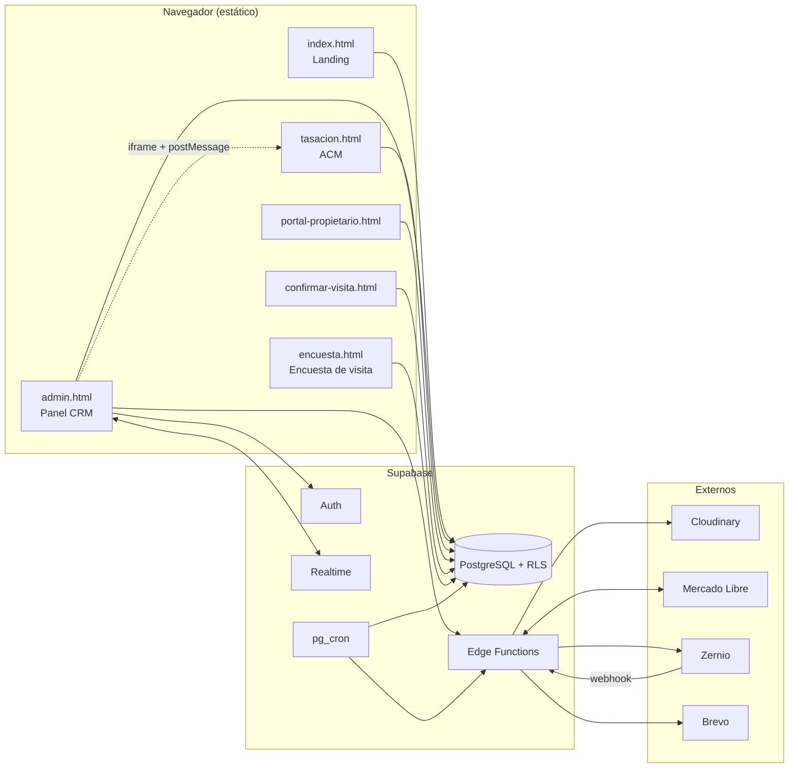
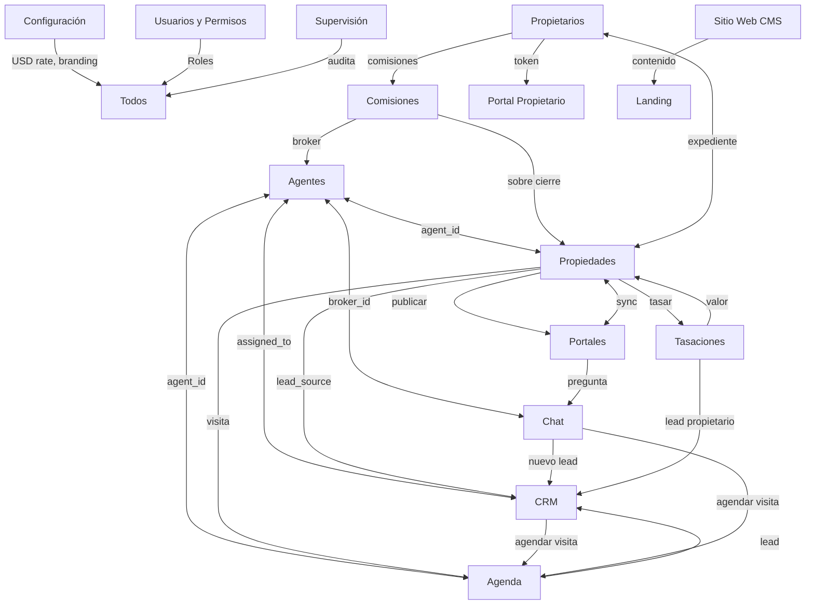
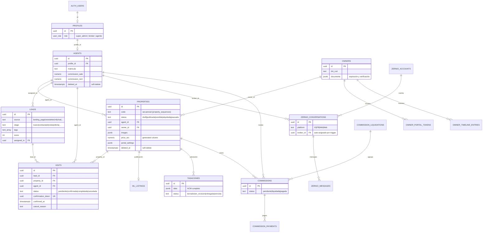
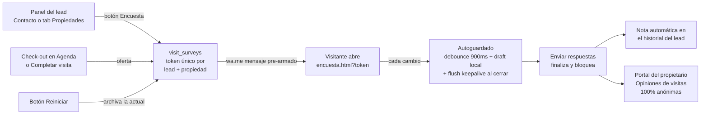
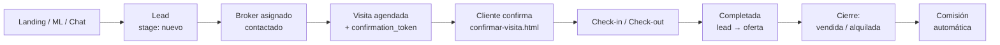

# 🏠 BIENENHAUS PROPIEDADES

**Landing pública + CRM inmobiliario completo para una inmobiliaria premium de Buenos Aires**


🌐 **Sitio:** https://bienenhaus.com.ar


---

## 📑 Índice

1. [Descripción y alcance](#-descripción-y-alcance)
2. [Funcionalidades del sistema](#-funcionalidades-del-sistema)
3. [Stack tecnológico](#-stack-tecnológico)
4. [Arquitectura](#-arquitectura)
5. [Páginas y URLs](#-páginas-y-urls)
6. [Estructura del proyecto](#-estructura-del-proyecto)
7. [Instalación y puesta en marcha](#-instalación-y-puesta-en-marcha)
8. [Base de datos](#-base-de-datos)
9. [Roles y permisos](#-roles-y-permisos)
10. [Seguridad](#-seguridad)
11. [Panel administrativo (14 módulos)](#-panel-administrativo-14-módulos)
12. [Landing pública](#-landing-pública)
13. [Portal del Propietario](#-portal-del-propietario)
14. [Confirmación de visitas](#-confirmación-de-visitas)
15. [Encuesta de Visita — HOJA DE VISITA](#-encuesta-de-visita--hoja-de-visita)
16. [Tasaciones (ACM)](#-tasaciones-acm)
17. [Comisiones y liquidaciones](#-comisiones-y-liquidaciones)
18. [Integración Mercado Libre](#-integración-mercado-libre)
19. [Chat omnicanal (Zernio)](#-chat-omnicanal-zernio)
20. [Centro de Supervisión](#-centro-de-supervisión)
21. [Edge Functions](#-edge-functions)
22. [Migraciones](#-migraciones)
23. [Flujos end-to-end](#-flujos-end-to-end)
24. [Patrones técnicos](#-patrones-técnicos)
25. [Deploy](#-deploy)
26. [Testing y CI](#-testing-y-ci)
27. [Convenciones de desarrollo](#-convenciones-de-desarrollo)
28. [Deudas técnicas y roadmap](#-deudas-técnicas-y-roadmap)
29. [ADRs](#-adrs-architecture-decision-records)
30. [Documentación complementaria](#-documentación-complementaria)
31. [Changelog](#-changelog)

---

## 📌 Descripción y alcance

**BIENENHAUS PROPIEDADES** es un sistema web integral para una inmobiliaria. Combina en un solo repositorio:

| Componente | Descripción |
|---|---|
| **Landing pública** | Sitio comercial con catálogo dinámico de propiedades, servicios, equipo, proceso, estadísticas y formulario de contacto que genera leads. |
| **Panel administrativo / CRM** | SPA de 14 módulos para gestionar propiedades, leads, visitas, propietarios, agentes, tasaciones, comisiones, portales, chat y supervisión. |
| **Portal del Propietario** | Acceso por token (sin login) donde el dueño ve sus propiedades, documentos, comisiones y liquidaciones. |
| **Confirmación de visita** | Página pública por token para que el cliente confirme o cancele una visita. |
| **Herramienta de tasación (ACM)** | Análisis Comparativo de Mercado con comparables, mapa, coeficientes y gráficos. |
| **Integraciones** | Mercado Libre (publicación y sync), Zernio (WhatsApp/Instagram/Facebook/Web), Cloudinary (imágenes), Brevo (emails). |

### Alcance funcional

- ✅ Gestión completa del ciclo comercial: **captación → tasación → publicación → lead → visita → cierre → comisión**.
- ✅ Multi-rol (`super_admin`, `broker`, `agente`) con seguridad a nivel de fila (RLS).
- ✅ CMS integrado: el contenido del landing se edita desde el panel sin tocar código.
- ✅ Publicación y sincronización bidireccional con Mercado Libre.
- ✅ Inbox unificado de mensajería (WhatsApp, Instagram, Facebook, Web).
- ✅ Auditoría, detección de anomalías y scoring de riesgo por usuario.
- ✅ Sin build step: se despliega como sitio estático.

### Fuera de alcance (actual)

- ❌ Envío saliente de mensajes por Zernio (pendiente de API key real; la recepción sí funciona).
- ❌ Notificaciones push reales (Web Push/VAPID, requiere Service Worker).
- ❌ Uso del `usd_rate` en las tarjetas del catálogo del landing.

---

## ⚙️ Funcionalidades del sistema

### 🌐 Público (sin login)
- Catálogo dinámico con filtros server-side (tipo, zona, precio, dormitorios), orden, paginación y *virtual scroller*.
- Galería de imágenes por propiedad.
- Formulario de contacto → inserta un `lead` (origen `landing_page` / `newsletter`).
- Botón flotante de WhatsApp.
- SEO: meta tags, Open Graph, `schema.org/RealEstateAgent`, `sitemap.xml`, `robots.txt`.
- Confirmar / cancelar visita por token.
- Portal del propietario por token.

### 🔐 Administración
| Área | Funciones |
|---|---|
| **Dashboard** | KPIs (volumen venta/alquiler, propiedades, leads, visitas, brokers), gráficos, **propiedades estancadas** (badge "bajó precio"), **razones de pérdida**, **recomendaciones** (exclusividades con countdown + leads sin contacto), **análisis de conversión** (embudo visual, fuentes, agentes), acciones rápidas. |
| **Propiedades** | CRUD, borradores, reordenamiento, soft-delete, publicación a ML, paginación server-side, validación Zod, precios ARS/USD, superficie cubierta/terreno. **Historial de encuestas por propiedad** (📋). **Código y título clickeables** → ficha pública. **Campaña WhatsApp** (📢) a leads que encajan. | |
| **Leads & CRM** | Pipeline Kanban, tags, scoring, exportación CSV, agendado directo de visitas. **Razón de pérdida obligatoria** (modal con 6 opciones). **Motor de match**: sugerencias automáticas de propiedades que encajan. **Deal room**: ofertas, contraofertas, aceptar/rechazar con transición a Ganado. | |
| **Agenda** | Calendario mensual + tabla, check-in/check-out, export CSV/ICS, recordatorios. |
| **Tasaciones** | ACM embebido en iframe + listado de tasaciones. |
| **Propietarios** | Expedientes, documentos con vencimiento/verificación, timeline, export CSV/PDF, link de portal. |
| **Sitio Web (CMS)** | 11 sub-tabs: Hero, Catálogo, Servicios, Equipo, Stats, Proceso, Contacto, Formulario, Navbar, Footer, SEO. |
| **Portales & APIs** | OAuth ML, configuración por portal, sync, dead-letter, importación desde ML. |
| **Agentes & Brokers** | CRUD, matrícula, comisiones de venta/alquiler, soft-delete, vínculo con `profiles`. |
| **Chat Redes** | Inbox unificado, crear lead, agendar visita, asignar broker. |
| **Ficha HTML** | Generador de fichas visuales por propiedad (compartir, PDF, HTML autocontenido). |
| **Usuarios & Permisos** | Alta, edición, roles y cambio de contraseña vía Edge Function. |
| **Configuración** | Identidad corporativa, contacto, redes, tipo de cambio USD, estado de integraciones. |
| **Supervisión** | Reglas, alertas, anomalías, ranking de riesgo, métricas ML. |

### 🛠️ Transversales
- Búsqueda global (`Ctrl+K`) con navegación por teclado.
- Notificaciones con badges por tab y contador en favicon.
- Realtime multi-tab en tablas core.
- Auditoría de escrituras y acciones sensibles.
- Rate limiting en Edge Functions.

---

## 🧰 Stack tecnológico

| Capa | Tecnología |
|---|---|
| **Frontend** | Vanilla JS (scripts clásicos con IIFE y globals `window.*`, **sin ES Modules ni bundler**), CSS custom properties, Font Awesome 6.5.1, Zod 3 (solo admin) |
| **Backend** | Supabase: PostgreSQL + Auth (email/contraseña) + Row Level Security + Realtime + Edge Functions (Deno) |
| **Imágenes** | Cloudinary (uploads firmados server-side, `f_auto,q_auto`, WebP) |
| **Portales** | Mercado Libre (OAuth 2.0, cron sync, webhooks, auto-reply) |
| **Mapas y gráficos** | Leaflet 1.9.4 + Chart.js 4.4.0 (CDN, en `tasacion.html`) |
| **Email** | Brevo (SMTP) para resúmenes de supervisión |
| **Chat** | Zernio (WhatsApp, Instagram, Facebook, Web) |
| **Deploy** | Cloudflare Pages (estático) + Supabase Edge Functions |
| **Testing** | Playwright (E2E) + `node --check` |
| **CI/CD** | GitHub Actions |

---

## 🏗️ Arquitectura

### Principios

1. **Vanilla JS sin build step**: deploy directo de estáticos, cache busters `?v=N`.
2. **Supabase como backend único**: Auth, DB, Realtime y Edge Functions.
3. **RLS como seguridad principal**: todas las tablas tienen RLS; el frontend nunca ve secretos.
4. **Realtime para reactividad**: `setupCoreRealtime` suscribe las tablas core.
5. **Configuración centralizada**: `app_settings` + `site_content` como fuente de verdad.
6. **Secretos solo en Edge Functions**: tokens ML/Zernio, Cloudinary, Brevo y service role nunca llegan al navegador.
7. **IDs de responsable unificados**: `properties.agent_id`, `leads.assigned_to`, `visits.agent_id` y `zernio_conversations.broker_id` apuntan a `agents.id`.
8. **Auditoría y supervisión integradas**.

### Diagrama de arquitectura



### Grafo de módulos



### Entidades compartidas

| Entidad | Tabla | Módulos que la usan |
|---|---|---|
| Usuario/Perfil | `profiles` | Todos |
| Broker | `agents` | Propiedades, CRM, Agenda, Chat, Comisiones |
| Propiedad | `properties` | Propiedades, CRM, Agenda, Portales, Tasaciones, Portal Propietario |
| Lead | `leads` | CRM, Agenda, Chat, Landing |
| Visita | `visits` | Agenda, CRM, Confirmar Visita |
| Encuesta | `visit_surveys` | CRM (lead, envío y estado), Portal Propietario (resultados anónimos), Encuesta (página pública) |
| Conversación | `zernio_conversations` | Chat, CRM |
| Propietario | `owners` | Propietarios, Portal, Comisiones |
| Tasación | `tasaciones` | Tasaciones, Portal |
| Comisión | `commissions` / `commission_liquidations` | Comisiones, Portal |
| Publicación ML | `ml_listings` | Portales, Propiedades |
| Config/Contenido | `app_settings`, `site_content` | Config, CMS, Landing |

---

## 🔗 Páginas y URLs

| Archivo | URL / Acceso | Propósito |
|---|---|---|
| `index.html` | https://bienenhaus.com.ar | Landing: hero, catálogo, servicios, equipo, proceso, stats, contacto |
| `admin.html` | `/admin.html` | Panel administrativo SPA (14 tabs, hash routing) |
| `tasacion.html` | `/tasacion.html?id=<uuid>` | ACM; se abre embebido en iframe desde `tab-tasaciones` |
| `portal-propietario.html` | `/portal-propietario.html?token=<uuid>` | Portal del propietario por token |
| `confirmar-visita.html` | `/confirmar-visita.html?token=<uuid>` | Confirmación/cancelación de visita |
| `encuesta.html` | `/encuesta.html?token=<uuid>` | Encuesta de visita (HOJA DE VISITA): autoguardado, se envía por WhatsApp desde el lead, resultados anónimos en el portal del propietario |
| `qr-visita.html` | `/qr-visita.html?token=<uuid>` | Cartel imprimible con QR de check-in (lo genera la Agenda; noindex) |
| `politica-de-privacidad.html` · `terminos-y-condiciones.html` | `/politica-de-privacidad.html` · `/terminos-y-condiciones.html` | Legales públicos |
| `403.html` · `404.html` | `/403` · `/404` | Páginas de error de Cloudflare Pages |
| `fichas/<code>.html` | `/fichas/<CÓDIGO>.html` | Fichas públicas por propiedad (generadas por CI, ver módulo Ficha HTML) |
| `canal.html` | `/canal.html` | Canal público de YouTube: grilla de videos publicados con su ficha (generada por CI, índice `assets/data/canal-videos.json`) |

---

## 📁 Estructura del proyecto

```
BH-OFICIAL/
├── index.html                    # Landing pública
├── admin.html                    # Panel administrativo (SPA por tabs, ~181 KB: 15 tabs + 20 modales inline)
├── canal.html                    # Canal público de YouTube (grilla de videos, índice generado por CI)
├── tasacion.html                 # ACM de tasación (autónomo, embebible)
├── portal-propietario.html       # Portal del propietario (token)
├── confirmar-visita.html         # Confirmación de visita (token)
├── encuesta.html                 # Encuesta de visita (token, autoguardado)
├── qr-visita.html                # Cartel QR de check-in (Agenda)
├── politica-de-privacidad.html · terminos-y-condiciones.html · 403.html · 404.html
├── CNAME                         # Dominio custom (Cloudflare Pages)
├── favicon.ico · robots.txt · sitemap.xml · .nojekyll
├── playwright.config.js          # Configuración E2E
├── package.json · package-lock.json
│
├── assets/
│   ├── css/
│   │   ├── landing.css           # Design system del landing
│   │   └── admin.css             # Estilos del panel (incluye calendario)
│   ├── js/
│   │   ├── config.js             # window.BH_CONFIG (Supabase URL + anon key)
│   │   ├── supabase-client.js    # Init de window.supabaseClient (fail-closed)
│   │   ├── utils.js              # BHUtils: esc, escAttr, safeUrl, safeImageUrl, safeCssUrl, sanitizeRichText
│   │   ├── cloudinary.js          # Upload firmado (window.BH_Cloudinary)
│   │   ├── zod.umd.js            # Zod 3 (solo admin)
│   │   ├── landing-app.js        # Catálogo, filtros, CMS, contacto → leads
│   │   ├── admin-app.js          # Núcleo del panel: state, helpers (window.__BH), realtime, modales (~3.5k líneas)
│   │   ├── admin-<modulo>.js     # 14 módulos de dominio cargados tras el core (ver tabla abajo)
│   │   └── yt-<modulo>.js        # Módulos compartidos del módulo Contenido/YouTube (window.BH_YT.*)
│   ├── js/pages/                 # JS de páginas públicas (tasacion, portal, encuesta, confirmar-visita, canal)
│   ├── data/                     # Índices generados por CI (property-videos.json, canal-videos.json)
│   ├── images/                   # favicon, hero-bg.webp, pwa-512x512.png
│   └── img/                      # logo-bh.png
│
├── supabase/
│   ├── functions/                # 58 Edge Functions (Deno) + _shared/
│   └── migrations/               # 114 migraciones SQL versionadas
│
├── tests/                        # Suite E2E Playwright (32 specs)
├── scripts/                      # bump-busters, generate-ficha, recovery, verificación
├── fichas/                       # Fichas HTML de propiedades (generadas por CI)
├── docs/                         # Documentación: backups, integraciones, guías, auditorías
├── .well-known/                  # Archivos de verificación de dominio
├── .github/workflows/            # CI (deploy.yml + ficha-generate.yml)
│
└── *.md                          # README.md, AGENTS.md
```

### Módulos del panel (`assets/js/admin-*.js`)

El panel se modularizó (antes era un `admin-app.js` de ~14k líneas; hoy el core tiene ~3.5k y el dominio vive en módulos con contrato documentado: `admin-app.js` publica `window.adminApp` y `window.__BH` **antes** de que los módulos se carguen y los destructuren):

| Módulo | Líneas | Dominio |
|---|---|---|
| `admin-app.js` (core) | ~3.5k | Estado global, auth, realtime (`setupCoreRealtime`), modales, toasts, KPIs, utilidades `__BH` |
| `admin-crm.js` | ~2.4k | Pipeline de leads, propietarios del CRM, tareas, encuestas, token de portal |
| `admin-agenda.js` | ~2.2k | Calendario mensual, bloqueos, QR, recordatorios |
| `admin-propietarios.js` | ~1.7k | Expedientes, documentos, timeline, acceso al portal |
| `admin-supervision.js` | ~1.3k | UI del Centro de Supervisión (Equipo/Feed/Errores/Alertas) |
| `admin-propiedades.js` | ~1.1k | CRUD de propiedades, publicación, papelera |
| `admin-portales.js` | ~1k | ML/RELA: OAuth, sync, importación |
| `admin-cms.js` | ~0.8k | 11 sub-tabs del CMS |
| `admin-agentes.js` · `admin-usuarios.js` | ~0.7k | CRUD de agentes y usuarios/roles |
| `admin-tasaciones.js` | ~0.5k | Listado de tasaciones, compartir, tokens |
| `admin-ficha.js` | ~0.4k | Generador manual de fichas |
| `admin-crm-tasks.js` | ~0.3k | Tareas del CRM (lead/owner) |
| `admin-contenido.js` | ~4.3k | Contenido & Redes: orquestador/UI de YouTube (Studio, publicación, historial) |
| `admin-supervision-panel.js` | 43 líneas | Shim de entrada al tab Supervisión (gate `super_admin` → `window.adminSupervision`) |

> Carpetas de tooling que **no** se versionan: `.codegraph/`, `.omo/`, `.playwright-mcp/`, `supabase/.temp/`, `node_modules/`, `*.log`, `.env.local`, `test-results/`, `playwright-report/`.

---

## 🚀 Instalación y puesta en marcha

### Requisitos

- Cualquier servidor estático (Python, `npx serve`, etc.)
- Node.js ≥ 18 (solo para lint y tests)
- [Supabase CLI](https://supabase.com/docs/guides/cli) (solo para migraciones y Edge Functions)

### Local

```bash
# 1. Clonar
git clone https://github.com/facuherrera23/BH-OFICIAL.git
cd BH-OFICIAL

# 2. Servir estáticamente (no hay build)
python -m http.server 8788

# 3. Abrir
#   Landing → http://localhost:8788/index.html
#   Admin   → http://localhost:8788/admin.html
```

### Herramientas de desarrollo (opcional)

```bash
npm install                        # Playwright y supabase-js (devDependencies)
npx playwright install chromium    # navegador para E2E
npm run lint                       # node --check de admin-app.js y landing-app.js
npm test                           # suite E2E
```

### Configuración del frontend

`assets/js/config.js`:

```js
window.BH_CONFIG = {
  SUPABASE_URL: 'https://<tu-proyecto>.supabase.co',
  SUPABASE_ANON_KEY: '<anon-key>'   // clave pública por diseño: la seguridad la da RLS
};
```

- `supabase-client.js` crea `window.supabaseClient` con el CDN `@supabase/supabase-js@2`. Sin CDN o sin `BH_CONFIG`, loguea el error y **no** expone el cliente (*fail-closed*).
- `utils.js` expone `window.BHUtils` (solo helpers de seguridad/URL) y se carga **antes** que `landing-app.js` / `admin-app.js`.
- `cloudinary.js` expone `window.BH_Cloudinary = { uploadImage, uploadImages }` (firma vía Edge Function `cloudinary-sign`).

### Usuarios

Los usuarios se crean desde el propio panel (**Usuarios & Permisos**) mediante la Edge Function `manage-users`. El rol se guarda en `profiles.role`.

### Variables de entorno de Edge Functions (secrets de Supabase)

| Variable | Uso |
|---|---|
| `SUPABASE_SERVICE_ROLE_KEY` | Operaciones privilegiadas |
| `CRYPTO_SECRET` | Derivación PBKDF2 para AES-256-GCM (tokens ML) |
| Credenciales Cloudinary | Firma de uploads |
| Credenciales Mercado Libre | OAuth y API |
| API key + webhook secret Zernio | Guardados en `zernio_config` |
| Credenciales Brevo | Envío de digest |

> Nunca se commitean: se cargan con `supabase secrets set`.

---

## 🗄️ Base de datos

PostgreSQL gestionado por Supabase. **63 tablas en el esquema `public`, todas con RLS activada (100 % de cobertura)** con 117 políticas RLS (verificado contra producción el **2026-10-15**: `pg_class` + `pg_policies`; además 17 jobs de `pg_cron` activos y 16 tablas en la publicación `supabase_realtime`).

### Diagrama entidad-relación (núcleo de negocio)

> Se muestran las relaciones y los campos documentados en el proyecto. Los campos completos están en `supabase/migrations/`.



### Tablas por dominio

#### 🏢 Núcleo de negocio

| Tabla | Descripción |
|---|---|
| `properties` | Propiedades (draft/publicada/vendida/alquilada/pausada), imágenes JSONB, `agent_id`, `owner_id`, `portal_settings`, `price_ars` generada |
| `agents` | Asesores/brokers: matrícula, `commission_sale`/`commission_rent`, `profile_id`, soft-delete `deleted_at` |
| `owners` | Propietarios: DNI/CUIT, documentos JSONB (vencimiento y verificación) |
| `leads` | Pipeline CRM: `source`, `stage`, `tags`, `score`, `assigned_to` |
| `visits` | Visitas: estados, `agent_id`, `confirmation_token`, check-in/out |
| `visit_surveys` | Encuesta de visita (HOJA DE VISITA): 1 activa por (lead, propiedad), `token` público, `answers` jsonb, `finalized`, `archived_at` para re-encuesta |
| `tasaciones` | ACM: `data` JSONB, valoración USD/ARS, estado borrador/en_revision/entregada/vencida |
| `commissions` | Comisiones por cierre (pendiente/liquidada/pagada) |
| `commission_liquidations` | Liquidaciones mensuales |
| `commission_payments` | Pagos registrados |
| `ml_listings` | Publicaciones Mercado Libre (sync, dedup) |
| `property_sequences` | Secuencia de códigos de propiedad (solo `service_role`) |

#### 🎨 CMS y configuración

| Tabla | Descripción |
|---|---|
| `site_content` | Contenido por sección del landing: hero, services, team, process, stats, contact, footer, social |
| `portal_settings` | CMS en vivo del landing (hero, servicios, stats, testimonios). Lectura solo autenticada |
| `app_settings` | Ajustes globales key/value JSONB: `preferences` (incl. `usd_rate`), `features`, `integrations` |
| `profiles` | Perfiles vinculados a `auth.users` con campo `role` |

#### 📱 Redes sociales (módulo Contenido)

| Tabla | Descripción |
|---|---|
| `social_accounts` | Cuentas conectadas por plataforma (`platform`: youtube\|facebook\|instagram\|tiktok): `external_id`, `display_name`, tokens AES-256-GCM (`*_encrypted` + `*_iv`), `refresh_token`, `scope`, `status`, `last_publish_at`. UNIQUE (`platform`, `external_id`) → reconectar no duplica |
| `social_posts` | Publicaciones por plataforma: `platform` (`youtube`\|`instagram`\|…), `post_type`, `content` JSONB (metadata, score, categoría, flags), `media`, `status` (`draft`\|`scheduled`\|`publishing`\|`published`\|`failed`), `external_post_id` (id del video en YouTube), `external_url`, `property_id` (vínculo con la ficha y origen del tour en video), `metrics` (incluye `youtube_privacy`) |

#### 💬 Chat Zernio

| Tabla | Descripción |
|---|---|
| `zernio_config` | Secretos del módulo (API key, webhook secret). RLS sin policies: solo `service_role` |
| `zernio_accounts` | Espejo de cuentas sociales conectadas |
| `zernio_conversations` | Hilos DM unificados (IG/FB/WA/Web); `broker_id` auto-asignado por trigger |
| `zernio_messages` | Mensajes; escritura solo vía Edge Functions |
| `zernio_webhook_events` | Deduplicación de eventos (`payload.id` único) |

#### 🛡️ Supervisión y auditoría

| Tabla | Descripción |
|---|---|
| `audit_log` | Registro de auditoría de escrituras y acciones sensibles (con cadena de integridad) |
| `supervision_rules` | Reglas configurables de detección (solo `super_admin`) |
| `supervision_alerts` | Alertas operativas generadas por reglas |
| `supervision_baselines` | Baselines estadísticos |
| `supervision_anomalies` | Anomalías detectadas (ML/estadística) |
| `supervision_anomaly_config` | Configuración del detector |
| `user_risk_scores` | Score de riesgo por usuario, con factores explicables |
| `user_sessions` | Sesiones registradas |
| `api_key_audit` | Auditoría de uso de API keys |
| `usage_events` | Métricas de uso (append-only) |
| `ml_model_metrics` | Métricas del modelo (precision, recall, F1) |
| `ml_predictions_log` | Log de predicciones |
| `rate_limit_logs` | Sliding window del rate limiter |
| `notification_preferences` | Preferencias por usuario (email/push/slack) |

#### 📂 Portal del Propietario y documentos

| Tabla | Descripción |
|---|---|
| `owner_portal_tokens` | Tokens de acceso al portal (validación + expiración) |
| `document_requirements` | Requisitos documentales por tipo de operación |
| `owner_timeline_entries` | Timeline de comunicaciones y eventos |

### Triggers y lógica en base de datos

| Trigger / Función | Efecto |
|---|---|
| `guard_profiles_self_update` | Impide la auto-elevación de rol |
| `trg_visits_sync_lead_stage` | Crear visita → lead pasa a `visita` |
| `trg_visits_lead_cancel_revert` | Cancelar visita → lead vuelve a `contactado` |
| `trg_visits_lead_completed_auto` | Completar visita → sugiere `oferta` |
| Triggers `BEFORE INSERT` en chat | Auto-asignan `broker_id` |
| `set_property_code` / `generate_property_code` | Código secuencial de propiedad |
| `get_sidebar_badge_counts` (RPC, SECURITY DEFINER) | Contadores del sidebar respetando RLS |
| `count_pending_visits_for_lead`, `is_super_admin` | Helpers de negocio y permisos |

### Vistas (`security_invoker = true`)

`ml_model_performance`, `daily_user_activity`, `daily_module_activity`, `open_alerts_by_user`, `my_assigned_alerts`, `purge_audit_log`, `supervision_anomalies_recent`, `current_user_risk_scores`.

### Políticas RLS destacadas

| Tabla | Política |
|---|---|
| `properties` | Lectura pública de las publicadas (`TO public`); escritura autenticada |
| `leads` | `INSERT` anónimo solo con `source IN ('landing_page','newsletter')` |
| `visits` | `SELECT/UPDATE` anónimo por `confirmation_token`; resto vía JOIN `agents.profile_id = auth.uid()` |
| `visit_surveys` | `SELECT` a authenticated; `INSERT/UPDATE` solo agente del lead o super_admin; público **solo** vía RPC por token (ver sección Encuesta) |
| `owners` | `SELECT` super_admin/broker; `INSERT/UPDATE/DELETE` solo super_admin |
| `tasaciones` | Solo `authenticated` y `service_role` (sin acceso anónimo) |
| `portal_settings` | Lectura solo autenticada (sin fuga de secretos) |
| `zernio_config`, `property_sequences` | Sin policies: solo `service_role` (intencional) |
| `supervision_rules` | Gestión exclusiva de `super_admin` |

---

## 👥 Roles y permisos

El permiso se resuelve con `profiles.role` (enum `user_role`):

| Rol | Alcance |
|---|---|
| `super_admin` | Acceso total, gestión de usuarios, ajustes sensibles y supervisión |
| `broker` | Gestión operativa completa y sus asignaciones (`agents.profile_id = auth.uid()`) |
| `agente` | Solo sus propias asignaciones |

**Chat:** `super_admin` ve todo; `broker` solo las conversaciones donde `broker_id` corresponde a su agente.

---

## 🔒 Seguridad

- **RLS en las 63 tablas (100 %)**; lectura pública solo donde corresponde.
- **Hardening de funciones**: `search_path` fijo, `REVOKE ALL` a `PUBLIC` y `anon` en 44 funciones, con `GRANT` explícitos.
- **XSS**: `esc()` obligatorio antes de todo `innerHTML`; `safeUrl` / `safeImageUrl` / `safeCssUrl` para atributos; `sanitizeRichText` con allowlist estricta para el CMS. Guards de regresión en `tests/security.spec.js` (CSP por página, cero handlers inline en admin, delegación `data-action`, sin secretos en `config.js`).
- **CSP** verificada por tests: estricta en las 5 páginas públicas (sin `unsafe-inline` ni nonce); admin usa `'unsafe-inline'` documentado (handlers dinámicos, sin nonce — CSP3 ignoraría el inline si hubiera nonce).
- **Autenticación por token** en portal, confirmación de visita y encuesta (RPC `SECURITY DEFINER` con validación de token/revocación/expiración dentro de cada función).
- **Sesión cruzada por iframe**: `postMessage` con `targetOrigin` explícito y verificación de `event.origin`.
- **Edge Functions**: `verify_jwt` según función (mapa en `deploy.yml`), chequeo de rol vía service role y rate limiting (sliding window en `rate_limit_logs`).
- **Secretos**: solo en Edge Functions (`Deno.env.get`), tokens ML cifrados con AES-256-GCM.
- **Auditoría**: `audit_log` con cadena de integridad + `api_key_audit`.
- **HIBP**: check de contraseñas filtradas en el alta de usuario (fail-open documentado).

> ✅ **Hallazgo de auditoría 2026-10-15 — RESUELTO mismo día** (migración `20261015000001_hardening_anon_execute_p1`): 12 funciones internas `SECURITY DEFINER` creadas *después* del hardening 2026-09-28 quedaban ejecutables por `anon` vía RPC. Se restringieron por invocador real (triggers/cron/edge functions), con **dos excepciones documentadas que NO se pueden revocar**: `compute_lead_score()` y `notify_new_lead()` son triggers sobre `leads`, tabla anon-writable (el formulario de contacto del landing inserta con rol anon) — anon necesita EXECUTE o se rompe el alta pública de leads. Verificado con `has_function_privilege` lista completa × 4 roles; advisor `anon_security_definer_function_executable` pasó de 25 a 15 (los restantes son las 13 RPC públicas por token + las 2 excepciones justificadas). Regla derivada: **todo trigger nuevo sobre una tabla con INSERT anónimo requiere `GRANT EXECUTE ... TO anon`** para su función.

---

## 🖥️ Panel administrativo (15 módulos)

SPA con hash routing (`#tab-dashboard`) y sidebar en 4 categorías: **Principal**, **Gestión & CRM**, **Red & Difusión** y **Sistema**.

| # | Módulo | Tab ID |
|---|---|---|
| 1 | Dashboard | `tab-dashboard` |
| 2 | Propiedades | `tab-propiedades` |
| 3 | Leads & CRM | `tab-leads` |
| 4 | Agenda de Visitas | `tab-agenda` |
| 5 | Tasaciones | `tab-tasaciones` |
| 6 | Propietarios | `tab-propietarios` |
| 7 | Sitio Web (CMS) | `tab-sitio-web` |
| 8 | Portales & APIs | `tab-portales` |
| 9 | Agentes & Brokers | `tab-agentes` |
| 10 | Chat Redes | `tab-chat-redes` |
| 11 | Ficha HTML | `tab-ficha-html` |
| 12 | Contenido & Redes (YouTube + Instagram) | `tab-contenido` |
| 13 | Usuarios & Permisos | `tab-usuarios` |
| 14 | Configuración | `tab-configuracion` |
| 15 | Centro de Supervisión | `tab-supervision` |

### API global `window.adminApp`

Expone los handlers al HTML (39 métodos):

- **Entidades:** `edit*` / `delete*` para propiedades, leads, propietarios, visitas y agentes.
- **Propietarios:** `exportOwnersCSV`, `exportOwnersPDF`, `generateOwnerPortalLink`, `deleteOwnerDoc`, `deleteTimelineEntry`.
- **Visitas:** `openVisitModal`, `checkinVisit`, `checkoutVisit`, `exportVisitsCSV`, `exportVisitsICS`.
- **Comisiones:** `markCommissionPaid`, `markLiquidationPaid`, `deletePayment`, `viewCommissionLiquidation`, `viewLiquidationPDF`.
- **Portales/ML:** `mlConnect`, `mlDisconnect`, `mlSaveCredentials`, `mlPublishProperty`, `mlRemoveProperty`, `mlUpdateProperty`, `mlToggleConfig`, `mlImportFromML`, `togglePortal`, `openPortalConfig`.
- **Chat:** `openChatConversation`.
- **Supervisión:** `loadSupervision`, `loadAnomaliesTable`.

### Navegación y estado

- Tabs con hash routing y persistencia en `localStorage`.
- Búsqueda global `Ctrl+K` con resaltado.
- Panel de notificaciones, badges en tabs y contador en favicon.
- Badges del sidebar en vivo vía RPC `get_sidebar_badge_counts`.

### 🧩 Módulo Sitio Web (CMS)

11 sub-tabs (Hero, Catálogo, Servicios, Equipo, Stats, Proceso, Contacto, Formulario, Navbar, Footer, SEO). Guarda en `site_content` y `portal_settings`; el landing re-renderiza con `applySectionContent()` y caché invalidable (`invalidateCmsCache`, `getCachedCMS`).

### 🧩 Módulo Ficha HTML

**Pipeline de fichas públicas (canónico):** `scripts/generate-ficha.mjs` genera `fichas/<code>.html` estáticas (template v3 dark: JSON-LD, OG, mapa, broker, relacionadas, lightbox, botón PDF, analytics) + `sitemap.xml`, y **reconcilia huérfanas**: al despublicar una propiedad su ficha se borra en la siguiente corrida. Corre por CI (`ficha-generate.yml`: cada 30 min + `repository_dispatch`), se commitea a `main` y Cloudflare Pages las sirve en `bienenhaus.com.ar/fichas/<code>.html`. Guard de seguridad: si la consulta devuelve 0 propiedades publicadas, aborta sin escribir ni borrar. Cada ficha lleva CSP propia.

La misma corrida genera los **índices del módulo Contenido** que el workflow stagea junto a las
fichas: `assets/data/property-videos.json` (tours en video por `property_code` → badge "Tour" del
catálogo) y `assets/data/canal-videos.json` (vídeos del canal público). Si se agrega otro archivo
generado, hay que sumarlo al `git add` de `ficha-generate.yml` o nunca llega a producción.

> `ficha-publish` (Edge Function → Supabase Storage) quedó **deprecado como stub 410** (2026-10-11): duplicaba la generación con un template inferior que ningún consumidor usaba y divergía del canónico. El redirector legado `/ficha?code=X` sigue apuntando a la ficha estática.

**Compartir:** en la tab Propiedades, cada propiedad publicada tiene "Ver ficha pública" y "Compartir por WhatsApp" — el link se arma con `?de=<agente>&tel=<tel>` del usuario logueado, y la ficha muestra ese contacto con su WhatsApp como CTA.

**Generador manual (tab Ficha HTML):** layout de dos columnas (formulario + preview 1:1, responsive 1200/1024/680px), autocompletado desde el CRM (debounce 250 ms), drag & drop de fotos y tres exportaciones: `navigator.share`, `window.print` (PDF) y HTML autocontenido descargable. Para fichas ad-hoc de propiedades no publicadas.

### 🧩 Módulo Contenido & Redes (YouTube + Instagram)

Publicación y gestión de videos de YouTube **sin pasar por Cloudinary**: los bytes del video van del
navegador directo a Google (subida resumable por chunks, con cancelación y reanudación) y la
miniatura viaja en base64 al server (≤ 2 MB).

**Arquitectura:** el orquestador `assets/js/admin-contenido.js` (UI) consume módulos compartidos
cargados antes que él, todos bajo `window.BH_YT`:

| Módulo | Archivo | Qué aporta |
|---|---|---|
| `core` | `assets/js/yt-core.js` | API con timeout/reintentos, estado, bus de eventos, storage, ajustes remotos (`app_settings`) y auditoría |
| `publish` | `assets/js/yt-publish.js` | Pre-flight (chequeos antes de gastar 1600 unidades), subida resumable, cola, sesión de reanudación, dry-run y borrador |
| `seo-tools` | `assets/js/yt-seo-tools.js` | Validación de límites reales de YouTube, canibalización, presets y frases |
| `seo-score` | `assets/js/yt-seo-score.js` | Score SEO de 12 checks (estilo vidIQ) con delta contra el publicado |
| `comments` | `assets/js/yt-comments.js` | Bandeja de comentarios del canal, respuestas, like, moderación y lead desde un comentario |
| `analytics` | `assets/js/yt-analytics.js` | 6 reportes de YouTube Analytics (resumen, evolución, top, retención, tráfico, demografía) con caché de 5 min |
| `ops` | `assets/js/yt-ops.js` | Semáforo de salud del canal, publicaciones fallidas y historial de acciones (`audit_log`) |
| `integrations` | `assets/js/yt-integrations.js` | Ficha del video, compartir por WhatsApp, republicar y payload de publicación desde una propiedad |

**Edge Functions:**

| Función | `verify_jwt` | Qué hace |
|---|---|---|
| `social-auth-youtube` | **OFF** | OAuth de Google (popup + `postMessage`). El callback vuelve por redirect **sin JWT** → no puede llevar `verify_jwt` ON; se protege con `state` firmado (HMAC) + `requireAdmin` en el `start` |
| `social-auth-instagram` | **OFF** | OAuth de Meta (mismo patrón: `state` firmado + `requireAdmin`) |
| `social-youtube-studio` | ON | Backend del Studio (acciones abajo) |
| `social-publish-youtube` | ON | Sesión de subida resumable: `init` → `complete` / `fail`, más `dry_run` (simulación) |
| `social-youtube-comments` | ON | Bandeja del canal: `comments_list`, `comments_inbox`, `comment_reply`, `comment_heart`, `comment_moderate`, `comment_lead` |
| `social-instagram` | ON | Publicación y administración en Instagram (ver abajo) |

> ⚠️ **El `verify_jwt` de cada Edge Function lo decide `.github/workflows/deploy.yml`** (listas `NO_VERIFY` y `EXCLUDED_FUNCTIONS`), no el código: las dos de OAuth están en `NO_VERIFY` **a propósito** (el callback externo no puede mandar un JWT del panel). El resto se auto-protege con `requireAdmin` + rate limit.

**Actions del Studio** (`social-youtube-studio`, todas vía `body.action`): `channel`, `videos`,
`video_update`, `video_delete`, `video_promote`, `thumbnail`, `playlists`, `playlist_create`,
`playlist_item_add`, `playlist_item_remove`, `video_categories`, `snapshot`, `analytics`,
`analytics_report`, `videos_sync_public`, `platforms_config`, `settings_get`, `settings_set` y
`audit_log`.

- `platforms_config`: qué redes tienen app OAuth configurada (`app_settings.social_<plataforma>`) →
  la tarjeta distingue **"Sin configurar"** (no hay app) de **"Sin conectar"** (hay app, falta autorizar).
- `video_promote`: promueve un video a público → escribe `metrics.youtube_privacy` (la visibilidad real).
- `audit_log`: única vía de auditoría desde el panel (ver abajo).

**OAuth (app y credenciales):** las credenciales se leen de `app_settings` con la clave
`social_<plataforma>` (`{client_id, client_secret}`) y, si no están, del fallback
`SOCIAL_<PLATAFORMA>_CLIENT_ID` / `SOCIAL_<PLATAFORMA>_CLIENT_SECRET` (`_shared/social.ts`).

- **YouTube**: redirect URI exacta `${SUPABASE_URL}/functions/v1/social-auth-youtube`; scopes
  `youtube.upload`, `youtube.readonly`, `youtube.force-ssl` (editar/borrar) y `yt-analytics.readonly`
  (métricas). Pide `access_type=offline` + `prompt=consent` para renovar el refresh token.
  ⚠️ La app de Google debe estar **en modo Producción con el consentimiento externo publicado**: en
  modo "Pruebas" el refresh token muere a los 7 días y el canal hay que reconectarlo.
- **Instagram**: requiere cuenta IG **Business/Creator** (las personales no funcionan) vinculada a una
  página de Facebook (Meta Business Suite) y una app con el producto "Instagram Graph API"; scopes
  `instagram_basic`, `instagram_content_publish`, `pages_show_list`. En modo Development funciona solo
  para los administradores de la app (sin review de Meta).

**Instagram (fase 2 — backend listo, publicación sin UI):** `social-instagram` expone `profile`,
`media`, `upload_temp`, `create`, `publish`, `delete` y `cleanup_temp`. La Graph API de IG exige una
**URL pública** de la que Meta descargue el archivo, así que las subidas desde PC van a un bucket
temporal de Supabase Storage (`social-temp`) que se borra en `cleanup_temp`; las fotos de propiedades
reusan las URLs de Cloudinary que ya existen (no son contenido nuevo). El contenido termina viviendo
**únicamente en Instagram** (Cloudinary no interviene, igual que en YouTube).
**Estado en el panel:** la tarjeta "Instagram" ya ofrece **Conectar** (el OAuth funciona), pero
**no hay pantalla de publicación**: el flujo de subida del panel es el de YouTube. Facebook y TikTok
están marcados `available: false` → "Próximamente".

**Persistencia (sin migraciones):** `social_posts.content` (JSONB: metadata, score, categoría,
flags), `app_settings` (`social_yt_stats_history`, `social_yt_categories`,
`social_yt_publish_queue`) y `localStorage`/`sessionStorage` (plantillas, cuota, CTA, caché del Studio).

**Canal público:** `/canal.html` muestra los videos publicados con su ficha. El índice
`assets/data/canal-videos.json` lo genera el mismo CI de las fichas (cada 30 min) desde
`social_posts`; si se borra un video del canal, el Studio marca el post como `failed` y desaparece
de la página (no quedan embeds muertos).

**Privacidad de la página pública:** un post con `status='published'` puede ser un video `unlisted`
(oculto) o programado (en privado hasta su fecha). La página pública es indexable y comparte links →
el generador publica **sólo videos públicos** (`scripts/channel-privacy.mjs`, regla fail-closed: sin
dato de visibilidad no se publica). La visibilidad real la reporta YouTube y la guarda el server en
`social_posts.metrics.youtube_privacy`.

**Sincronización canal → CRM:** el botón "Sincronizar canal" del Studio llama a la action
`videos_sync_public`: importa al CRM el inventario real del canal (idempotente, refresca la
visibilidad y reconcilia los videos que ya no están). Es lo que hace que `/canal.html` muestre los
videos ya publicados, incluidos los que se subieron fuera del panel.

**Tour en video por propiedad:** un video publicado y vinculado a una propiedad
(`social_posts.platform='youtube'` + `status='published'` + `property_id` no nulo) aparece en la
**ficha** como poster *click-to-load* (el iframe `youtube-nocookie` solo se carga al abrirlo) y en el
**catálogo público** con el badge **"Tour"**. El índice `assets/data/property-videos.json` (lo genera
el mismo CI de las fichas) mapea `property_code → video_id`; la ficha además incluye JSON-LD
`VideoObject` (rich result de video en Google) y su CSP lleva `frame-src` para
`https://www.youtube-nocookie.com`. Si el video se borra del canal, el post pasa a `status='failed'`
y la ficha deja de embeberlo (nunca se embebe un video muerto).

**Permisos:** `youtube.force-ssl` habilita edición/borrado/programación/moderación;
`yt-analytics.readonly` habilita los reportes. Las conexiones hechas antes de agregar el scope de
analítica responden `needs_reconnect` (banner claro) y el resto del módulo sigue funcionando.

**Auditoría desde el panel:** `audit_log` **no** es insertable desde el cliente (RLS) → todo pasa
por la action `audit_log` del Studio (`service_role`). El contrato evita la colisión de nombres:
`body.action` **despacha** y `body.audit_action` es la acción real (los ids no-UUID se filtran a
`null`). `core.audit()` nunca lanza: devuelve `true/false` y el semáforo de salud solo marca "ya
avisado" si la traza se guardó de verdad.

**Cola de publicación compartida:** la cola vive en `localStorage` (`bh_yt_publish_queue`) y su copia
en `app_settings` (`social_yt_publish_queue`, escrita por el server con `service_role`; `settings_get/set`
solo acepta claves `social_yt_*`). Merge por `id` con la local ganando; "última escritura gana"
(aceptable para un usuario único). La categoría pedida antes de que la API conteste queda
**pendiente** (`_pendingCategoryId`) y se aplica cuando llegan las opciones — si no, se pierde en
silencio.

**HUD de cuota (estimación local):** el panel estima las unidades de cuota por acción (`publish` =
1600). **No es la cuota real de Google** (todo request suma, incluso los que fallan): no prometer
exactitud ni usarlo como alerta.

**Cliente autenticado del panel (warning de GoTrue):** además de `window.supabaseClient`, el admin
usa un cliente Supabase "authed" (`storageKey` propio) para las queries autenticadas. Es un
**singleton**: se crea **una sola vez** y, cuando Supabase rota el token, sólo se actualiza la
cabecera `Authorization` (nunca se recrea). Crear varios `GoTrueClient` con el mismo storageKey
dispara el warning *"Multiple GoTrueClient instances detected in the same browser context"* —
Supabase advierte que puede dar comportamiento indefinido al concurrir. Cubierto por
`tests/admin-auth-client.spec.js` (8 tests sobre el bloque real de `admin-app.js`).

> Auditoría completa de las 50 mejoras del módulo: `docs/audit/AUDITORIA_YOUTUBE_50_MEJORAS_2026-10-30.md`.

### 🧩 Módulo Configuración

| Sección | Destino |
|---|---|
| Identidad corporativa | `site_content.footer` (razón social, matrícula, CUIT) |
| Contacto digital | `site_content.contact` (WhatsApp, email, teléfono, dirección, horario) |
| Redes sociales | `site_content.social` (URL vacía = icono oculto) |
| Preferencias | `app_settings.preferences.usd_rate` |
| Sistema e integraciones | Chips de estado: Supabase, Cloudinary, ML, Zernio |
| Sesión activa | Usuario, rol y cierre de sesión |

El guardado valida, hace *deep merge* (preserva claves no editadas) y hace UPDATE/INSERT. Sin `super_admin`, los campos quedan deshabilitados.

---

## 🌍 Landing pública

Consume `site_content` y `portal_settings` desde `landing-app.js`.

- Catálogo dinámico con filtros server-side, orden, paginación y virtual scroller.
- Galería con thumbnails y navegación.
- Formulario de contacto → `leads`, con pills de interés y validación.
- Secciones de stats, equipo, servicios y proceso desde el CMS.
- Imágenes con Cloudinary (`f_auto,q_auto`) y lazy loading.
- Mobile-first con menú móvil y botón flotante de WhatsApp.
- SEO completo (meta, Open Graph, `schema.org`, sitemap, robots).

---

## 🏡 Portal del Propietario

`portal-propietario.html?token=<uuid>` — acceso **sin login**.

- Valida token y expiración (`owner_portal_tokens`); muestra error si es inválido.
- Lista las propiedades del propietario, sus tasaciones (con moneda según `type`), documentos (`document_requirements` + `owners.documents`), comisiones y liquidaciones (pendiente / liquidada / pagada).
- Muestra las encuestas de visita **anónimas** (`portal_get_surveys`) y enmascara teléfonos (7+ dígitos) en textos libres — pedido de privacidad del dueño.
- El admin genera el link con `generateOwnerPortalLink`. **Gestión del token (2026-10-14)**: `owner_portal_tokens` tiene UNIQUE(owner_id) — un acceso por propietario. Si ya tiene uno vigente se **REUTILIZA** (regenerar con upsert invalidaría al instante el link que el propietario ya tiene); regenerar exige confirmación explícita desde el modal "Acceso al Portal" (muestra el vigente con su vencimiento, botón "Generar nuevo" con confirmación, y al generar muestra el banner ✓ con el código nuevo + copia al portapapeles). Los diálogos de confirmación/prompt pintan por encima de cualquier modal (`z-index: calc(var(--z-modal) + 10)`).

---

## ✅ Confirmación de visitas

`confirmar-visita.html?token=<uuid>` usa `visits.confirmation_token`.

| Acción | Resultado |
|---|---|
| **Confirmar** | `status = 'confirmada'`, `confirmed_at = now()` |
| **Cancelar** | `status = 'cancelada'`, `cancel_reason = 'Cancelado por cliente'` |

Muestra cliente, fecha/hora y estado visual (pendiente / confirmada / completada / cancelada).

---

## 📝 Encuesta de Visita — HOJA DE VISITA

`encuesta.html?token=<uuid>` — digitaliza la hoja de visita en papel del mismo nombre. El asesor genera un link por WhatsApp desde el panel del lead; el visitante responde **durante o después de la visita**; las opiniones quedan guardadas en la propiedad y el **dueño las ve en su portal sin saber quién visitó**.

### Flujo completo



### Origen de los botones (todas las superficies)

| Dónde | Comportamiento |
|---|---|
| Lead → **Contacto** | 1 propiedad: envía directo · varias: te lleva a la tab Propiedades · 0: deshabilitado |
| Lead → **tab Propiedades** | Botón por propiedad + chip de estado (Enviada / ✓ Respondida) + 👁 Ver respuestas + 🔄 Reiniciar |
| **Agenda → check-out** y Lead → Completar visita | Diálogo "¿Le mandás la encuesta?" en el momento natural |
| Envío | Copia el link + abre `wa.me` con mensaje pre-armado; sin WhatsApp solo copia. Log en `lead_activities` |

### Las preguntas (mapean el PDF HOJA DE VISITA)

| Tipo | Campos |
|---|---|
| Valoración 1–10 (sliders) | `ubicacion`, `superficie`, `distribucion`, `conservacion`, `general` — set v3 (2026-10-12): se quitaron Tamaño/Calidad/Precio y se agregó Superficie; los displays mantienen los labels del set viejo para respuestas anteriores |
| Decisión | `compraria` → Sí / No + `por_que` (texto) — v3: sin "Quizás" |
| Texto libre | `mas_gusto`, `menos_gusto` (máx 1000 chars, sanitizado server-side) |

### Autoguardado ("si no guarda, se guardó igual")

- Cada cambio se persiste con debounce de 900 ms vía `survey_submit_by_token` (replace full-set).
- Draft en `localStorage` por token: al reabrir, merge campo a campo (el draft local gana).
- Al cerrar la pestaña: `fetch keepalive` contra PostgREST en `pagehide`/`visibilitychange`.
- Offline: el draft queda y se empuja al volver la señal (`online`).
- **Finalizar** = lock server-side (`FOR UPDATE` evita nota duplicada ante submits concurrentes). Reabrir muestra el "gracias".

### Modelo de datos y seguridad

`visit_surveys`: `id`, `token` (uuid público único), `lead_id`, `property_id`, `answers` jsonb, `finalized`, `submitted_at`, `archived_at`, timestamps. **1 encuesta activa por (lead, propiedad)** — unique parcial sobre `archived_at IS NULL`; reiniciar archiva (la opinión archivada sigue visible para el dueño) y habilita un token nuevo para una segunda visita.

| Capa | Regla |
|---|---|
| RLS `SELECT` | Abierto a `authenticated` (consistente con `leads`/`lead_activities`) |
| RLS `INSERT`/`UPDATE` | Solo el agente asignado/creador del lead o super_admin (mismo criterio que `lead_activities`) |
| RPC `survey_get_by_token` | Lectura pública por token uuid v4; corta si el lead o propiedad tienen soft-delete |
| RPC `survey_submit_by_token` | Sanitiza todo (notas 1–10 enteras, enum compraria, textos ≤1000); lock post-finalización; `FOR UPDATE` |
| RPC `portal_get_surveys` | Solo `finalized`, **cero datos del visitante** (propiedad + fecha + respuestas); valida token/revocación/expiración del portal |
| Hardening | Las 3 funciones `SECURITY DEFINER`, `search_path=''`, REVOKE a `PUBLIC`, GRANT a `anon`+`authenticated`+`service_role` |
| Privacidad extra | El portal enmascara secuencias de 7+ dígitos (teléfonos/DNI) escritas en texto libre |

---

## 📐 Tasaciones (ACM)

`tasacion.html` es una herramienta autónoma de Análisis Comparativo de Mercado:

- **Comparables**: alta manual, extracción por URL, carga y renovación de fotos.
- **Mapa** (Leaflet) con búsqueda por dirección (geocoding).
- **Características** (ambientes, uso de terreno) y **coeficientes** (condiciones, depreciación) con recálculo en vivo.
- **Gráficos** (Chart.js) de análisis comparativo.
- **Guardado** en `tasaciones` (`data` JSONB + estado + valoración USD/ARS).
- **Moneda por destino** (2026-10-12): `f_destino = 'Alquiler'` → todo el pipeline en **$ (ARS mensual)**, persiste en `valuation_ars` con `type='alquiler'`; `Venta` → **U$S**, persiste en `valuation_usd`. El símbolo sale de `currencySymbol()` — nunca hardcodear 'U$S' en displays. El listado admin lee la columna según `type` y solo convierte a pesos en las de venta.
- **Fotos**: JSONB con base64 embebidas; las nuevas se comprimen client-side (`resizeImageToDataUrl`: fachada 1600 px, comparables 1400 px, JPEG q≈0.82). El listado admin **no** selecciona `data` a propósito. `valuation_usd` se calcula al guardar; el fallback que recalcula desde `data` si es NULL existe por seguridad.
- **PDF/print**: 3 comparables por página (foto flotada a la derecha), fachada 620 px, la página 3 arranca con "Descripción de la Propiedad".
- **Sesión** recibida del admin vía `postMessage`; notifica con `tasaciones-finalized` y `tasaciones-back`.

---

## 💰 Comisiones y liquidaciones

- Tablas: `commissions`, `commission_liquidations` (mensual), `commission_payments`.
- Edge Functions: `trigger_commission_on_close` (crea la comisión al cerrar la propiedad) y `monthly_commission_liquidation` (cierre mensual).
- Porcentajes por agente: `commission_sale` y `commission_rent`.
- Admin: marcar como pagada, liquidar, ver PDF de liquidación, eliminar pagos, filtrar por broker/estado.
- El Portal del Propietario muestra el estado.

---

## 🛒 Integración Mercado Libre

1. **Conexión OAuth 2.0** → `mlConnect` (tab Portales). **La suscripción de notificaciones se configura en el gestor de aplicaciones de ML** (applications.mercadolibre.com.ar → editar la app → callback URL `${SUPABASE_URL}/functions/v1/ml-webhook` + tópico **VIS Leads**): ML retiró el registro por API (`POST /users/{id}/topics/{topic}` responde 404). Los tópicos `questions`/`items` NO traen consultas de inmuebles.
2. **Publicación** → `mlPublishProperty` con validación de campos y fotos.
3. **Sincronización** → `ml-sync` (cron cada 5 min): precio, stock y estado, en ambas direcciones.
4. **Auto-reply** → plantillas por tipo de pregunta con variables.
5. **Webhook** → responde 200 inmediato y procesa en background (`EdgeRuntime.waitUntil` — ML desactiva tópicos si el callback tarda >~500 ms). Barrera real: binding (`application_id` + `user_id` de `ml_connection`) + re-fetch del recurso con el token del vendedor (los tópicos **no vienen firmados**). Parseo tolerante + `logRejectedPayload` guarda en `ml_webhook_events` todo lo que falle validación.
6. **Flujo de consultas de inmuebles** (2026-10-13): llegan como `vis_leads` (`/vis/leads/{uuid}`) y se procesan en `handleVisLeads`. **Claim atómico** entre topics: `questions` y `vis_leads` compiten por INSERT en el ledger `ml_questions` (UNIQUE `question_id`); quien pierde (23505) no actúa por su cuenta. La vía `questions` **nunca crea leads** (ML anonimiza la identidad en inmuebles): claima el ledger, responde con la plantilla y nada más. Los leads se crean solo desde `vis_leads` **con identidad** (nombre o email/teléfono/whatsapp); la misma persona en otra publicación se consolida en el lead existente (`mergeMlEventIntoLead` rellena campos, vincula la propiedad en `lead_properties` y deja traza en el historial) — nunca sobre etapas terminales.
7. **Importación inversa** → `mlImportFromML` trae publicaciones que existen en ML pero no en el CRM (⚠️ duplica las huérfanas DA-P0019/21/22/03 — cerrarlas antes de republicar).
8. **Acceso a leads de inmuebles**: la suscripción solo dispara el webhook; el detalle (`GET /vis/leads/{id}`) y el listado devuelven **403 `PA_UNAUTHORIZED_RESULT_FROM_POLICIES`** hasta que ML otorgue el acceso de lectura de leads a la app (lo pide el empleador a soporte ML; app `6473600664555938`, usuario `2038586793`). Mientras tanto los eventos quedan en `failed` con HTTP 403 y se re-importan cuando se habilite (no se pierden).

Los tokens se guardan cifrados (AES-256-GCM) y nunca llegan al frontend. Estados de `ml_questions` en minúsculas (`unanswered`/`answered`); `ml_listings` usa `ml_status`/`last_sync`.

---

## 💬 Chat omnicanal (Zernio)

**Estado:** API key activa en producción (envío saliente operativo). Entrada de mensajes vía `zernio-sync` (cron cada 2 min): pull incremental de conversaciones con actividad nueva → los INSERT disparan el realtime del panel. El webhook push (`zernio-webhook`) está construido y verificado, pero requiere configuración manual en el dashboard de Zernio (acceso del dueño) — ver `CONECTAR_ZERNIO_CHAT.md` §4.

| Componente | Ubicación | Estado |
|---|---|---|
| Webhook receptor | `supabase/functions/zernio-webhook` | ✅ `verify_jwt` OFF |
| Proxy API | `supabase/functions/zernio-proxy` | ✅ `verify_jwt` ON |
| Test de webhook | `supabase/functions/zernio-webhook-test` | ✅ |
| Frontend | tab Chat Redes (`admin-app.js`) | ✅ `super_admin` y `broker` |
| Base de datos | 5 tablas `zernio_*` | ✅ RLS + triggers |
| Guía | `docs/integrations/CONECTAR_ZERNIO_CHAT.md` | ✅ |

**Acciones del inbox:** ver contexto lateral (propiedad/lead/visitas), crear lead, agendar visita, asignar broker, marcar leído y enviar mensaje.

---

## 🛡️ Centro de Supervisión

- **Reglas configurables** ejecutadas con `pg_cron` cada 5 min (`evaluate_supervision_rules`); el motor soporta `filter.contains` (changed_fields) y `filter.equals` con whitelist de campos (`status`, `table_name`) — un `equals` con campo desconocido no filtra pero no rompe. `role_change_detection` quedó deshabilitada por duplicar a `privilege_escalation_attempt`.
- **Alertas** con severidad y asignación. Las que no vienen de reglas: `lead_followup_overdue` (las genera `crm_queue_followup_alerts()`) y `crm_email_broken` (las genera `notify-new-lead`).
- **Anomalías** estadísticas/ML vía cron SQL `supervision-anomalies-15min` + baselines hourly.
- **Risk scoring** por usuario con factores explicables.
- **Notificaciones**: canal actual = **digest semanal vía Brevo** (cron `supervision-digest-weekly`, lunes 11:00 UTC = 08:00 ART) a la casilla compartida de los dueños (`bienenhaus.propiedades@gmail.com`, en `app_settings.integrations.supervision_digest_recipients`). `supervision-notify`, `supervision-notifications` y `supervision-ml-anomaly` quedaron como stubs 410.
- **API de consulta** (`supervision-api`, verify_jwt ON, límite 60 req/min).
- **Retención y purga**: `purge_supervision_daily` (usa `COALESCE(resolved_at, dismissed_at, created_at)` — la tabla no tiene `updated_at`).
- **UI**: `admin-supervision-panel.js` es un shim (gate `super_admin` + delegación); la UI real vive en `admin-supervision.js` (Equipo/Feed/Errores/Alertas). El panel viejo de ~90 KB fue retirado.

---

## ⚡ Edge Functions

### Helpers compartidos (`_shared/`)

| Archivo | Propósito |
|---|---|
| `auth.ts` | `requireAdmin` / `isAdmin`: valida Bearer JWT + rol |
| `cors.ts` · `http.ts` | Headers CORS, `jsonResponse`, `optionsResponse`, allowlist de origins |
| `crypto.ts` | AES-256-GCM (clave PBKDF2 derivada de `CRYPTO_SECRET`) |
| `ml.ts` · `ml.schemas.ts` | Cliente API Mercado Libre + schemas Zod |
| `rate-limit.ts` | Sliding window log en `rate_limit_logs` |
| `audit.ts` | `auditEvent`, `auditSensitiveAction`, `trackToolUsage`, `auditError` |

### Funciones versionadas en el repo (48) y estado de deploy

**Estado verificado contra producción el 2026-10-15**: 49 funciones desplegadas (47 del repo + `tmp-gen-jwt` y `cta-test`, leftovers de debug que viven **solo en el dashboard** como stubs 410 y deben borrarse manualmente). El CI deploya todas las del repo en cada push a `main` con el mapa `verify_jwt` de `deploy.yml`; `contact-submit` y `convert-image` están en `EXCLUDED_FUNCTIONS` (nunca se deployan desde CI).

| Función | JWT | Propósito |
|---|---|---|
| `backup-snapshot` | OFF (cron) | Snapshot lógico diario 04:00 ART → bucket privado `backups` (retención 30 días) |
| `check-password-hash` | OFF | HIBP k-anonymity (pre-login) |
| `cloudinary-sign` | ON + admin | Firma uploads con allowlist de carpetas |
| `ficha` | ON | Redirector legado `/ficha?code=X` → ficha estática |
| `ficha-publish` | — | **Stub 410 deprecado** (2026-10-11): el pipeline canónico es `scripts/generate-ficha.mjs` vía CI |
| `ics-feed` | ON | Calendario ICS por token de agente |
| `manage-users` | ON + super_admin | `invite`, `create-direct`, `set-role`, `update-user`, `update-self` |
| `ml-oauth` · `ml-callback` | OFF (OAuth) | Conexión OAuth 2.0 con Mercado Libre |
| `ml-webhook` | OFF | Notificaciones ML: `questions` (claim + auto-reply, nunca crea leads) y `vis_leads` (identity gate + consolidación) |
| `ml-sync` · `ml-sync-import` · `ml-questions-sweep` · `ml-portal-status` | OFF (cron) | Sync bidireccional, importación inversa, barrido de preguntas, estado del panel |
| `ml-publish` · `ml-api` · `ml-auth` · `ml-config` · `ml-categories` · `ml-listing-types` · `ml-metrics` · `ml-answer-question` · `ml-bulk-enqueue` · `ml-revoke-tokens` · `ml-import-listings` · `ml-disconnect` | mixto | Suite ML (publicación, catálogos, métricas, respuestas, tokens cifrados) |
| `monthly_commission_liquidation` · `trigger_commission_on_close` | OFF (cron/evento) | Liquidación mensual y comisión al cerrar |
| `cron_exclusivity_renewals` · `owner-tasks-reminder` · `visits-reminders` | OFF (cron) | Recordatorios de exclusividades, tareas y visitas |
| `notify-new-lead` | OFF | Email de lead nuevo al agente (Brevo) |
| `rela-callbacks` · `rela-sync` · `rela-proxy` | mixto | Integración RELA (OAuth, sync, proxy de publicación) |
| `supervision-api` | ON | API externa del Centro de Supervisión (rate limit 60/min) |
| `supervision-digest` | OFF (cron) | **Digest semanal** (lunes 08:00 ART) a `bienenhaus.propiedades@gmail.com` vía Brevo |
| `supervision-notify` · `supervision-notifications` · `supervision-ml-anomaly` | — | **Stubs 410 deprecados** (Fase 2, 2026-10-12): el digest semanal reemplazó a notify/notifications; la detección ML la hace el cron SQL `supervision-anomalies-15min` |
| `zernio-proxy` | ON | `send_message`, `mark_read`, `typing`, `list_accounts`, `backfill_*`, `diagnose` (super_admin; broker: send/typing/mark_read en conversaciones propias) |
| `zernio-sync` | OFF | Cron cada 2 min: pull incremental de Zernio → realtime del panel (puentea la falta de webhook push; secret `x-sync-secret` en `zernio_config`) |
| `zernio-webhook` | OFF | Recibe webhooks (HMAC timing-safe, dedup, persistencia) — pendiente registrar en el dashboard de Zernio |
| `zernio-webhook-test` | OFF | Test de configuración |

### Crons activos verificados (2026-10-15, `pg_cron`)

`backup-snapshot-daily` (07:00 UTC) · `evaluate-supervision-rules` (cada 5 min) · `supervision-anomalies-15min` · `supervision-baselines-hourly` · `supervision-digest-weekly` (lunes 11:00 UTC) · `purge-supervision-daily` · `purge-rate-limit-logs` · `ml-sync-every-5-min` · `ml-questions-sweep` (cada 10 min) · `zernio-sync-every-2-min` · `visits-reminders` · `owner-tasks-reminder` (cada 15 min) · `survey-reminders-daily` (15:00 UTC) · `crm-followup-alerts` · `crm-overdue-visits` (hourly) · `crm-stale-leads` (lunes) · `monthly-commission-liquidation` (día 1). **17 jobs, todos activos.**

> ⚠️ **Patrón obligatorio en crons con `net.http_post`** (fix 2026-10-15, migración `20261015000004`): URL **hardcodeada** + auth por `x-sync-secret` leído de `zernio_config(key='sync_secret')` en runtime. `current_setting('app.settings.*')` es NULL en este proyecto y rompió 4 crons en total (ml-questions-sweep 2026-10-08, digest semanal con 401 silencioso, owner-tasks-reminder con 3.999 fallos, monthly-commission en no-op). Verificar la entrega con la respuesta real en `net._http_response`, no con el estado del cron (el SQL solo encola el request).

> Las funciones huérfanas `qr-checkin`, `admin-user-invite`, `audit-log`, `chat-ai`, `chat-upload` se eliminaron de producción el 2026-08-30; `tmp-gen-jwt` y `cta-test` quedan neutralizadas como stubs 410 hasta su borrado manual.

---

## 🧬 Migraciones

`supabase/migrations/` (orden cronológico):

| Migración | Contenido |
|---|---|
| `20260824000001_audit_system_foundation` | Base de auditoría (`audit_log`, usuarios, sesiones) |
| `20260824000002_supervision_rules_defaults` | Reglas por defecto |
| `20260824000003_pg_cron_supervision_rules` | Cron de reglas |
| `20260824000004_risk_scoring_system` | `user_risk_scores` |
| `20260824000005_audit_integrity_chain` | Cadena de integridad del log |
| `20260824000006_notification_preferences` | Preferencias de notificación |
| `20260824000007_ml_metrics_dashboard` | Métricas ML |
| `20260824000008_supervision_repair` | Ajustes de supervisión |
| `20260824000009_supervision_alert_assignment` | Asignación de alertas |
| `20260824000010_supervision_notify_integration` | Integración de notificaciones |
| `20260824000011_purge_policy` | Retención y purga |
| `20260824000012_supervision_digest` | Digest diario |
| `20260824000013_supervision_anomaly_detection` (+ part1/part2) | Detección de anomalías |
| `20260824000016_api_key_audit_sessions` | Auditoría de API keys y sesiones |
| `20260826_propietarios_100pct` | Módulo propietarios completo |
| `20260826000001_cms_complete_landing` | CMS del landing |
| `20260827_chat_broker_access` | Acceso de brokers al chat |
| `20260827_fix_visits_rls` | Fix RLS de visitas |
| `20260827_unify_agent_ids` | Unificación de IDs → `agents.id` |
| `20260827_zernio_chat_completo` | Schema Zernio completo |
| `20260828_fix_owners_rls` | RLS de owners |
| `20260830_fix_properties_public_read` | Lectura pública de propiedades |
| `20260901000001_fix_p0_security_and_functional` | Hardening P0 (RLS, REVOKEs, vistas, policies anon) |
| *(…101 migraciones intermedias, ver `supabase/migrations/` — total 105)* | ML completo (sync, webhooks, questions, tokens cifrados), Zernio chat (5 tablas + realtime + publication), CRM revamp (stages canónicos, scoring, tareas), Agenda v2 (QR, recordatorios cron), RELA, encuesta de visita (`visit_surveys` + RPC por token + archivado + set v3), portal del propietario v2 (RPCs por token hardening), crons (backup, reminders, crm-*), deal room (`lead_offers`), historial de precios, lost reason |
| `20261012000001_supervision_engine_fixes` | Motor de reglas: `filter.equals` con whitelist + fix de purga (`COALESCE` de fechas) |
| `20261012000002_portal_tasaciones_type` | Portal lee tasaciones según `type` (alquiler=ARS / venta=USD) |
| `20261012000003_survey_questions_v3` | Set de preguntas v3 de la encuesta (RPC replace full-set) |
| `20261015000001_hardening_anon_execute_p1` | Hardening P1 de la auditoría: EXECUTE por grupos en 12 funciones internas (2 excepciones justificadas por INSERT anónimo del landing) |
| `20261015000002_realtime_publication_crm` | Publicación realtime del CRM versionada (4 tablas, DO block idempotente) |
| `20261015000003_supervision_digest_stats` | RPC de KPIs exactos del digest (agregación server-side; fix de los 3 bugs de `fetchDigestData`) |
| `20261016000001_leads_lost_reason` | Columna `lost_reason` en leads — razón estructurada de pérdida (presupuesto, ubicación, encontró otra, no responde, financiamiento, otro) |
| `20261016000002_lead_offers_deal_room` | Deal room: tabla `lead_offers` para ofertas y contraofertas (tipo, monto, moneda, condiciones) con RLS scoped al agente |
| `20261016000003_property_price_history` | Historial de precios: tabla `property_price_history` + trigger automático en cada cambio de `price_usd` |
| `20261016000004_owner_notifications_legal` | Trail legal de notificaciones a propietarios (tabla `owner_notifications`) para la notificación de exclusividad |
| `20261016000005_leads_consent_at` | Columna `consent_at` en leads — consentimiento Ley 25.326 rastreado desde el formulario del landing |
| `20261017000001_sidebar_badge_counts_v2` | RPC `get_sidebar_badge_counts` v2: TODOS los badges del sidebar en una sola llamada (leads 24h, tareas vencidas leads/owners/total, chat unread, propiedades estancadas con la lógica del dashboard, salud ML, visitas hoy ART). SECURITY DEFINER, EXECUTE authenticated-only |

> ⚠️ **Drift conocido (auditoría 2026-10-15)**: la publicación realtime de `lead_properties`, `lead_tasks`, `lead_activities` y `owner_tasks` se aplicó directo en producción vía MCP **sin archivo de migración** (el cambio está activo y verificado en `supabase_realtime`, pero no es reproducible desde el repo). Pendiente: crear la migración equivalente para que un rebuild desde cero quede idéntico.

```bash
supabase migration list     # ver estado
supabase db push            # aplicar pendientes
```

---

## 🔄 Flujos end-to-end

### 1. Lead → Visita → Cierre



### 2. Consulta y publicación en Mercado Libre

```
Propiedad → mlPublishProperty → validación → ml-sync (cron cada 5 min) → API ML
   → ml_listings → sync bidireccional (precio / stock / estado)
   → Webhook ML (binding + re-fetch; VIS Leads configurado en el gestor de apps de ML)
   → vis_leads: claim atómico en ml_questions → lead en CRM (con identidad) + consolidación
   → questions: claim + auto-reply con plantilla (nunca crea lead: ML anonimiza identidad)
   → Importación inversa: mlImportFromML (⚠️ cerrar huérfanas DA-P0019/21/22/03 antes)
```

### 3. Tasación → Captación

```
tab-tasaciones → iframe tasacion.html?id= → ACM (comparables, mapa, coeficientes)
   → guardar en tasaciones → finalizar → postMessage al admin
   → Lead de captación → visita → contrato → propiedad publicada
```

### 4. Chat omnicanal

```
WhatsApp / IG / FB / Web → zernio-webhook (HMAC + dedup)
   → conversación + mensaje → Realtime → Inbox unificado
   → crear lead · agendar visita · asignar broker
```

### 5. Portal del Propietario

```
Admin: Propietarios → generateOwnerPortalLink → owner_portal_tokens
   → Propietario abre ?token= → propiedades, documentos, comisiones
   → Token vencido o inválido → mensaje de error
```

### 6. Supervisión

```
pg_cron → supervision_rules + baselines + ml-anomaly → alertas / anomalías
  → supervision-notify → supervision-notifications (push/email)
  → supervision-digest (Brevo) → tab Supervisión / supervision-api
```

### 7. Encuesta de visita (HOJA DE VISITA)

```
Lead (Contacto / tab Propiedades / check-out de la Agenda)
  → botón Encuesta → visit_surveys (token único por lead+propiedad, se reusa al reenviar)
  → wa.me con link → encuesta.html?token= → visitante responde con autoguardado
  → Enviar = finalizada (lock) → nota automática en historial del lead
  → portal_get_surveys → Portal del Propietario: "Opiniones de visitas" (anónimo)
  → Reiniciar archiva la respondida y habilita token nuevo (segunda visita)
```

---

## 🧱 Patrones técnicos

### `mutate(table, fn)`

Wrapper de escrituras: ejecuta la mutación, invalida la caché de búsqueda y emite un evento de cambio.

```js
await mutate('properties', () =>
  supabaseClient.from('properties').update(data).eq('id', id)
);
```

### Realtime

`setupCoreRealtime` suscribe 16 tablas de la publicación `supabase_realtime`: `properties`, `leads`, `visits`, `agents`, `owners`, `tasaciones`, `commissions`, `commission_liquidations`, `commission_payments`, `lead_properties`, `lead_tasks`, `lead_activities`, `owner_tasks` y las 3 de Zernio — para mantener varias pestañas sincronizadas sin polling. El CRM refresca con **debounce de 500 ms** (`debouncedCRMRefresh`) y con guards de modo (`loadLeads` no pisa la vista de propietarios y viceversa). Patrón actual: full-refresh por cambio (evitar N+1 en renders grandes — deuda conocida).

### Helpers de seguridad (`window.BHUtils`)

`esc`, `escAttr`, `safeUrl` (http/https/mailto/tel/relativos), `safeImageUrl`, `safeCssUrl`.

### Validación con Zod

Solo en el admin, para formularios (ej. Agente con `commission_sale` / `commission_rent`).

### Reglas de negocio compartidas

| Regla | Fuente |
|---|---|
| Tipo de cambio USD | `app_settings.preferences.usd_rate` |
| Roles | `profiles.role` + RLS |
| Responsable | `agent_id` / `assigned_to` / `broker_id` → `agents.id` |
| Estados de propiedad | `properties.status` |
| Pipeline | `leads.stage` |
| Estado de visita | `visits.status` |
| Feature flags | `app_settings.features` |

---

## 🌥️ Deploy

### Cloudflare Pages

| Ajuste | Valor |
|---|---|
| Build command | *(vacío)* |
| Output directory | `/` |
| Dominio | `CNAME` → `bienenhaus.com.ar` |

Guía detallada: [`docs/CLOUDFLARE_SETUP.md`](docs/CLOUDFLARE_SETUP.md).

### Cache busters

Al modificar un JS o CSS, correr `npm run bump` (sube automáticamente el `?v=N` de los assets con cambios en todos los HTML del root) o subirlo a mano en el HTML correspondiente.

### Edge Functions

```bash
supabase functions deploy <slug>                  # verify_jwt ON (por defecto)
supabase functions deploy <slug> --no-verify-jwt  # webhooks y cron
```

---

## 🧪 Testing y CI

```bash
npm run lint    # node --check sobre admin-app.js y landing-app.js
npm test        # Playwright (65 tests: 62 activos + 3 de admin que requieren BH_TEST_ADMIN_EMAIL/PASSWORD)
npm run test:unit  # tests unitarios node --test (utils.js) — existe pero aún no corre en CI
```

La suite E2E corre **en modo lectura** contra producción (RLS protege las escrituras) y cubre:

- Catálogo con propiedades publicadas y búsqueda.
- Presencia del formulario de contacto.
- CSP de las 5 páginas públicas + `admin.html` (sin nonce/unsafe-inline en las públicas).
- Regresión de delegación `data-action` y whitelist.
- Smoke de tasaciones, portal, confirmar-visita, fichas, propietarios, agenda, CRM y flujo de leads.
- Keepalive del autoguardado de la encuesta.
- Guards de seguridad: sin handlers inline, sin secretos en `config.js`.

> ⚠️ **Deuda conocida**: al ser read-only, los flujos de **escritura** (CRUD, estados de modales, realtime) no tienen cobertura automatizada — los últimos bugs (stacking z-index del confirm, shorthand `expires_at`, realtime CRM) ocurrían en esa zona ciega y se detectaron a mano.

**CI** (`.github/workflows/deploy.yml`): `node --check` + `npm test` con Chromium headless; luego deploya TODAS las Edge Functions del repo (mapa `verify_jwt` en `NO_VERIFY`/`EXCLUDED_FUNCTIONS`) y auto-bumpea los cache busters. `html-validate` corre como informativo. `ficha-generate.yml` corre aparte (cada 30 min + `repository_dispatch`).

---

## 📏 Convenciones de desarrollo

- Scripts clásicos IIFE + globals (`BH_CONFIG`, `supabaseClient`, `BHUtils`, `BH_Cloudinary`, `adminApp`); sin ES Modules ni bundler.
- **Siempre** `esc()` antes de `innerHTML`; `safeUrl` / `safeImageUrl` en `href` / `src`.
- `async/await` con `try/catch` en cada llamada a Supabase o Edge Functions.
- Escrituras del admin con `mutate()` en lugar de `.insert/.update/.delete` directos.
- Suscripciones Realtime centralizadas en `setupCoreRealtime`.
- Subir el cache buster tras tocar JS/CSS.
- Ejecutar `npm run lint` antes de cada commit.
- Secretos únicamente en Edge Functions.

---

## 🧾 Deudas técnicas y roadmap

> Refrescado por la **auditoría completa del 2026-10-15** (ver `docs/audit/`). Ordenado por prioridad.

| Ítem | Impacto | Estado |
|---|---|---|
| ~~11 funciones internas `SECURITY DEFINER` ejecutables por `anon`~~ | Seguridad | **RESUELTO 2026-10-15** (`20261015000001_hardening_anon_execute_p1`): restricción por grupos con 2 excepciones justificadas (`compute_lead_score`/`notify_new_lead`, triggers sobre `leads` anon-writable); advisor 25 → 15 |
| ~~Migración faltante de la publicación realtime (`lead_properties`, `lead_tasks`, `lead_activities`, `owner_tasks`)~~ | Reproducibilidad | **RESUELTO 2026-10-15** (`20261015000002_realtime_publication_crm`, idempotente) |
| ~~KPIs del digest con queries flojas~~ | Reporting | **RESUELTO 2026-10-15** (`20261015000003_supervision_digest_stats`): RPC de agregación exacta server-side — eran 3 bugs (cap 1000 de PostgREST, columna `severity` inexistente en `audit_log`, sample que anulaba uniqueUsers). Verificado: 17.842 acciones vs 1.000 antes |
| `tmp-gen-jwt` y `cta-test` siguen desplegadas como stubs 410 | Higiene del dashboard | **Permanece manual** — no hay tool MCP para borrar Edge Functions; lo hace el dueño desde Supabase Studio (el stub neutraliza el riesgo P0 original) |
| Vaciar bucket Storage `fichas` (29 fichas stale del viejo flujo `ficha-publish`) | Higiene estética | **Permanece manual** — desde Storage (bloqueado por `storage.protect_delete`); sin tool MCP de Storage |
| 83 policies RLS con `auth.uid()` directo (advisor `auth_rls_initplan`) | Performance a escala (hoy imperceptible con el volumen actual) | P3: reemplazar por `(select auth.uid())` en policies calientes |
| ~~Botón "Imprimir cartel" de `qr-visita.html` bloqueado por su propia CSP~~ | Bug funcional | **RESUELTO 2026-10-15**: la CSP bloqueaba TODO el script inline (página en "Cargando…" eterno, sin QR). Migrado a `assets/js/pages/qr-visita-page.js` externo + botón por listener |
| Publicaciones huérfanas ML DA-P0019/21/22/03 | Operativa ML | Cerrarlas desde el panel antes de republicar ("Importar desde ML" duplica) |
| Leaked Password Protection (Supabase Auth) | Seguridad | Activar en Dashboard → Auth (manual); mitigado mientras tanto con HIBP check en el alta |
| Zernio webhook push sin registrar (solo el dueño tiene el dashboard) | Chat opera con pull cada 2 min | Si el dueño completa `CONECTAR_ZERNIO_CHAT.md` §4, el push instantáneo se suma solo; rotar el secret tras registrar |
| Mojibake cosmético: `admin.css` (57 chars en comentarios) y `AGENTS.md` (1) | Estético | P3: limpieza puntual con script node (nunca PowerShell) |
| 48 índices sin uso / 25 FKs sin índice (advisor) | Info | Revisar con `pg_stat_user_indexes` antes de borrar |
| Realtime full-refresh por cambio | Performance en listados grandes | Documentado; optimizar si crece el equipo |
| `admin.html` de ~181 KB (20 modales inline) | Mantenibilidad | Candidato a seguir dividiendo (los módulos JS ya están splitteados) |
| Notificaciones push reales (Web Push / VAPID) | Futuro | Service Worker pendiente |
| `usd_rate` sin uso en tarjetas del landing | Feature | Conectar `fmtARS` cuando se necesite |
| Advisor: `pg_net`/`pg_trgm` en schema `public` | Info | Requeridas por Edge Functions / búsqueda trigram |
| Advisor: 4 tablas RLS sin policies (`ml_oauth_states`, `rela_tokens`, `rela_webhook_events`, `zernio_webhook_events`) | Intencional | Solo `service_role` |

---

## 📚 ADRs (Architecture Decision Records)

| ADR | Decisión | Razón |
|---|---|---|
| 001 | Vanilla JS + scripts clásicos IIFE | Deploy simple, sin build |
| 002 | Supabase como backend único | RLS nativo, DX unificada |
| 003 | `agent_id` en todas las entidades (→ `agents.id`) | Trazabilidad, comisiones, permisos |
| 004 | `source` + `tags` en leads | Flexibilidad de origen |
| 005 | Realtime centralizado | UI instantánea multi-tab |
| 006 | Config en `app_settings` + `site_content` | Fuente única de USD, branding y flags |
| 007 | Edge Functions para secretos | Nada sensible en el frontend |
| 008 | Chat Zernio opcional (feature flag) | No bloquea releases |
| 009 | Soft delete en `properties` y `agents` | Auditoría y recuperación |
| 010 | `price_ars` como columna generada | Consistencia ARS/USD |
| 011 | `confirmation_token` único en `visits` | Confirmación sin login |
| 012 | Idempotency keys en webhooks | Procesamiento exactly-once |
| 013 | Cache busters `?v=N` | Control total de caché |
| 014 | Wrapper `mutate()` | Invalida caché y mantiene Realtime consistente |
| 015 | Zod (UMD) solo en admin | Validación runtime de formularios |
| 016 | Portal/Visita por token URL | Acceso público sin credenciales |
| 017 | Encuesta: token por (lead, propiedad) + autoguardado continuo + archivado para re-encuesta | 1 link registrado reutilizable, cero pérdida de datos del visitante, historial preservado |
| 018 | Moneda por destino en tasaciones (Alquiler→ARS, Venta→USD) con `currencySymbol()` | El mismo pipeline sirve ambos mercados sin columnas dobles en displays |
| 019 | Claim atómico ML (`ml_questions` UNIQUE) + identity gate: `questions` nunca crea leads | ML anonimiza identidad en inmuebles: sin esto se duplicaban leads o quedaban filas vacías |
| 020 | Diálogos confirm/prompt a `z-index` mayor que modales (`calc(var(--z-modal)+10)`) | Al mismo z-index el último del DOM pinta encima y la confirmación quedaba invisible detrás del modal padre |
| 021 | Tokens de portal: reutilizar el vigente, regenerar solo con confirmación | Un upsert ciega invalidaría al instante el link que el propietario ya tiene |
| 022 | Encoding: nunca PowerShell 5.1 para archivos con acentos (usar tools/Node `fs` utf8) | Incidentes reales de doble-encoding en admin.html (2026-10-12); scripts de recovery/resolución con Node |
| 023 | Lost reason obligatoria: modal con 6 opciones predefinidas, cancelar revierte el dropdown | 36 leads perdidos sin registro de por qué; en 2 meses el dueño sabe exactamente dónde se le escapan los clientes |
| 024 | Motor de match lead↔propiedad: scoring por criterios (zona 30 + presupuesto 30 + tipo 20 + ambientes 20), filtro duro por operación | Convierte el CRM de registro pasivo en herramienta de venta activa: el agente abre el lead y ya ve qué propiedades ofrecer |
| 025 | Deal room: tabla `lead_offers` separada (no notas en activities) para ofertas y contraofertas | La negociación necesita estructura (monto, tipo, estado) — las etapas visita_realizada→negociacion→cerrado_ganado existían pero nadie las usaba |
| 026 | Campaña WhatsApp: matching reverso propiedad→leads con wa.me links individuales | WhatsApp no soporta batch sends vía wa.me; el agente ve la lista ordenada por score y envía uno por uno con click |
| 027 | Sidebar v2: despliegues flotantes JAMÁS inline (popover/context-menu/hover-card/tooltip body-level) + una sola RPC para todos los badges (`get_sidebar_badge_counts` v2, cache en `__BH.lastBadgeCounts`) + bus `scheduleBadgeRefresh()` con debounce | Un despliegue inline en el menú plano empuja todos los ítems (bug reportado por el empleador) y viaja mal con `applyMenuOrder`; una ráfaga realtime de 5 inserts eran 5 RPCs seguidas pidiendo lo mismo. Hallazgos que motivan la ADR: el canal core murió en silencio por `table: [array]` (supabase-js v2 ya no lo acepta) y el hashchange quedó atrapado en un IIFE con early-return |

---

## 📖 Documentación complementaria

| Documento | Contenido |
|---|---|
| [`docs/audit/AUDITORIA_COMPLETA_2026-10-15.md`](docs/audit/AUDITORIA_COMPLETA_2026-10-15.md) | **Auditoría completa del proyecto** (score 79/100 con desglose por dimensión, hallazgos P1/P2/P3 y roadmap priorizado) |
| [`docs/audit/AUDITORIA_YOUTUBE_50_MEJORAS_2026-10-30.md`](docs/audit/AUDITORIA_YOUTUBE_50_MEJORAS_2026-10-30.md) | **Auditoría de las 50 mejoras del módulo Contenido/YouTube** (Studio v2, comentarios, analítica, canal público, cola de publicación) |
| [`docs/CIERRE_PROYECTO_2026-10.md`](docs/CIERRE_PROYECTO_2026-10.md) | **Cierre del proyecto para el dueño**: entregables, cómo usar cada módulo nuevo y pendientes que solo él puede resolver |
| [`docs/GUIA_ENCUESTA_VISITA.md`](docs/GUIA_ENCUESTA_VISITA.md) | Guía de uso de la Encuesta de Visita (HOJA DE VISITA) para el equipo |
| [`docs/COTIZACION_PROYECTO_COMPLETA_2026-10.md`](docs/COTIZACION_PROYECTO_COMPLETA_2026-10.md) | Valorización completa módulo por módulo (octubre 2026) |
| [`docs/AGENDA_CALENDARIO.md`](docs/AGENDA_CALENDARIO.md) · [`docs/AUDITORIA_PORTALES_APIS.md`](docs/AUDITORIA_PORTALES_APIS.md) · [`docs/AUDITORIA_USUARIOS_CONFIG.md`](docs/AUDITORIA_USUARIOS_CONFIG.md) | Guías y auditorías por módulo |
| [`docs/GUIA_GOOGLE.md`](docs/GUIA_GOOGLE.md) · [`docs/COTIZACION_PLATAFORMA_BH.md`](docs/COTIZACION_PLATAFORMA_BH.md) | Google Business / cotización de plataforma |
| [`docs/CLOUDFLARE_SETUP.md`](docs/CLOUDFLARE_SETUP.md) | Configuración de Cloudflare Pages |
| [`docs/integrations/`](docs/integrations/) | Integraciones: Zernio (chat) y RELA |
| [`docs/audit/`](docs/audit/) | Auditorías históricas del sistema |
| [`docs/referencias/`](docs/referencias/) | Material de referencia del dueño (especificaciones originales) |

---

## 📝 Changelog

| Fecha | Versión | Cambios |
|---|---|---|
| 2026-10-31 | — | **Documentación del módulo Contenido & Redes** (solo `README.md`, sin cambios de código). El módulo ya estaba documentado (arquitectura de los 8 módulos `window.BH_YT.*`, Edge Functions, persistencia, canal público, privacidad fail-closed, sincronización canal→CRM, scopes y cliente autenticado singleton); el delta que faltaba: **corrección** — "todas las Edge Functions con `verify_jwt` ON" era falso: `social-auth-youtube` y `social-auth-instagram` se despliegan con **verify_jwt OFF** (lista `NO_VERIFY` de `deploy.yml`) porque el callback de Google/Meta vuelve por redirect sin JWT; se autoprotegen con `state` firmado (HMAC) + `requireAdmin`. **Instagram documentado** (OAuth vía Meta + `social-instagram` con 7 acciones: `profile`, `media`, `upload_temp`, `create`, `publish`, `delete`, `cleanup_temp`; requisitos IG Business/Creator + página de Facebook; bucket temporal `social-temp` con cleanup; sin Cloudinary) y su **estado real**: la tarjeta "Conectar" funciona pero no hay pantalla de publicación (el flujo de subida del panel es el de YouTube) — Facebook y TikTok siguen en "Próximamente". **Tour en video por propiedad** (`assets/data/property-videos.json`: badge "Tour" en el catálogo + poster click-to-load en la ficha + JSON-LD `VideoObject` + `frame-src youtube-nocookie`). **OAuth**: dónde viven las credenciales (`app_settings.social_<plataforma>` + fallback env), redirect URI, scopes y el aviso de que la app de Google debe estar en **Producción con consentimiento externo publicado** (en "Pruebas" el refresh token muere a los 7 días). **Studio**: catálogo completo de actions (incluye `platforms_config` y `video_promote`). **Auditoría desde el cliente** (`audit_log` no es insertable por RLS → todo pasa por la action del Studio). **Cola compartida** (local + `app_settings`, merge por id) y **HUD de cuota = estimación local, no cuota real de Google**. Ficha HTML: los dos índices generados que el CI stagea |
| 2026-10-30 (2) | — | **Propietario DESACTIVADO (sin eliminar)** — feature pedida por el empleador: un propietario que vendió su única propiedad y con el que ya no hay contacto no puede quedar "activo" (genera alertas, cuenta en los KPIs, recibe recordatorios) ni se lo puede eliminar (se pierde el historial de sus datos y de la propiedad vendida, y puede volver a vender con nosotros). Nuevo estado comercial explícito `owners.status` (`activo`/`inactivo`) + `status_reason` + `status_changed_at` (migración `20261030000001_owner_status`, **aditiva: 0 de los 28 propietarios alterados**), con trigger que revoca el token del portal y `portal_validate_token` que ya no valida tokens de inactivos. **UI**: filtro Activos/Desactivados/Todos en la vista Propietarios del CRM (la búsqueda ignora el filtro "activos" a propósito: si no, el historial de un dueño que vendió quedaría inaccesible), chip `DESACTIVADO` con el motivo en el tooltip, botón Desactivar/Reactivar **solo para super_admin** (RLS: UPDATE de `owners`), modal propio con **motivo obligatorio** + consecuencias + aviso de propiedades publicadas y de tareas abiertas + **opt-in** para despublicarlas (nunca automático), traza en `owner_timeline_entries` (`type='status'`) y chip de estado en el expediente. **KPIs/alertas del padrón cuentan solo activos** + nuevo KPI "Desactivados" (clickeable, filtra por estado); la fila de KPIs de leads pasa a 8 slots (se rellenan "Tareas pendientes" y "Propiedades", que estaban muertos) y sus 3 filtros KPI fantasma (conversión / tareas pendientes / propiedades) ahora filtran de verdad. **Notificaciones**: `owner-tasks-reminder`, `cron_exclusivity_renewals` y `exclusive-expiry-alert` dejan de avisar a los inactivos (las tareas NO se borran: vuelven a contar si se reactiva; la comisión de una venta vieja se liquida igual). Tests: 7 guards estáticos + 16 tests funcionales en browser con harnesses de cliente Supabase falso (corren el JS real sin tocar la DB) |
| 2026-10-18 | — | **Proyecto Sidebar completo — 50/50 mejoras en 5 fases + auditoría crítica**. **F1 Infraestructura**: RPC `get_sidebar_badge_counts` v2 (todo en una llamada: leads 24h, tareas vencidas leads/owners/total, chat unread, estancadas, ML, visitas hoy), bus `scheduleBadgeRefresh()` con debounce 800ms (antes: una ráfaga de ML = 5 RPCs), delegación de eventos (eliminó el doble-bind histórico), tooltips premium `data-bh-tip`, navegación persistente (último módulo `bh_last_tab`, último modo del CRM `bh_crm_viewmode`, sub-vistas `#tab-leads/owners`, back/forward real con pushState + guard de rol en la restauración). **F2 Señales**: chat sin leer (badge verde al boot vía RPC, relevo del módulo con su realtime), Agenda "0 Citas · 30 venc." en rojo (las 27 tareas de leads vencidas eran invisibles), Propiedades "· N estanc." ámbar, count-up animado, ML "Live" con tooltip del último evento del webhook, pulso de Supervisión, "+N hoy" en leads, **modo offline** (badges grises + toast + refresco al reconectar, estado del canal vía callback SUBSCRIBE), **anillo del avatar** = realtime vivo. **Hallazgo crítico y resucitado**: el canal core (`setupCoreRealtime`) estaba MUERTO — `table: [array]` en un solo `.on()` ya no funciona en supabase-js v2 (la suscripción muere en silencio y el canal desaparece); vivía anidado dentro de `loadChatRedes` (el boot nunca lo creaba) — movido al top-level del IIFE + un `.on()` por tabla + blindado con try/catch (jamás rompe el boot). **F3 Acciones**: búsqueda global `Ctrl+K` revivida (motor completo existía sin UI — al agregarle el DOM resucitó el hashchange que estaba atrapado en el IIFE de resultados: el back/forward cambiaba la URL pero la UI no seguía), favoritos con pin (flotan arriba de su categoría, baseline original capturada al boot para que quitar el pin restaure), orden por rol (agente→leads+agenda, broker→propiedades), botón "+" de alta rápida (reusa los chips del dashboard), menú contextual (click derecho: fijar, alta, padrón, refrescar, compacto, acento), `Alt+1..9`, tag NUEVO con dismiss persistido, badges clickeables con desglose en hover. **F4 Contexto**: widget "Hoy" colapsable bajo el Dashboard (citas del día clickeables → panel de visita, tareas del agente → panel del lead, dots de servicios realtime/ML/Zernio con "hace N" legible — ya señala real: 6 días sin mensajes de Zernio), dirty check con lista blanca de 5 forms + confirm con "navegar igual" (el modal sobrevive) + MutationObserver de limpieza, ítems de sistema solo super_admin, build `v.NNN` en el footer (leído del propio script), hover card de chats sin leer, prefetch de la caché de búsqueda con throttle. **F5 Pulido**: skeleton shimmer de badges (solo primer boot), ripple, micro-bounce, modo compacto, acento del menú por usuario (teal/violeta/ámbar — solo sidebar, la identidad del sistema queda teal), separadores degradados, barra de scroll del menú, stagger del drawer móvil, breadcrumb contextual "CRM › <lead>", handle del borde estilo VSCode, quick-stats al hover de los ítems. **Auditoría crítica final**: popover de canales de chat como flotante body-level (el despliegue inline empujaba TODO el menú — bug reportado por el empleador; verificado cero movimiento por medición), convivencia tooltip/hover-card resuelta, accesibilidad real (tabindex + Enter/Espacio + aria-current + focus-visible + prefers-reduced-motion en 4 familias de animación), 5 specs nuevos (35 guards), AGENTS.md con la sección de gotchas. localStorage: 9 keys `bh_*` documentadas. **Deuda declarada**: "recientes" quedan como tracking sin reordenar el menú (decisión: el pin es la herramienta explícita; reordenar automático = menú inestable) |
| 2026-10-17 | — | **Propietarios vive en el CRM** (pedido del empleador: "el apartado Propietarios es inútil, todos están en el CRM"): el CRM ya tenía una vista Propietarios completa (listado, filtros de exclusividad/tareas/agente, orden server-side, token de portal) — el item del sidebar duplicaba el acceso. Removidos el nav-item y la sección `#tab-propietarios` (86 líneas); el engine `admin-propietarios.js` queda intacto como editor (CUIT con dígito verificador, dedupe, papelera, exports). Migrado al modo Propietarios del CRM: papelera propia (chip ELIMINADO + restaurar, filtros deshabilitados, orden por fecha de baja), exports .csv/.pdf en el header (reusan las funciones del engine), banner de alertas del padrón (valor en exclusividad, vencimientos, DNI/CUIT), alta "Expediente de Propietario" con título correcto (`openNewOwner`). Sidebar reorganizado: Agentes & Brokers pasa a "Equipo & Sistema", modo colapsado desktop (84px, tooltips, persistido), indicador activo con barra glow. **Selector de propiedad para encuesta** (el empleador tenía que QUITAR propiedades del lead para mandar una encuesta): botón "Encuesta" con múltiples propiedades abre modal premium con un botón "Enviar" verde por propiedad — cero quites. Fix `ensureSurveyToken`: filtro `archived_at IS NULL` (sin él, `maybeSingle()` reventaba con encuestas archivadas del mismo par) |
| 2026-10-16 | — | **Día más productivo del proyecto — 8 features de negocio + fixes UI + visual overhaul**. **CRM**: tareas se quedan en pestaña tras crear + editar tareas pendientes con modal premium (título, descripción, prioridad, vencimiento). **Propiedades**: botón 📋 historial de encuestas por propiedad (visitante, puntuaciones, compraría, textos libres) + código y título clickeables → ficha pública (botón "Ver ficha" removido). **Mejoras de negocio (8 de 12 de la auditoría)**: (1) **Razón de pérdida obligatoria** — columna `lost_reason` + modal premium con 6 opciones (presupuesto, ubicación, encontró otra, no responde, financiamiento, otro) al marcar perdido desde chip o dropdown, widget en dashboard con conteo agrupado; (2) **Alerta de estancamiento** — widget en dashboard: 30 días para nunca visitadas, 60 para sin visitas recientes, badges color-codificados, "N bajó precio"; (3) **Funnel de conversión** — sección full-width en dashboard: embudo visual de 7 etapas, Lead→Visita %, Lead→Ganado %, tasa de pérdida, conversión por fuente (Landing/ML/Manual), rendimiento por agente; (4) **Motor de match lead↔propiedad** — al abrir un lead en la pestaña Propiedades aparecen automáticamente las propiedades del inventario que encajan (zona 30 + presupuesto 30 + tipo 20 + ambientes 20), con score badge, razones y botón vincular; (5) **Deal room** — tabla `lead_offers` + botón 🤝 "Ofertar" en cada propiedad vinculada, modal de oferta (monto, moneda, cliente/contrario, condiciones), historial de negociación con aceptar (→ lead GANADO + estimated_value) y rechazar, al registrar primera oferta el lead pasa a negociación; (6) **Alertas de exclusividad** — sección en recomendaciones con countdown por propietario, color-codificado (rojo ≤7d, amarillo ≤15d, naranja ≤30d); (7) **Historial de precios** — tabla `property_price_history` + trigger automático en cada cambio de price_usd, widget estancadas muestra badge "↓N%" si la propiedad bajó precio; (8) **Campaña WhatsApp masiva** — botón 📢 en cada propiedad publicada, matching reverso propiedad→leads, score de encaje, links wa.me con mensaje personalizado, registro automático en lead_activities. **Fix adicional**: botón WhatsApp individual en propiedades estaba sin handler (solo funcionaba en tasaciones) — corregido. **Visual overhaul de todos los elementos nuevos**: botones aceptar/rechazar premium (32px, gradientes, glow, uppercase), sugerencias con hover lift, btn-ghost unificado en los 4 modales nuevos |
| 2026-10-15 (4) | — | **Hallazgo mayor durante la verificación del P2 — 3 crons de entrega rotos por `current_setting` NULL** (extensión del bug del incidente 2026-10-08): digest semanal con 401 silencioso en cada corrida (nunca llegó por cron), `owner-tasks-reminder` con **3.999 fallos consecutivos** (URL NULL), `monthly-commission-liquidation` en no-op (guard de vault con secret inexistente — **las liquidaciones de septiembre nunca se generaron**, pendiente de decisión del dueño). Fix (migración `20261015000004`): gate `x-sync-secret` contra `zernio_config` en las 3 funciones + crons con URL literal y secret leído en runtime. **Verificado end-to-end**: digest 401 sin secret / 200 con secret + email real con KPIs correctos; owner-tasks-reminder 200 (dedup nativo, sin ráfaga) |
| 2026-10-15 (3) | — | **Fix de los P2 de la auditoría**: (1) KPIs del digest — eran 3 bugs (cap de 1000 filas de PostgREST, filtro por `severity` inexistente en `audit_log`, sample que anulaba uniqueUsers) → RPC `supervision_digest_stats` con agregación exacta server-side + rewrite de `fetchDigestData` (verificado: 17.842 acciones reales vs 1.000 mostradas antes, uniqueUsers 3, successCount 17.841); el digest ahora resuelve nombres de todos los usuarios y corta los días en ART. (2) `qr-visita.html` — la CSP bloqueaba TODO el script inline (página en "Cargando…" eterno, sin QR) → migrado a `assets/js/pages/qr-visita-page.js` + botón imprimir por listener, verificado en browser. (3) Borrado de `tmp-gen-jwt`/`cta-test`/bucket `fichas` queda documentado como manual (sin tool MCP) |
| 2026-10-15 (2) | — | **Fix de los 2 hallazgos P1 de la auditoría**: (1) hardening de EXECUTE en 12 funciones internas `SECURITY DEFINER` ejecutables por `anon` (`20261015000001`) — clasificación por invocador real en 4 grupos (triggers de tablas anon-writable / triggers de tablas authenticated-only / crons / RPC de edge functions), con 2 excepciones documentadas que conservaron anon por el INSERT público del landing (`compute_lead_score`, `notify_new_lead`); advisor 25 → 15. (2) publicación realtime del CRM versionada (`20261015000002`, idempotente — cierra el drift DB↔repo). Verificación completa con `has_function_privilege` × 4 roles |
| 2026-10-15 | — | **Auditoría completa del proyecto** (read-only + verificación en producción: 63 tablas 100 % RLS, 117 policies, 49 Edge Functions, 17 crons activos, 16 tablas realtime; hallazgos: 11 funciones internas anon-executable, migración realtime faltante, botón print de qr-visita, link XSS_REVIEW removido) + documentación puesta al día. Fixes UI: confirm/prompt pintan por encima del modal padre (z-index+10; el confirm de "Generar nuevo" del portal quedaba invisible), X en confirm resuelve la promesa pendiente, fix shorthand `expires_at` que arrojaba ReferenceError tras generar el token (el upsert funcionaba pero el modal no refrescaba), banner ✓ con el código nuevo al generar |
| 2026-10-14 | — | Realtime CRM completo: `lead_properties`/`lead_tasks`/`lead_activities`/`owner_tasks` en la publicación realtime, debounce 500 ms para el refresh del CRM, guards de modo en `loadLeads`/`loadOwners` (el realtime ya no pisa la vista equivocada). X de cierre auto-inyectado en los 20 modales. Modal "Acceso al Portal" premium con reutilización del token vigente |
| 2026-10-13 | — | ML leads dedup: claim atómico entre `questions`/`vis_leads` vía UNIQUE(`question_id`) en el ledger, identity gate (solo `vis_leads` con identidad crea leads), consolidación de la misma persona en un lead con todas sus propiedades (`mergeMlEventIntoLead`), nunca sobre etapas terminales |
| 2026-10-12 | — | Centro de Supervisión Fase 1+2: fix del motor de reglas (`filter.equals` + whitelist, purga con `COALESCE`), 51 falsos positivos dismissados, panel viejo de ~90 KB retirado (shim), **Brevo operativo end-to-end** (digest semanal lunes 08:00 ART a la casilla de los dueños), stubs 410 de notify/notifications/ml-anomaly, regla duplicada deshabilitada. Tasaciones: moneda por destino (Alquiler→ARS). Encuesta: set v3 (Ubicación/Superficie/Distribución/Estado Conservación/General, compraria Sí/No). PDF tasaciones: 3 comparables por página. WhatsApp: mensaje de compartir en texto plano |
| 2026-10-12 (previo) | — | Ficha HTML: deprecado `ficha-publish` como stub 410 (duplicaba la generación hacia Storage con template inferior y divergente — ej. HS-P0004 faltante), CSP propia en las 30 fichas públicas, reconciliación de fichas huérfanas en la CI (al despublicar una propiedad su ficha se borra) + guard anti-wipe, documentación del pipeline |
| 2026-10-10 (3) | — | Camino al 90: `backup-snapshot` (Edge Function + cron 04:00 → bucket privado, retención 30 días), recordatorio de encuestas sin responder a las 48h (cron → tarea al agente con link de reenvío), HIBP check en login (mitiga Leaked Password Protection pendiente), test E2E del keepalive del autoguardado |
| 2026-10-10 (2) | — | Hardening de cierre: **P0 neutralizado** (stubs con verify_jwt sobre `tmp-gen-jwt`/`cta-test` — ya no generan links sin auth; eliminarlas del dashboard queda como pendiente estético), estrategia de **backups** (snapshot lógico verificado + runbook `pg_dump` en `docs/BACKUPS.md`), **brokers pueden responder el chat** en sus conversaciones (proxy con verificación de dueño), código muerto eliminado (`checkoutVisit` duplicado) |
| 2026-10-10 | — | Chat Redes: auditoría completa + `zernio-sync` (Edge Function + cron cada 2 min) — pull incremental de Zernio con realtime en el panel sin depender del webhook push; recuperación de mensajes perdidos; portal: quitados el botón "Coordiná una por WhatsApp" y el beneficio "Comisión preferencial"; encuesta rediseñada con identidad de marca (teal, Plus Jakarta Sans, logo) + mejoras de accesibilidad; documentación de cierre y cotización completa |
| 2026-10-09 | — | Encuesta de visita (HOJA DE VISITA): tabla `visit_surveys` + RPC por token, página pública con autoguardado, botones en el panel del lead (Contacto/Propiedades), oferta al completar visita, resultados anónimos en el portal del propietario, re-encuesta por archivado |
| 2026-09-01 | — | Migración `20260901000001`: hardening P0 aplicado a producción |
| 2026-08-30 | — | Suite E2E Playwright; fix RLS `properties_public_read`; RLS de `tasaciones`; REVOKE en 44 funciones; 8 vistas `security_invoker`; policies anon para `leads` y `visits`; `portal_settings` sin fuga de secretos; 9 Edge Functions huérfanas eliminadas; `acorn` removido |
| 2026-08-28 | — | Limpieza de repo y documentación |
| 2026-08-27 | v2.3.0 | Chat Zernio 100 %; auditoría P0/P1/P2; unificación de IDs de agente; Realtime en tablas core; `mutate()`; split de comisiones venta/alquiler |
| 2026-08-26 | — | Módulo Propietarios y CMS completo |
| 2026-08-25 | v2.2.0 | Fixes visuales del landing, CMS consolidado en un solo tab |
| 2026-08-24 | v2.1.0 | Ficha HTML + Centro de Supervisión + paquete de migraciones de auditoría |

---


**BIENENHAUS PROPIEDADES** · Mantenedor: [@facuherrera23](https://github.com/facuherrera23)

*Documento vivo: actualizar con cada release.*

</div>
